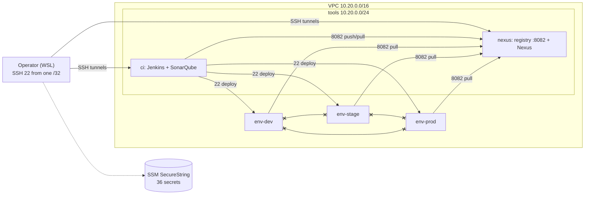

# CircleGuard Monorepo

**Absolute Privacy. High-Speed Containment. Secure Campus.**

CircleGuard is a state-of-the-art university contact tracing and fencing system designed to identify interconnected contact groups ("Circles") and apply rapid health fences while preserving individual anonymity.

---

## Vision & Mission

Our vision is a university campus where health containment speed outpaces lab confirmation timelines without compromising student privacy. CircleGuard leverages campus-native intelligence—class schedules and WiFi infrastructure—to deliver a human-validated, graph-based protection ecosystem.

### Key Differentiators
- **Privacy-as-Code**: Zero real-name exposure outside a secure Health Center vault.
- **Recursive Containment**: Status promotion cascades (Suspect → Probable → Confirmed) that trigger in milliseconds.
- **Campus Integration**: Smart check-ins using existing WiFi AP triangulation and Bluetooth Low Energy (BLE).

---

## Success Metrics

| Metric | Target | Measurement |
|:---|:---|:---|
| **Containment Speed** | < 60 Seconds | Automated test of promotion engine cascade |
| **Privacy Compliance** | 100% Anonymity | Penetration test on graph database (Zero real names) |
| **Check-in Adoption** | > 70% | Analytics on scheduled class contact validation |
| **False Positive Rate** | < 15% | Post-fence surveys of actual vs. suspected contact |
| **System Uptime** | 99.5% | 7:00 AM – 10:00 PM (Academic Peak Hours) |

---

## Architecture Overview

CircleGuard follows a **Microservice Architecture** built on a **Hybrid Data Model**.

### Core Engine
1. **Status Promotion Machine**: Uses **Neo4j** for recursive graph traversals to identify contacts within a 14-day temporal window.
2. **Anonymization Vault**: A segregated **PostgreSQL** vault handles salted-hash identity mapping, compliant with **FERPA** regulations.
3. **Event-Driven Core**: **Apache Kafka** manages asynchronous status changes, audit logs, and notification dispatches.

### Services Directory
- **Auth Service**: Dual-chain LDAP (University) / Local (Guest) auth with Dynamic RBAC.
- **Identity Service**: Cryptographic vault for anonymizing real identities.
- **Promotion Service**: The status engine (Recursive Graph Processing).
- **Notification Service**: Multi-channel dispatcher (Push/Email/SMS).
- **Form Service**: Dynamic health questionnaire engine.
- **Gateway Service**: Campus entry validation via signed, time-limited QR tokens.
- **Dashboard Service**: Geospatial hotspot analytics (Privacy-preserving).
- **File Service**: Secure certificate and document storage (S3-compatible).

---

## Technical Stack

| Layer | Technology | Rationale |
|:---|:---|:---|
| **Backend** | Spring Boot 4 / Java 21 | Enterprise-grade maturity & low-latency Jakarta EE support. |
| **Graph DB** | Neo4j 5.26 | High-performance recursive traversals unreachable with SQL. |
| **Relational DB**| PostgreSQL 16 | ACID compliant storage for identity and configuration. |
| **Message Bus** | Apache Kafka 7.6 | Persistent, audit-trailed event log for status dispatches. |
| **Caching** | Redis 7.2 | L2 distributed cache for rapid entry-gate status validation. |
| **Mobile/Web** | Expo (React Native) | Unified codebase across iOS, Android, and Browser. |
| **Infra** | Kubernetes | Orchestration for high availability and auto-scaling. |

---

## Roadmap

### Phase 1: MVP — The Intelligence Core (Current)
- [x] Status Promotion Machine (Suspect → Probable → Confirmed).
- [x] Temporal graph with 14-day TTL edges.
- [x] Multi-channel fence notifications (Push/Email/SMS).
- [ ] Health Center de-identification console.

### Phase 2: Growth — Spatial Intelligence
- [ ] WiFi AP triangulation integration.
- [ ] Campus entry validation (Gatekeeper) QR integration.
- [ ] LMS integration for "Remote Attendance" status automation.

### Phase 3: Vision — Full Ecosystem
- [ ] Off-campus circle detection via P2P Bluetooth.
- [ ] Global Health Dashboard with hotspot visualization.
- [ ] Lab API bridge for automated test result ingestion.

---

## Local Development

### 1. Infrastructure
Credentials are not versioned. Create your local env files **outside the repository and outside OneDrive**
from [`.env.example`](.env.example) (see [infra/README.md](infra/README.md#entorno-local-de-desarrollo)),
then start the middleware stack:
```bash
docker compose -f docker-compose.dev.yml --env-file "$HOME/.circleguard/dev.env" up -d
```
*Middleware includes: PostgreSQL, Neo4j, Kafka, Zookeeper, Redis, and OpenLDAP.*

The microservices read the same variables (`POSTGRES_*`, `NEO4J_PASSWORD`, `LDAP_ADMIN_PASSWORD`, `CG_*`).
Load them in the shell before `bootRun`:
```bash
set -a; . "$HOME/.circleguard/dev.env"; . "$HOME/.circleguard/dev-app.env"; set +a
```

Platform infrastructure (Jenkins, SonarQube, Nexus and the isolated dev/stage/prod hosts on AWS) is
provisioned with Bash and Docker Compose: see [Cloud Infrastructure on AWS](#cloud-infrastructure-on-aws-hu-01)
and [infra/README.md](infra/README.md).

### 2. Build & Run
CircleGuard uses Gradle for parallel builds across services:
```bash
# Start all microservices in parallel
./gradlew bootRun --parallel

# Start a specific service
./gradlew :services:<service-name>:bootRun
```

### 3. API Exploration
Every service exposes an OpenAPI 3.0 interface. Once running, visit:
`http://localhost:<service-port>/swagger-ui/index.html`

## Cloud Infrastructure on AWS (HU-01)

Everything below is provisioned with idempotent Bash scripts (`infra/bootstrap-*.sh`) and Docker Compose.
There is no manual configuration beyond the human steps listed in
[`infra/README.md`](infra/README.md#acceso-a-aws-sesiones-temporales-y-autorización-técnica)
(account sign-in and MFA, which are typed only in AWS pages). Detailed reference (Spanish):
[`infra/README.md`](infra/README.md). Final report:
[`INFORME_FINAL_HU01_SPRINT1.md`](docs/evidencias/hu-01/INFORME_FINAL_HU01_SPRINT1.md).

### What is deployed

| Component | Where | Details |
|---|---|---|
| **Jenkins** LTS 2.580.2 | `circleguard-ci` | Configured as code (JCasC, no setup wizard); the image includes `crane` 0.22.1 |
| **SonarQube** 26.10 + PostgreSQL 16 | `circleguard-ci` | Anonymous access denied; admin password managed from SSM |
| **Artifact registry**: CNCF Distribution 3.0.0 | `circleguard-nexus`, port 8082 | TLS (self-signed) + htpasswd user `ci`. Jenkins pushes and pulls with `crane` |
| **Nexus** 3.96.5 | `circleguard-nexus` | Installed **without** an operational repository: the team decided **not to accept the Sonatype EULA**, so the registry is CNCF Distribution |
| **dev / stage / prod** hosts | 3 × `t3.small` | One subnet, security group, SSH key and secret path **per environment**; no traffic between environments |

Region `us-east-2` (Ohio), zone `us-east-2a`. VPC `10.20.0.0/16` with 4 subnets (`tools`, `dev`, `stage`, `prod`),
5 security groups and an Internet Gateway (no NAT Gateway). `ci` and `nexus` are `m7i-flex.large` (8 GiB); all disks
are encrypted gp3; IMDSv2 is required; every host stops itself 4 hours after boot.



**Access model.** The tool UIs (Jenkins 8080, SonarQube 9000, Nexus 8081) are **not exposed to the Internet**: only SSH
(22) is open, from the operator's IP. You reach them through an SSH tunnel, which is why they appear as `localhost`
(step 6 below). AWS access uses temporary credentials with MFA: a *reader* role, an *operator* role (create and start,
cannot delete) and a *teardown* role that only runs from AWS CloudShell. No permanent access keys exist.

### Prerequisites

- Windows with **WSL Ubuntu 24.04** (the scripts run in WSL), AWS CLI v2, `ssh`, `curl`, `python3` and `openssl`. Docker is only needed for `scan-secrets.sh` and the local tests.
- A clone **inside WSL** (not under OneDrive: `git status` over `/mnt/c` can take many minutes).
- Check the workstation (read-only, no AWS): `bash infra/check-prerequisites.sh` must end with `fail=0`.
- The IAM users and roles must exist (one time per account): see
  [`infra/README.md`](infra/README.md#acceso-a-aws-sesiones-temporales-y-autorización-técnica).

### Build everything from scratch (one command)

Run from the repository root, in WSL. The operator role needs an MFA sign-in younger than **1 hour**.

| Step | Command | What happens |
|---|---|---|
| 1. Sign in | `bash infra/aws-session.sh init`, then `bash infra/aws-session.sh login operator` | Opens the official AWS page in an InPrivate Edge window: choose **IAM user** `circleguard-hu01-operator` and type password and MFA **only there** (you have 10 minutes) |
| 2. Plan (free) | `bash infra/bootstrap-all.sh --plan` | Lists every resource it would create and the estimated cost. Changes nothing |
| 3. **Build** | **`bash infra/bootstrap-all.sh --apply --approve ci,nexus`** | Creates, in order: network, secrets and SSH keys, servers, Jenkins, SonarQube, Nexus, registry and a health check. **≈ 15 min from an empty account** (measured: 922 s). The run log is saved in `infra/logs/` |
| 4. Verify | `bash infra/verify-infra.sh --health --roles=ci,nexus` | Expected: `verify-infra pass=26 fail=0 pendiente=0` |
| 5. Prove idempotency | Run step 3 again | Expected: `created=0 updated=0 unchanged=138` and no `CREATED` or `UPDATED` line |
| 6. Open the UIs | `bash infra/tunnel.sh jenkins` (and `sonarqube`, `nexus`) in separate terminals | Jenkins `http://localhost:8080/login`, SonarQube `http://localhost:9000`, Nexus `http://localhost:8081`. `Ctrl+C` closes a tunnel. Never type passwords in a screenshot |
| 7. Environments | `bash infra/test-isolation.sh --apply --phases=1,2,3`, sign in again, then `--phases=4,5` | Creates the three environment hosts **in pairs** (the vCPU limit is 5) and tests the traffic between them; type `PROBAR AISLAMIENTO` to confirm. ≈ 25 min + ≈ 10 min |
| 8. **Stop** | `bash infra/teardown.sh --stop --apply` (type `DETENER`) | Stops every instance and keeps the disks. Then `bash infra/teardown.sh --stop` must say *no hay instancias de circleguard en ejecución* |

If a run is cut (expired MFA, closed terminal), sign in again and **repeat the same command**: it is idempotent.
Running `ci` + `nexus` costs ≈ 0.20 USD/hour; stopped instances only pay for disks (≈ 0.22 USD/day for all five).

### Destroy and rebuild from scratch

This is the "rebuild Jenkins, SonarQube and the registry from scratch with one command" check. Destruction is a
**separate, human step by design**: the operator role cannot delete anything, so it runs only in AWS CloudShell, as a
different IAM user, with its own MFA.

> **Data lost:** the Jenkins, SonarQube, Nexus and registry volumes (plus the TLS certificates and public IPs).
> **Kept:** the 36 SSM secrets, the SSH keys (custody copy in SSM), IAM and the repository.
> **Never** pass `--purge-secrets` unless you want to regenerate every credential.

**A. Prepare (WSL, the operator).**
1. `bash infra/teardown.sh --destroy`: read-only inventory and plan of what would be deleted.
2. `bash infra/aws-session.sh cloudshell-bundle`: builds `circleguard-teardown.tgz` (10 files, **no secrets**) in
   `~/.circleguard/cloudshell/`. Note its `sha256sum`.

**B. Destroy (browser, as the IAM user `circleguard-hu01-teardown`).**
1. Open a **private window** and sign in to the AWS console as **IAM user** `circleguard-hu01-teardown` (account ID,
   password and its own MFA entry in your authenticator app).
2. Select the region **US East (Ohio) us-east-2** and open **CloudShell** (the `>_` icon).
3. *Actions → Upload file* → `circleguard-teardown.tgz` (as it is, do not unzip it first).
4. In CloudShell:
   ```bash
   sha256sum circleguard-teardown.tgz      # must match the hash from step A.2
   tar -xzf circleguard-teardown.tgz
   bash infra/teardown-cloudshell.sh       # asks for the MFA code; prints the inventory and the plan only
   bash infra/teardown-cloudshell.sh --apply
   ```
5. For `--apply`, type a **new** MFA code and the exact phrase **`DESTRUIR circleguard`**. Expected end:
   `SUMMARY teardown-destroy created=0 updated=17 unchanged=0` and *los secretos de SSM se conservan*.
6. Back in WSL, `bash infra/teardown.sh --destroy` must report *no hay instancias, red ni llaves de circleguard que destruir*.

**C. Rebuild (WSL, the operator).** Sign in again (`login operator`) and run steps 2 to 5 of the previous section.
Measured on 2026-11-06: `created=43 updated=55 unchanged=67`, 922 s, `verify-infra pass=26 fail=0`; second run
`created=0 updated=0 unchanged=138`, 475 s. Step 7 then recreates and tests the environments, and step 8 stops everything.

The destroy and rebuild cycle can be repeated as often as needed (< 1 USD each). Do it well before a deadline and not
live in a presentation: a failed cold start leaves the platform down until it is fixed.

### Evidence (HU-01)

All outputs are **real and masked** (account number, public IPs and secret-file hashes removed; each folder's README
lists the sha256 of the unmasked originals). `bash infra/check-evidence.sh <folder>` must report `hallazgos=0` before
anything is committed.

| Criterion | Result | Where |
|---|---|---|
| **C1** Servers for Jenkins, SonarQube and the registry | **PASS** | [`aws/idempotencia/`](docs/evidencias/hu-01/aws/idempotencia/README.md) (`registry.txt`: `ci` and Jenkins publish and pull; health 25/0/1), [`14-despliegue-aws-fase4.md`](docs/evidencias/hu-01/14-despliegue-aws-fase4.md) |
| **C2** dev, stage and prod isolated | **PASS** | [`aws/aislamiento/`](docs/evidencias/hu-01/aws/aislamiento/README.md): the six cross-environment flows are blocked; `ci→env:22` and `env→nexus:8082` are allowed. Repeated on the rebuilt infrastructure in [`aws/reconstruccion/`](docs/evidencias/hu-01/aws/reconstruccion/README.md) |
| **C3** Idempotent `infra/bootstrap-*.sh` | **PASS** | `run2.txt`: `created=0 updated=0 unchanged=137` and empty state diffs ([`aws/idempotencia/`](docs/evidencias/hu-01/aws/idempotencia/README.md)); `bootstrap-env.sh` is idempotent in the three environments |
| **From scratch with one command** (rubric P1.2) | **PASS** | [`aws/reconstruccion/`](docs/evidencias/hu-01/aws/reconstruccion/README.md): inventory before, the CloudShell destruction, the rebuild (922 s), the second run and the inventory after |
| **C4** `docker-compose.dev.yml` without credentials | **PASS** | [`auditoria/20261103T160739Z-commit-3a43855-credenciales.txt`](docs/evidencias/hu-01/auditoria/20261103T160739Z-commit-3a43855-credenciales.txt) |
| **C5** No undocumented manual configuration | **Pending** | Needs a rehearsal by a **different team member**: [`ensayo-reconstruccion/README.md`](docs/evidencias/hu-01/ensayo-reconstruccion/README.md) |
| **C6** Secrets outside the repository | **PASS** | SSM SecureString and `.env` 0600 on the hosts; Gitleaks reports 0 active secrets ([summary](docs/evidencias/hu-01/auditoria/20261104T002645Z-worktree-summary.txt)) |

Other validations (all local, no AWS): ShellCheck v0.11.0 on 34 scripts with 0 findings
([report](docs/evidencias/hu-01/auditoria/20261103T231008Z-shellcheck-hu01.txt)), 40/40 unit checks
([report](docs/evidencias/hu-01/auditoria/20261103T231039Z-comprobaciones-unitarias-hu01.txt)), and Compose, links and
whitespace ([report](docs/evidencias/hu-01/auditoria/20261104T002821Z-validaciones-locales-hu01.txt)). Screenshots:
[`capturas/README.md`](docs/evidencias/hu-01/capturas/README.md). Index of every evidence file:
[`docs/evidencias/hu-01/README.md`](docs/evidencias/hu-01/README.md).

### Budget and known limits

- **Budget:** 15 USD absolute, alert at 12 USD. Estimated accrued cost on 2026-11-06: ≈ 1.1 USD (the local ledger over-estimates). Every billable script needs `--apply` plus `--approve <role>`.
- **The configured vCPU limit is 5** (`QUOTA_VCPU_LIMIT`), below the real account quota of 16, so environments start in pairs and `--approve all` is rejected.
- The environments are **provisioned and isolated, without applications**: a `t3.small` (2 GiB) cannot run the core services. Deploying them is E1.5.
- The registry uses a **self-signed certificate**: traffic is encrypted but clients do not authenticate the server (`insecure-registries` / `crane --insecure`), limited to the `tools` subnet.
- The UIs are reachable only through the SSH tunnel; the pipeline's webhook and teacher access (E1.4) will need a decision on how to expose Jenkins.
- Known Gitleaks leftovers: 51 historical findings in the initial commit (considered compromised, history not rewritten) and 2 test-password comments in Flyway migrations (E2.6).

More: [architecture and environments](docs/arquitectura/infra-ambientes.md),
[registry decision](docs/arquitectura/registro-artefactos.md),
[Nexus EULA decision](docs/evidencias/hu-01/16-nexus-eula.md),
[reconstruction rehearsal](docs/evidencias/hu-01/ensayo-reconstruccion/README.md).

---

## Frontend Development

The frontend is built using **Expo (React Native)**, supporting iOS, Android, and Web from a single codebase located in `/mobile`.

### 1. Prerequisites
Ensure you have Node.js installed and dependencies loaded:
```bash
cd mobile
npm install
```

### 2. Run the Application
You can run the app in various modes depending on your target platform:

| Platform | Command | Notes |
|:---|:---|:---|
| **Development Menu** | `npm run start` | Opens the Expo Go start-up menu. |
| **Android** | `npm run android` | Requires Android Studio / Emulator or a connected device. |
| **iOS** | `npm run ios` | Requires macOS with Xcode / Simulator installed. |
| **Web Browser** | `npm run web` | Launches the dashboard/app in your default browser. |

### 3. Testing
To run frontend unit and component tests:
```bash
npm run test
```

---

## Testing

We maintain high system integrity via multi-level testing:

| Command | Scope |
|:---|:---|
| `./gradlew test` | Full system suite (Unit + Integration) |
| `./gradlew :services:<name>:test` | Single service testing |

**Note**: Integration tests use **Testcontainers** to spawn ephemeral Neo4j and PostgreSQL instances for zero-side-effect validation.

---

## Privacy & Compliance

- **FERPA Compliance**: Student identities are never stored in the contact graph.
- **Right to be Forgotten**: Users can trigger complete data purging via the Identity Vault.
- **Temporal Privacy**: All contact edges are automatically purged after 14 days.
