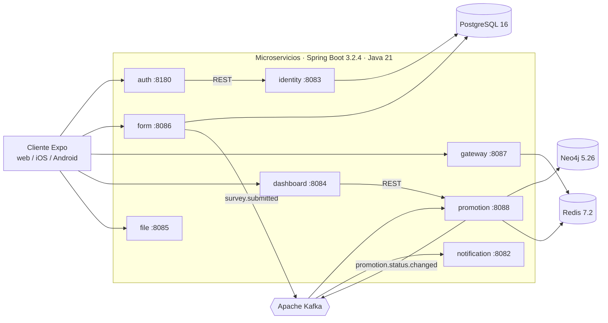
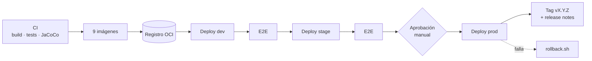

# CircleGuard

**Privacidad absoluta. Contención rápida. Campus seguro.**

CircleGuard es un sistema universitario de trazabilidad de contactos que identifica grupos de contacto
interconectados («círculos») y aplica cercos sanitarios rápidos sin exponer la identidad de las personas.
Este repositorio es el **monorepo** del proyecto final: código de los servicios, pipeline de CI/CD,
infraestructura como código en Bash, pruebas, evidencias y la bitácora de uso de IA generativa.

> **¿Quiere reproducir el proyecto?** Vaya a [Inicio rápido](#inicio-rápido-cómo-reproducir-el-proyecto).
> **¿Quiere evaluarlo?** Vaya a [Mapa de evidencias por historia de usuario](#mapa-de-evidencias-por-historia-de-usuario).

## Contenido

1. [Qué hace y por qué](#qué-hace-y-por-qué)
2. [Arquitectura](#arquitectura)
3. [Inicio rápido: cómo reproducir el proyecto](#inicio-rápido-cómo-reproducir-el-proyecto)
4. [Pruebas y calidad](#pruebas-y-calidad)
5. [Pipeline de CI/CD](#pipeline-de-cicd)
6. [Infraestructura en AWS](#infraestructura-en-aws)
7. [Cliente web y móvil](#cliente-web-y-móvil)
8. [Privacidad y cumplimiento](#privacidad-y-cumplimiento)
9. [Flujo de trabajo del equipo](#flujo-de-trabajo-del-equipo)
10. [Mapa de evidencias por historia de usuario](#mapa-de-evidencias-por-historia-de-usuario)
11. [Bitácora de IA generativa](#bitácora-de-ia-generativa)
12. [Limitaciones conocidas y hoja de ruta](#limitaciones-conocidas-y-hoja-de-ruta)

---

## Qué hace y por qué

La visión es un campus donde la velocidad de contención sanitaria supere a los tiempos de confirmación de
laboratorio, sin comprometer la privacidad. CircleGuard usa información propia del campus (horarios de clase
e infraestructura WiFi) para ofrecer una protección basada en grafos y validada por personas.

- **Privacidad como código:** ningún nombre real sale de la bóveda segura del centro de salud.
- **Contención recursiva:** la promoción de estado (Sospechoso → Probable → Confirmado) se propaga por el grafo de contactos.
- **Integración con el campus:** registro de asistencia con WiFi y Bluetooth de bajo consumo.

| Métrica | Meta | Cómo se mide |
|:---|:---|:---|
| Velocidad de contención | < 60 s | Prueba automatizada de la cascada del motor de promoción |
| Cumplimiento de privacidad | 100 % de anonimato | Prueba de penetración sobre la base de grafos (sin nombres reales) |
| Adopción del registro | > 70 % | Analítica sobre la validación de contactos por clase |
| Falsos positivos | < 15 % | Encuestas posteriores al cerco |
| Disponibilidad | 99,5 % | 7:00 a 22:00 (horas pico académicas) |

---

## Arquitectura

Arquitectura de **microservicios** con un **modelo de datos híbrido**: grafo (Neo4j) para los contactos,
relacional (PostgreSQL) para la bóveda de identidades y los formularios, caché (Redis) para el control de
acceso y **Kafka** para desacoplar los servicios por eventos.



Todos los diagramas (flujo de eventos, CI, CD e infraestructura) están en
[`docs/arquitectura/diagramas.md`](docs/arquitectura/diagramas.md).

### Servicios

| Servicio | Puerto | Función |
|---|---|---|
| `circleguard-auth-service` | 8180 | Autenticación dual (LDAP universitario / local de invitados) con RBAC dinámico y JWT |
| `circleguard-identity-service` | 8083 | Bóveda criptográfica que anonimiza las identidades reales |
| `circleguard-form-service` | 8086 | Motor de cuestionarios de salud y validación de certificados |
| `circleguard-promotion-service` | 8088 | Motor de estados: recorridos recursivos sobre el grafo de contactos de 14 días |
| `circleguard-notification-service` | 8082 | Despacho multicanal (Push, correo, SMS, LMS) y auditoría |
| `circleguard-gateway-service` | 8087 | Validación de acceso al campus con QR firmados y de vida corta |
| `circleguard-dashboard-service` | 8084 | Analítica geoespacial agregada que preserva la privacidad |
| `circleguard-file-service` | 8085 | Almacenamiento de certificados y documentos (compatible con S3) |

### Tecnologías

| Capa | Tecnología | Razón |
|:---|:---|:---|
| Backend | Spring Boot 3.2.4, Java 21, Gradle 8.14 (Kotlin DSL) | Madurez empresarial y soporte de Jakarta EE |
| Grafo | Neo4j 5.26 | Recorridos recursivos que SQL no resuelve con eficiencia |
| Relacional | PostgreSQL 16 | Almacenamiento ACID de identidades y configuración |
| Mensajería | Apache Kafka (Confluent 7.6) | Registro persistente y auditable de cambios de estado |
| Caché | Redis 7.2 | Validación rápida de estado en la puerta de acceso |
| Cliente | Expo (React Native) | Una sola base de código para iOS, Android y navegador |
| CI/CD | Jenkins, SonarQube, JaCoCo, Testcontainers, Playwright | Pipeline reproducible con control de calidad |
| Infraestructura | AWS (EC2, VPC, IAM, SSM), Bash y Docker Compose | Aprovisionamiento idempotente, sin pasos manuales no documentados |

---

## Inicio rápido: cómo reproducir el proyecto

Elija el recorrido según lo que quiera comprobar. Todos los comandos se ejecutan desde la raíz del repositorio.

| Quiero… | Necesito | Sección |
|---|---|---|
| Ver las pruebas y la cobertura | JDK 21, Docker | [A](#a-pruebas-y-cobertura-sin-nube-15-min) |
| Levantar la aplicación en mi máquina | JDK 21, Docker, `openssl` | [B](#b-ejecutar-los-servicios-en-local) |
| Construir las imágenes y un ambiente con Compose | Docker con Compose v2.20+, Bash | [C](#c-imágenes-y-ambientes-con-compose-hu-02) |
| Ver el pipeline y la infraestructura en AWS | Cuenta AWS, WSL | [D](#d-pipeline-e-infraestructura-en-aws) |

### Prerrequisitos generales

| Herramienta | Versión | Para qué |
|---|---|---|
| JDK | 21 | Compilar y probar los servicios (el *wrapper* de Gradle descarga Gradle 8.14) |
| Docker | Engine o Desktop con Compose v2.20+ | Testcontainers, middleware local e imágenes |
| Git y Bash | Git Bash, WSL o Linux | Scripts de `deploy/` e `infra/` |
| Node.js | 22 | Cliente `mobile/` y pruebas E2E (opcional) |

En Windows use `gradlew.bat` en lugar de `./gradlew`, o trabaje desde WSL o Git Bash. Si clona bajo
OneDrive, `git status` puede tardar mucho: se recomienda clonar dentro de WSL.

### A. Pruebas y cobertura (sin nube, ~15 min)

No necesita credenciales ni infraestructura; solo Docker en marcha para las pruebas de integración.

```bash
git clone https://github.com/ingesoft5/circle-guard-finalproject_A00400179_A00399934_A00399492.git
cd circle-guard-finalproject_A00400179_A00399934_A00399492

# 1. Pruebas unitarias de todos los servicios + tabla de cobertura de líneas
./gradlew test coverageSummary

# 2. Pruebas de integración con contenedores reales (Kafka, PostgreSQL, Neo4j, Redis)
./gradlew :tests:integration:integrationTest :services:circleguard-promotion-service:integrationTest
```

**Resultado esperado (referencia: build #10 en Jenkins, `docs/evidencias/hu-04/`):**

| Servicio | Cobertura de líneas | Mínimo |
|---|---|---|
| auth | 98,0 % | 60 % |
| identity | 98,1 % | 60 % |
| promotion | 90,9 % | 60 % |
| form | 97,9 % | 60 % |
| gateway | 100 % | 60 % |

Los informes HTML quedan en `services/<servicio>/build/reports/jacoco/test/html/index.html` y
el de integración en `tests/integration/build/reports/tests/integrationTest/index.html`.
Si la cobertura de uno de esos cinco servicios baja de 60 %, `./gradlew test` falla
(`jacocoTestCoverageVerification`).

### B. Ejecutar los servicios en local

1. **Credenciales fuera del repositorio.** Las credenciales no se versionan. Cree los archivos locales
   **fuera del repositorio y fuera de OneDrive** a partir de [`.env.example`](.env.example) y complete
   **todos** los valores con datos aleatorios (por ejemplo `openssl rand -hex 24`):
   ```bash
   mkdir -p ~/.circleguard
   cp .env.example ~/.circleguard/dev.env        # PostgreSQL, Neo4j y LDAP
   cp .env.example ~/.circleguard/dev-app.env    # secretos de aplicación CG_*
   ```
   Detalle de cada archivo en [`infra/README.md`](infra/README.md#entorno-local-de-desarrollo).
2. **Middleware** (PostgreSQL, Neo4j, Kafka, ZooKeeper, Redis y OpenLDAP):
   ```bash
   docker compose -f docker-compose.dev.yml --env-file "$HOME/.circleguard/dev.env" up -d
   ```
   No ejecute nunca `down -v` ni `docker system prune`: borran los volúmenes `pgdata` y `neo4jdata`.
3. **Servicios**, con las variables cargadas en la misma terminal:
   ```bash
   set -a; . "$HOME/.circleguard/dev.env"; . "$HOME/.circleguard/dev-app.env"; set +a
   ./gradlew bootRun --parallel                          # todos
   ./gradlew :services:circleguard-form-service:bootRun  # uno solo
   ```
4. **API:** cada servicio publica OpenAPI en `http://localhost:<puerto>/swagger-ui/index.html`
   (puertos en la [tabla de servicios](#servicios)).

Los servicios **se niegan a arrancar si falta una variable de entorno**: es intencional (criterio de
credenciales fuera del repositorio).

### C. Imágenes y ambientes con Compose (HU-02)

```bash
docker compose -f deploy/registry/docker-compose.yml up -d   # registro OCI local
./deploy/build-images.sh 1.0.0       # 9 imágenes multi-stage, usuario no root, etiqueta semver
./deploy/publish-images.sh 1.0.0     # publica en el registro
./deploy/verify-images.sh --evidence 1.0.0
./deploy/compose-up.sh dev           # stack dev con healthchecks → http://localhost:3000
./deploy/compose-down.sh dev         # detiene sin borrar volúmenes
```

Stage y prod requieren indicar `IMAGE_REGISTRY` e `IMAGE_TAG`. Guía completa:
[`deploy/README.md`](deploy/README.md) y diseño en
[`docs/arquitectura/empaquetado-inmutable.md`](docs/arquitectura/empaquetado-inmutable.md).

### D. Pipeline e infraestructura en AWS

Aprovisionar la plataforma (Jenkins, SonarQube, registro de artefactos y tres ambientes aislados) requiere
una cuenta de AWS, WSL con Ubuntu 24.04 y las identidades IAM descritas en
[`infra/README.md`](infra/README.md). El resumen de comandos es:

```bash
bash infra/check-prerequisites.sh                           # estación de trabajo: debe terminar con fail=0
bash infra/aws-session.sh login operator                    # inicia sesión en la página oficial de AWS (MFA)
bash infra/bootstrap-all.sh --plan                          # plan gratuito: no crea nada
bash infra/bootstrap-all.sh --apply --approve ci,nexus      # ≈ 15 min desde cero (medido: 922 s)
bash infra/verify-infra.sh --health --roles=ci,nexus        # esperado: pass=26 fail=0
bash infra/tunnel.sh jenkins 8090                           # Jenkins en http://localhost:8090
bash infra/teardown.sh --stop --apply                       # apaga las instancias (conserva los discos)
```

Cada script es **idempotente**: ejecutarlo dos veces no cambia nada la segunda vez
(`created=0 updated=0`). Una instancia encendida cuesta unos 0,10 USD/h; todas se apagan solas a las 4 h.
Guía paso a paso, destrucción y reconstrucción, y demostración guiada:
[`docs/operacion/infraestructura-aws.md`](docs/operacion/infraestructura-aws.md).

---

## Pruebas y calidad

| Nivel | Qué cubre | Cómo se ejecuta | Dónde se ve |
|---|---|---|---|
| Unitarias | Lógica de cada servicio, con Mockito y MockMvc | `./gradlew test` | JUnit y JaCoCo en Jenkins |
| Cobertura | ≥ 60 % de líneas en auth, identity, promotion, form y gateway (gate bloqueante) | `./gradlew test coverageSummary` | [`docs/evidencias/hu-04/`](docs/evidencias/hu-04/README.md) |
| Integración | 5 pruebas con Testcontainers: form → Kafka → promotion y promotion → Kafka → notification | `./gradlew :tests:integration:integrationTest` | Informe de integración en Jenkins |
| Integración por servicio | Promotion con PostgreSQL, Neo4j y Redis reales (`*IntegrationTest`) | `./gradlew :services:circleguard-promotion-service:integrationTest` | idem |
| Rendimiento | Benchmark del motor de promoción (etiqueta `performance`) | `./gradlew integrationTest -PwithPerformance` | Solo bajo demanda |
| E2E (humo) | Playwright: el cliente web y el healthcheck del proxy responden | `./deploy/e2e.sh dev` | [`tests/e2e-playwright/`](tests/e2e-playwright/README.md) |
| Calidad estática | SonarQube con *quality gate* | `RUN_SONAR=true` en el pipeline | Requiere SonarQube conectado a Jenkins |

Las pruebas de integración están separadas de `test` porque necesitan Docker y son más lentas. Detalle de
HU-04, hallazgos y limitaciones en [`docs/evidencias/hu-04/README.md`](docs/evidencias/hu-04/README.md).

---

## Pipeline de CI/CD

Un único [`Jenkinsfile`](Jenkinsfile) multibranch con una Shared Library ([`jenkins/vars/`](jenkins/vars)).
**CI:** detección de cambios → build → pruebas y cobertura → SonarQube → integración → empaquetado.
**CD:** imágenes → registro → dev → E2E → stage → E2E → **aprobación manual** → prod → tag semver → notas de versión.



| Rama | Despliega | Producción |
|---|---|---|
| `dev` | dev y stage | No |
| `main` | dev, stage y prod | Con aprobación manual; crea tag y notas |

```bash
./deploy/deploy.sh dev 1.0.0         # desplegar una versión
./deploy/rollback.sh dev 0.9.0       # volver a una versión anterior
./deploy/current-version.sh dev      # versión desplegada y trazabilidad
./deploy/release-notes.sh 1.0.0      # notas de la versión
```

Parámetros útiles del job: `RUN_SONAR` y `RUN_INTEGRATION` (ambos **desactivados por defecto**; actívelos para
ejecutar el quality gate y las pruebas con Testcontainers), `SERVICES_MODE` (`changed` o `all`) y `VERSION`.

Diseño: [`docs/arquitectura/pipeline-cd.md`](docs/arquitectura/pipeline-cd.md) y
[`docs/arquitectura/diagramas.md`](docs/arquitectura/diagramas.md). Requisitos de Jenkins (plugins,
credenciales, agente): [`jenkins/README.md`](jenkins/README.md).

---

## Infraestructura en AWS

Se crea con scripts Bash idempotentes (`infra/bootstrap-*.sh`) y Docker Compose; no hay configuración manual
más allá de los pasos humanos documentados (inicio de sesión y MFA, que se escriben solo en la página de AWS).

| Componente | Dónde | Detalle |
|---|---|---|
| **Jenkins** LTS 2.580.2 | `circleguard-ci` | Configurado como código (JCasC), con Docker-in-Docker para Testcontainers |
| **SonarQube** + PostgreSQL | `circleguard-ci` | Acceso anónimo denegado |
| **Registro de artefactos** CNCF Distribution 3.0.0 | `circleguard-nexus`, puerto 8082 | TLS y usuario `ci`; Jenkins publica con `crane` |
| **Nexus** 3.96.5 | `circleguard-nexus` | Instalado **sin repositorio operativo**: el equipo decidió no aceptar el EULA de Sonatype |
| **dev / stage / prod** | 3 × `t3.small` | Subred, grupo de seguridad, llave y secretos propios; sin tráfico entre ambientes |

Región `us-east-2`. Las interfaces de Jenkins, SonarQube y Nexus **no se exponen a Internet**: solo SSH (22) desde
la IP del operador, y las demás se alcanzan por túnel. No existen claves de acceso permanentes: se usan roles
temporales con MFA. Los secretos viven en SSM Parameter Store (SecureString) y en `.env` con permisos 0600.
Presupuesto: 15 USD en total; gasto estimado acumulado ≈ 3 USD.

Más información: [`infra/README.md`](infra/README.md) (referencia),
[`docs/arquitectura/infra-ambientes.md`](docs/arquitectura/infra-ambientes.md) (diagrama completo),
[`docs/arquitectura/registro-artefactos.md`](docs/arquitectura/registro-artefactos.md) (decisión del registro) y
[`docs/operacion/infraestructura-aws.md`](docs/operacion/infraestructura-aws.md) (operación y demostración).

---

## Cliente web y móvil

El cliente usa **Expo (React Native)** y sirve iOS, Android y navegador desde `mobile/`.

```bash
cd mobile
npm install
npm run web        # navegador · también: npm run start | android | ios
npm run test       # pruebas del cliente
```

Las URL de los servicios están en `mobile/constants/Config.ts` (apuntan a `localhost` y a los puertos de la
[tabla de servicios](#servicios)). En los ambientes, el cliente se empaqueta como imagen `circleguard-web`
detrás de un proxy nginx.

---

## Privacidad y cumplimiento

- **FERPA:** las identidades de estudiantes nunca se guardan en el grafo de contactos; solo identificadores anónimos.
- **Derecho al olvido:** la bóveda de identidades permite purgar los datos de una persona.
- **Privacidad temporal:** las aristas de contacto se eliminan automáticamente a los 14 días.
- **Secretos:** ningún secreto se versiona; el escaneo con Gitleaks reporta 0 secretos activos en el árbol de
  trabajo (los 51 hallazgos del historial se consideran comprometidos y no se reutilizan).

---

## Flujo de trabajo del equipo

GitHub Flow con rama de integración `dev`: una rama por historia, **Conventional Commits**, Pull Request hacia
`dev` con al menos una revisión y `commit-lint` como verificación requerida. `main` solo recibe PR desde `dev` y
cada merge genera un release con tag semántico. Detalle: [`docs/estrategia-branching.md`](docs/estrategia-branching.md) y
[`CHANGELOG.md`](CHANGELOG.md).

---

## Mapa de evidencias por historia de usuario

| Historia | Qué entrega | Documento principal |
|---|---|---|
| **HU-01** Infraestructura en la nube con Bash | Jenkins, SonarQube y registro en AWS; ambientes aislados; scripts idempotentes; credenciales fuera del repo | [`docs/evidencias/hu-01/`](docs/evidencias/hu-01/README.md) · [`infra/README.md`](infra/README.md) |
| **HU-02** Imágenes Docker inmutables | 9 imágenes versionadas y Compose por ambiente | [`docs/evidencias/hu-02/`](docs/evidencias/hu-02/README.md) · [`deploy/README.md`](deploy/README.md) |
| **HU-03** Pipeline Jenkins multibranch | Pipeline CI con Shared Library | [`Jenkinsfile`](Jenkinsfile) · [`jenkins/README.md`](jenkins/README.md) |
| **HU-04** Pruebas unitarias y de integración | Cobertura ≥ 60 % y 5 pruebas con Testcontainers | [`docs/evidencias/hu-04/`](docs/evidencias/hu-04/README.md) |
| **HU-06** Entrega continua y promoción | dev → stage → prod con aprobación manual | [`docs/evidencias/hu-06/`](docs/evidencias/hu-06/README.md) · [`docs/arquitectura/pipeline-cd.md`](docs/arquitectura/pipeline-cd.md) |
| **HU-07** Rollback, notificaciones y release notes | Reversión, avisos y notas de versión | [`docs/evidencias/hu-07/`](docs/evidencias/hu-07/README.md) |
| **HU-08** Documentación y bitácora de IAG | Este README, diagramas y bitácora | [`docs/evidencias/hu-08/`](docs/evidencias/hu-08/README.md) |
| **HU-09** Estrategia de ramas y commits | GitHub Flow y Conventional Commits | [`docs/estrategia-branching.md`](docs/estrategia-branching.md) |

Índice de toda la documentación: [`docs/README.md`](docs/README.md).

---

## Bitácora de IA generativa

El proyecto usa el **Nivel 3 de colaboración con IA generativa**: la IA apoya, pero el equipo revisa, entiende
y puede explicar cada resultado. El anexo está en [`IAG_REGISTRO.md`](IAG_REGISTRO.md) (resumen, método de
verificación y reflexión crítica); las sesiones con los prompts literales y las decisiones están en
[`docs/iag/`](docs/iag/README.md).

---

## Limitaciones conocidas y hoja de ruta

**Limitaciones declaradas**

- **Validación de pipeline.** HU-04 y HU-06 se ejecutaron en el Jenkins de AWS sobre repositorios Git temporales;
  el flujo contra GitHub con webhook o `github-token` se prueba al integrar las ramas.
- **E2E mínimo.** Playwright ejecuta 2 pruebas de humo, no los 3 flujos completos (inicio de sesión, cuestionario
  de salud y validación de acceso).
- **SonarQube** no está conectado de extremo a extremo al pipeline (falta la red entre contenedores y la credencial `sonar-token`).
- **Defecto conocido:** `HealthStatusService.updateStatus` (promotion) no devuelve filas cuando el usuario no tiene
  contactos recientes o el nuevo estado es `ACTIVE`; en ese caso no actualiza Redis ni publica el evento.
- **HU-01, criterio C5:** falta el ensayo de reconstrucción por otro integrante.
- Los ambientes `t3.small` (2 GiB) no ejecutan todos los servicios núcleo a la vez.
- El registro usa un certificado autofirmado (solo dentro de la subred de herramientas).

**Hoja de ruta**

- **Fase 1 (actual) · MVP, núcleo de inteligencia:** motor de promoción de estados ✔, grafo temporal con aristas de 14 días ✔,
  notificaciones multicanal ✔, consola de desidentificación del centro de salud ☐.
- **Fase 2 · Inteligencia espacial:** triangulación WiFi ☐, validación de acceso con QR ☐, integración con el LMS ☐.
- **Fase 3 · Ecosistema:** detección de círculos fuera del campus por Bluetooth ☐, panel global de focos ☐, puente con laboratorios ☐.
