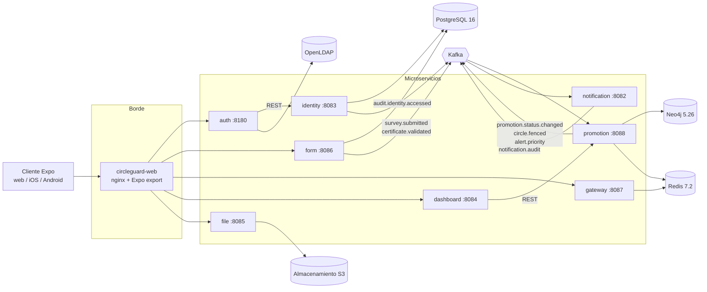
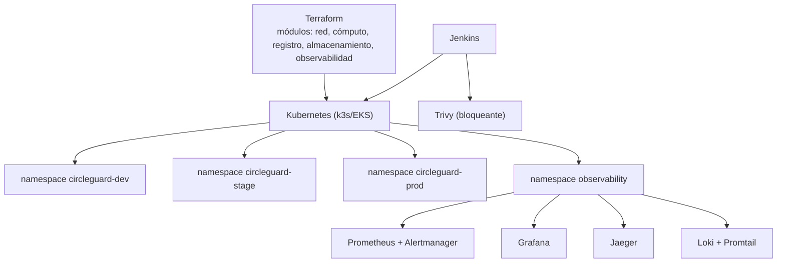

# Arquitectura general de CircleGuard

**Documento:** HU-17 (Sprint 2 · E2.9, criterios 1 y 2)
**Última actualización:** 2026-11-16
**Estado:** vigente para la arquitectura lógica. La topología de ejecución cambia en el Sprint 2
(Terraform + Kubernetes); las secciones marcadas **[S2]** describen el estado objetivo y se
actualizan cuando cada historia se mergee.

> Diagramas complementarios: [`diagramas.md`](diagramas.md) (flujos y pipeline) e
> [`infra-ambientes.md`](infra-ambientes.md) (red y hosts AWS). Este documento es la vista de
> conjunto: qué servicios hay, de qué dependen y cómo se comunican.

## 1. Vista lógica

CircleGuard es un sistema de trazabilidad de contactos con **ocho microservicios Spring Boot 3.2.4
(Java 21)**, un cliente Expo (web/iOS/Android) y un middleware de cuatro almacenes. El principio de
diseño es la **separación entre identidad real y grafo anónimo**: los nombres solo existen en la
bóveda de `identity`; el resto del sistema trabaja con `anonymousId`.

## 2. Responsabilidades y dependencias

| Servicio | Puerto | Responsabilidad | Depende de | Expone / consume |
|---|---:|---|---|---|
| `auth` | 8180 | Autenticación dual (LDAP universitario / local), RBAC y emisión de JWT | PostgreSQL, OpenLDAP, `identity` (REST) | `POST /api/v1/auth/login`, `/visitor/handoff` |
| `identity` | 8083 | Bóveda criptográfica: mapea identidad real ↔ `anonymousId`; auditoría de accesos | PostgreSQL | `POST /api/v1/identities/map`; publica `audit.identity.accessed` |
| `form` | 8086 | Cuestionarios de salud y validación de certificados | PostgreSQL, Kafka | Publica `survey.submitted`, `certificate.validated` |
| `promotion` | 8088 | Motor de estados y recorrido recursivo del grafo de contactos (14 días) | PostgreSQL, Neo4j, Redis, Kafka | Consume eventos de `form`; publica `promotion.status.changed`, `circle.fenced`, `alert.priority`, `proximity.detected` |
| `notification` | 8082 | Despacho multicanal (push, correo, SMS, LMS) y auditoría | Kafka; servicios externos de mensajería | Consume eventos de `promotion`; publica `notification.audit` |
| `gateway` | 8087 | Validación de QR firmados y de vida corta para el acceso al campus | Redis | `POST /api/v1/gateway/validate` |
| `dashboard` | 8084 | Analítica agregada que preserva la privacidad | PostgreSQL, `promotion` (REST) | Consultas agregadas para el panel administrativo |
| `file` | 8085 | Certificados y documentos | Almacenamiento compatible con S3 | Descarga/almacenamiento de archivos |
| `web` | 3000 (dev) | Cliente Expo compilado y proxy nginx por prefijo | Los ocho servicios | UI |

**Regla de dependencia.** Ningún servicio lee la base de otro. Las dos llamadas síncronas son
`auth → identity` y `dashboard → promotion`; el resto se desacopla con Kafka. Un fallo de
`notification` no detiene `promotion`.

## 3. Mecanismos de comunicación

| Mecanismo | Uso | Contrato |
|---|---|---|
| REST/JSON | Login, anonimización y analítica | OpenAPI por servicio en `/swagger-ui/index.html` |
| Kafka | Cambios de estado, cercos, alertas y auditoría | Tópicos con nombre de evento; consumidores por grupo (`promotion-service-group`, `notification-group`) |
| Redis | Estado precalculado para el control de acceso | Clave `user:status:<anonymousId>`; promotion escribe, gateway lee |
| Neo4j | Grafo de contactos anónimos | Aristas con ventana de 14 días; limpieza programada |
| PostgreSQL | Bóveda, formularios, configuración y auditoría | Una base lógica por servicio (`circleguard_*`) |
| S3 | Documentos | Bucket compatible; credenciales fuera del repositorio |

### Tópicos Kafka

| Tópico | Productor | Consumidor | Efecto |
|---|---|---|---|
| `survey.submitted` | form | promotion | Marca `SUSPECT` si hay síntomas y recorre contactos |
| `certificate.validated` | form | promotion | Restaura a `ACTIVE` si el certificado se aprueba |
| `promotion.status.changed` | promotion | notification | Dispara avisos al usuario |
| `circle.fenced` | promotion | notification | Notifica el cerco al círculo |
| `alert.priority` | promotion | notification | Alerta prioritaria al centro de salud |
| `proximity.detected` | promotion | notification | Contacto de proximidad detectado |
| `notification.audit` | notification | (auditoría) | Registro de envíos |
| `audit.identity.accessed` | identity | (auditoría) | Registro de accesos a la bóveda |
| `<tópico>.DLT` | promotion | operación | Dead Letter Topic de HU-12 para eventos no procesables |

## 4. Datos y consistencia

- **Database per Service (lógico).** Cinco bases en una instancia PostgreSQL, con usuario común. El
  aislamiento es lógico, no físico; un fallo de la instancia afecta a todos. Está documentado como
  limitación en [`patrones-diseno.md`](patrones-diseno.md) §B.1.
- **Privacidad.** El grafo guarda solo identificadores anónimos. La bóveda permite el derecho al
  olvido. Las aristas de contacto caducan a los 14 días.
- **Consistencia.** Los flujos son eventualmente consistentes vía Kafka. La entrega es *al menos
  una vez*; los consumidores deben ser idempotentes. HU-12 añadió DLT para no perder eventos.
- **Migraciones.** Flyway por servicio. En Blue-Green las migraciones deben ser compatibles hacia
  atrás (expand-contract) porque dos versiones conviven durante el cambio.

## 5. Despliegue y ambientes

### 5.1 Estado actual (Sprint 1, verificado)

| Ambiente | Cómo se ejecuta | Evidencia |
|---|---|---|
| Local | `docker compose -f docker-compose.dev.yml` + `bootRun` | [`README.md`](../../README.md) |
| dev / stage / prod | Docker Compose por host (`deploy/compose/*.yml`), imágenes semver en CNCF Distribution | [`../deploy/README.md`](../../deploy/README.md) |
| CI/CD | Jenkins multibranch + Shared Library; dev → stage → aprobación → prod | [`pipeline-cd.md`](pipeline-cd.md) |
| Infraestructura | Scripts Bash idempotentes sobre AWS (VPC, EC2, IAM, SSM) | [`../operacion/infraestructura-aws.md`](../operacion/infraestructura-aws.md) |

### 5.2 Estado objetivo Sprint 2 **[S2]**

| Pieza | Historia | Estado |
|---|---|---|
| Terraform con módulos y backend remoto con lock | HU-09 (S2) | Pendiente |
| Kubernetes con 8 servicios, ConfigMaps, Secrets, Ingress, HPA y probes | HU-10 (S2) | Pendiente |
| Jenkins gobernando el despliegue K8s | HU-11 (S2) | Pendiente |
| Observabilidad (Prometheus/Grafana/Jaeger/Loki) | HU-13 (S2) | Pendiente |
| Seguridad (Trivy, RBAC, TLS, secretos) | HU-14 (S2) | Pendiente |
| Blue-Green en prod + RollingUpdate en dev/stage | HU-16 (S2) | Aceptado (D-29, 2026-11-16) |

Los detalles de cada pieza están en [`kubernetes.md`](kubernetes.md),
[`terraform.md`](terraform.md) y [`../operacion/observabilidad.md`](../operacion/observabilidad.md).

## 6. Atributos de calidad

| Atributo | Cómo se aborda | Dónde se verifica |
|---|---|---|
| Disponibilidad | Réplicas por servicio, probes, RollingUpdate | HU-10/HU-13 |
| Resiliencia | Circuit Breaker (`auth → identity`), DLT, Retry de notification | HU-12, pruebas de falla |
| Seguridad | JWT, RBAC, TLS, secretos fuera del repositorio, Trivy | HU-14 |
| Observabilidad | Métricas, trazas y logs correlacionados | HU-13 |
| Recuperación | Rollback por versión (Compose hoy, K8s en S2) | HU-16 |
| Privacidad | Anonimización y caducidad de aristas | Pruebas de HU-04 |
| Rendimiento | Locust sobre validación de acceso y envío de cuestionarios | HU-15 |

## 7. Decisiones que explican esta arquitectura

| Decisión | Documento |
|---|---|
| Por qué microservicios y no monolito | `Proyecto_Final_CircleGuard.tex` (planteamiento del curso) |
| Por qué Kafka y no REST para todo | [`patrones-diseno.md`](patrones-diseno.md) §B.2 |
| Por qué Circuit Breaker y DLT | [`patrones-diseno.md`](patrones-diseno.md) §C |
| Por qué CNCF Distribution y no Nexus | [`registro-artefactos.md`](registro-artefactos.md) |
| Por qué Blue-Green en prod | [`../iag/decisiones.md`](../iag/decisiones.md) D-29 |
| Por qué se apagan los ambientes | [`../iag/decisiones.md`](../iag/decisiones.md) D-24/D-33 |

## 8. Cómo mantener este documento

1. Al mergear una HU que cambie servicios, puertos, tópicos o ambientes, actualizar la tabla
   correspondiente en el mismo PR.
2. Los diagramas se mantienen en Mermaid para que GitHub los renderice sin exportar imágenes.
3. La columna **Estado** no se deja vacía: `Implementado`, `Parcial` o `Pendiente (HU-xx)`.
4. Una captura no reemplaza una tabla: la captura es evidencia, la tabla es el contrato.
