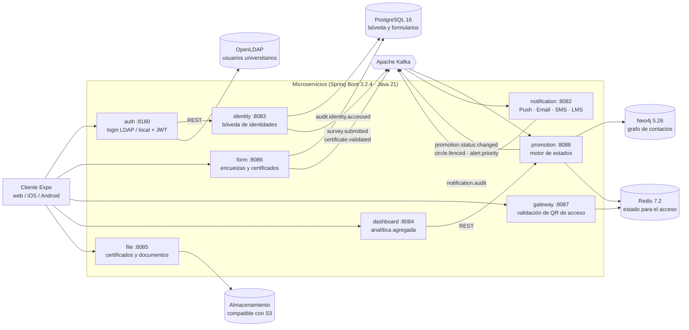
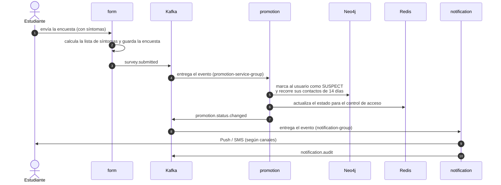
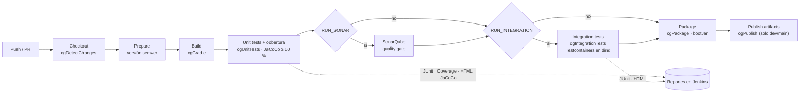
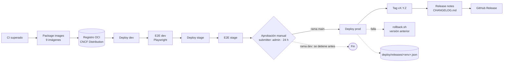
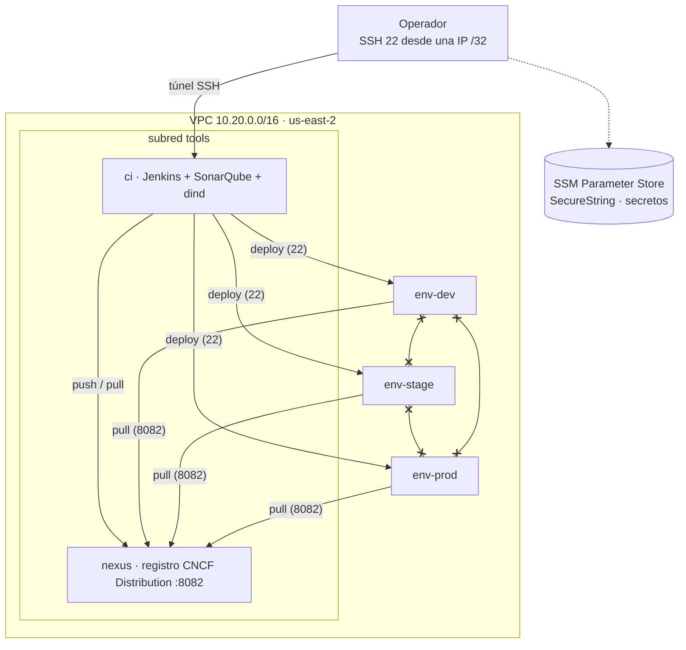

# Diagramas de arquitectura y del pipeline (HU-08)

Los diagramas están escritos en [Mermaid](https://mermaid.js.org/): GitHub y VS Code (con la
extensión «Markdown Preview Mermaid Support») los dibujan directamente. Cada diagrama indica de
dónde salen sus datos, para poder verificarlos contra el código.

| # | Diagrama | Responde a |
|---|---|---|
| 1 | [Arquitectura lógica de la aplicación](#1-arquitectura-lógica-de-la-aplicación) | ¿Qué servicios hay y cómo se comunican? |
| 2 | [Flujo de eventos de una encuesta de salud](#2-flujo-de-eventos-de-una-encuesta-de-salud) | ¿Qué ocurre cuando alguien reporta síntomas? |
| 3 | [Pipeline de integración continua (CI)](#3-pipeline-de-integración-continua-ci) | ¿Qué valida cada cambio antes de integrarse? |
| 4 | [Pipeline de entrega continua (CD)](#4-pipeline-de-entrega-continua-cd) | ¿Cómo llega una versión a dev, stage y prod? |
| 5 | [Infraestructura en AWS](#5-infraestructura-en-aws) | ¿Dónde corre todo y cómo se aíslan los ambientes? |

---

## 1. Arquitectura lógica de la aplicación

Ocho microservicios Spring Boot (Java 21), un cliente Expo (web/móvil) y cuatro almacenes de datos.
El cliente llama directamente a cada servicio (ver `mobile/constants/Config.ts`); los servicios se
desacoplan entre sí con **Kafka** y con dos llamadas REST (`auth → identity`, `dashboard → promotion`).

**Fuentes:** puertos en `services/*/src/main/resources/application.yml`; tópicos en
`HealthSurveyService`, `HealthStatusService`, `AuditLogService` y los `@KafkaListener` de promotion y
notification; clientes REST en `IdentityClient` y `PromotionClient`; Redis en `QrValidationService`.

**Decisión de diseño.** El grafo (Neo4j) guarda solo identificadores anónimos; los nombres reales
viven únicamente en la bóveda de `identity` (PostgreSQL). Un fallo de `notification` no detiene
a `promotion`, porque se comunican por eventos.

---

## 2. Flujo de eventos de una encuesta de salud

Es el recorrido que ejercitan las pruebas de integración de HU-04
(`tests/integration`, clases `FormToPromotionIntegrationTest` y
`PromotionToNotificationIntegrationTest`).

> Defecto conocido (no corregido): en `HealthStatusService.updateStatus` la consulta Cypher no devuelve
> filas si el usuario no tiene contactos recientes o si el nuevo estado es `ACTIVE`; en esos casos
> los pasos 6 y 7 no ocurren. Está documentado en `docs/evidencias/hu-04/README.md`.

---

## 3. Pipeline de integración continua (CI)

Lo ejecuta el `Jenkinsfile` con la Shared Library de `jenkins/vars/`. Se dispara con `githubPush()` o,
si Jenkins no es alcanzable desde Internet, con `pollSCM` cada 5 minutos.

| Etapa | Qué verifica | Falla el build si… |
|---|---|---|
| Unit tests + cobertura | `test` de cada servicio y JaCoCo | La cobertura de líneas de auth, identity, promotion, form o gateway baja de 60 % |
| SonarQube (opcional) | Calidad y vulnerabilidades | El quality gate no es `OK` |
| Integration tests (opcional) | 5 pruebas con Kafka, PostgreSQL, Neo4j y Redis reales | Cualquier prueba falla |

**Docker en Jenkins.** Testcontainers necesita un daemon de Docker. Se usa un contenedor
Docker-in-Docker (`dind`) en la red interna de Compose, sin puerto publicado, en lugar de montar el
socket del host (`infra/bootstrap/jenkins/docker-compose.yml`).

---

## 4. Pipeline de entrega continua (CD)

Detalle de etapas y ramas en [`pipeline-cd.md`](pipeline-cd.md). Vista de conjunto:

| Rama | Despliega | Producción |
|---|---|---|
| `dev` | dev y stage | No |
| `main` | dev, stage y prod | Con aprobación manual; crea tag y notas |

---

## 5. Infraestructura en AWS

El diagrama completo, con todas las reglas de red, está en [`infra-ambientes.md`](infra-ambientes.md).
Resumen:

Reglas clave: las interfaces de Jenkins, SonarQube y Nexus **no** se exponen a Internet (solo SSH,
desde una IP); los tres ambientes no pueden hablarse entre sí; los secretos no están en el
repositorio (SSM + `.env` con permisos 0600 en cada host).
