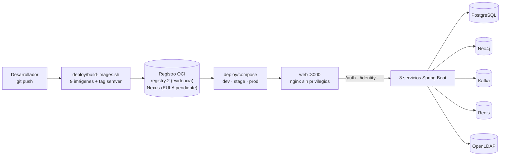

# Empaquetamiento inmutable y ambientes (HU-02)

Documento de arquitectura del empaquetamiento reproducible de CircleGuard. Complementa
[`infra-ambientes.md`](infra-ambientes.md) (HU-01) y [`deploy/README.md`](../../deploy/README.md).



## 1. Objetivo y alcance

- Imágenes reproducibles y versionadas de los 8 microservicios y del cliente web (`expo export`).
- Ejecución con usuario no root.
- Etiquetas semánticas; `latest` prohibido.
- Publicación en un registro OCI.
- Un Compose por ambiente (`dev`, `stage`, `prod`) con healthchecks.
- **Sin cambios en el código base**: los servicios se adaptan con variables `SPRING_*` y el
  cliente web con una transformación en tiempo de build.

## 2. Matriz de imágenes

| Imagen | Puerto | Dockerfile | Dependencias de arranque |
|---|---|---|---|
| `circleguard-auth-service` | 8180 | `services/circleguard-auth-service/Dockerfile` | PostgreSQL, OpenLDAP |
| `circleguard-identity-service` | 8083 | `services/circleguard-identity-service/Dockerfile` | PostgreSQL |
| `circleguard-dashboard-service` | 8084 | `services/circleguard-dashboard-service/Dockerfile` | PostgreSQL |
| `circleguard-file-service` | 8085 | `services/circleguard-file-service/Dockerfile` | — |
| `circleguard-form-service` | 8086 | `services/circleguard-form-service/Dockerfile` | PostgreSQL, Kafka |
| `circleguard-gateway-service` | 8087 | `services/circleguard-gateway-service/Dockerfile` | Redis |
| `circleguard-notification-service` | 8082 | `services/circleguard-notification-service/Dockerfile` | Kafka, auth |
| `circleguard-promotion-service` | 8088 | `services/circleguard-promotion-service/Dockerfile` | PostgreSQL, Neo4j, Kafka, Redis |
| `circleguard-web` | 8080 (contenedor) | `mobile/Dockerfile` | Los 8 servicios |

## 3. Multi-stage y usuario no root

- **Builder**: `gradle:8.14-jdk21` fijado por digest. Ejecuta `bootJar` del servicio con
  `-x test`; la caché de Gradle se monta con BuildKit. No depende de
  `gradle/wrapper/gradle-wrapper.jar`, que no está versionado.
- **Runtime**: `eclipse-temurin:21.0.9_10-jre-alpine` fijado por digest.
- Se crea el usuario/grupo `circleguard` con UID/GID **10001**; `USER 10001:10001`.
- El cliente web usa `node:22.22-alpine` para el build y
  `nginxinc/nginx-unprivileged:1.27-alpine` para el runtime; corre como UID **101**.
- Etiquetas OCI: `title`, `description`, `version`, `revision`, `created`, `source` y
  `base.name`.

## 4. Versionado y registro

Formato:

```
${IMAGE_REGISTRY}/${IMAGE_NAMESPACE}/circleguard-<servicio>:<MAJOR.MINOR.PATCH>
```

- `deploy/lib.sh` valida semver y rechaza `latest` **antes** de invocar Docker.
- `deploy/build-images.sh` propaga `VERSION`, `REVISION` (commit) y `CREATED` como build args.
- `deploy/publish-images.sh` publica y muestra los digests.
- `deploy/verify-images.sh` falla si una imagen corre como root o si la etiqueta de versión no
  coincide.

### Nexus y el EULA

Nexus Repository Community Edition exige aceptar su **EULA** antes de permitir descargar o subir
componentes. Es un acuerdo de licencia de Sonatype, no un fallo técnico. Con
`NEXUS_ACCEPT_EULA=false` (estado actual), `infra/bootstrap/nexus/configure.sh` despliega Nexus
pero deja el EULA en `PLAN`: no crea el repositorio `circleguard-docker`, no habilita el realm
DockerToken y no permite publicar.

Mientras el equipo no acepte el EULA:

- Se usa `deploy/registry/` (`registry:2.8.3`, loopback, sin autenticación) como **registro
  equivalente** para las evidencias de HU-02.
- El repositorio Nexus ya está declarado con `writePolicy: allow_once` (etiquetas inmutables);
  cuando se acepte el EULA y se creen los usuarios de push/pull, basta cambiar
  `IMAGE_REGISTRY` al host de Nexus y publicar las mismas imágenes.

## 5. Compose por ambiente

| Archivo | Diferencias |
|---|---|
| `docker-compose.common.yml` | Middleware, 8 servicios, web, healthchecks, límites, volúmenes y red |
| `docker-compose.dev.yml` | Publica middleware y web en loopback; reinicio `unless-stopped` |
| `docker-compose.stage.yml` | Solo el web; reinicio `always`; límites mayores |
| `docker-compose.prod.yml` | Solo el web en loopback; reinicio `always`; límites mayores |

Decisiones de red:

- Los servicios **no publican puertos**; el cliente web es el único punto de entrada.
- nginx reescribe las rutas `/auth`, `/identity`, `/dashboard`, `/file`, `/form`, `/gateway`,
  `/notification` y `/promotion` a los contenedores correspondientes.
- En prod, el puerto del web queda en `127.0.0.1` hasta que E2.6 añada TLS/ingress.
- Los volúmenes son nombrados por proyecto (`circleguard-dev_postgres-data`, etc.) y no se borran
  con `compose-down.sh`.

## 6. Configuración sin tocar el código

Los `application.yml` apuntan a `localhost`. En Compose se sobrescriben con variables de Spring
Boot:

| Variable | Servicios |
|---|---|
| `SPRING_DATASOURCE_URL` | auth, identity, dashboard, form, promotion |
| `SPRING_NEO4J_URI` | promotion |
| `SPRING_KAFKA_BOOTSTRAP_SERVERS` | form, notification, promotion |
| `SPRING_DATA_REDIS_HOST` / `PORT` | gateway, promotion |
| `SPRING_LDAP_URLS` | auth |
| `AUTH_API_URL` | notification |
| `SPRING_MAIL_HOST` / `PORT` | notification |

Los secretos siguen siendo los de HU-01 y se pasan por `--env-file` desde
`~/.circleguard/` o `/opt/circleguard/<env>/.env`.

## 7. Healthchecks sin Actuator

No se añadió `spring-boot-starter-actuator` (restricción de HU-02). Las sondas de los servicios
hacen una petición HTTP a `/` y aceptan `2xx`, `3xx`, `400`, `401`, `403` o `404`: confirman que
el proceso acepta HTTP. El middleware usa sus propias herramientas (`pg_isready`,
`cypher-shell`, `kafka-broker-api-versions`, `redis-cli`, `ldapsearch`, `zookeeper-shell`).
`web` espera a que los 8 servicios estén `healthy`.

Limitación: la sonda no verifica que una dependencia esté sana. Añadir Actuator es el siguiente
paso recomendado (fuera de HU-02 por la restricción de no tocar el código base).

## 8. Portabilidad a las 7 computadoras

- Los scripts son Bash portable y no usan rutas de WSL ni de Windows.
- El único requisito es Docker Engine/Desktop con Compose v2.20+ y Bash.
- En el equipo de desarrollo se usa WSL; en los hosts de despliegue, Linux.
- Las imágenes son multi-arquitectura en sus bases; el build es nativo salvo que se fije
  `PLATFORM=linux/amd64`.
- `openldap:1.5.0` no publica digest multi-arquitectura; si alguna máquina es ARM, hay que
  validar esa imagen por separado.

## 9. Evidencias

En [`docs/evidencias/hu-02/`](../evidencias/hu-02/README.md):

1. `docker build` de las 9 imágenes (`deploy/logs/` + resumen versionado).
2. `docker inspect` con usuario no root, etiqueta de versión e ID/digest.
3. Listado del registro (`/v2/_catalog` y tags).
4. `docker compose config` por ambiente y `docker compose ps` con `healthy`.

## 10. Decisiones y limitaciones

- **No se toca el código base.** Por eso no hay Actuator ni configuración por ambiente en
  `mobile/constants/Config.ts`; el cliente web se adapta en el Dockerfile.
- **EULA de Nexus pendiente.** La publicación se evidencia con `registry:2`; Nexus queda listo
  para cuando el equipo acepte.
- **Reproducibilidad byte a byte.** Las bases y dependencias están fijadas, pero Gradle conserva
  timestamps en los JAR. Configurar JAR reproducible requiere tocar `build.gradle.kts`.
- **Sin TLS.** El web de prod queda en loopback; el ingress/TLS es E2.6.
