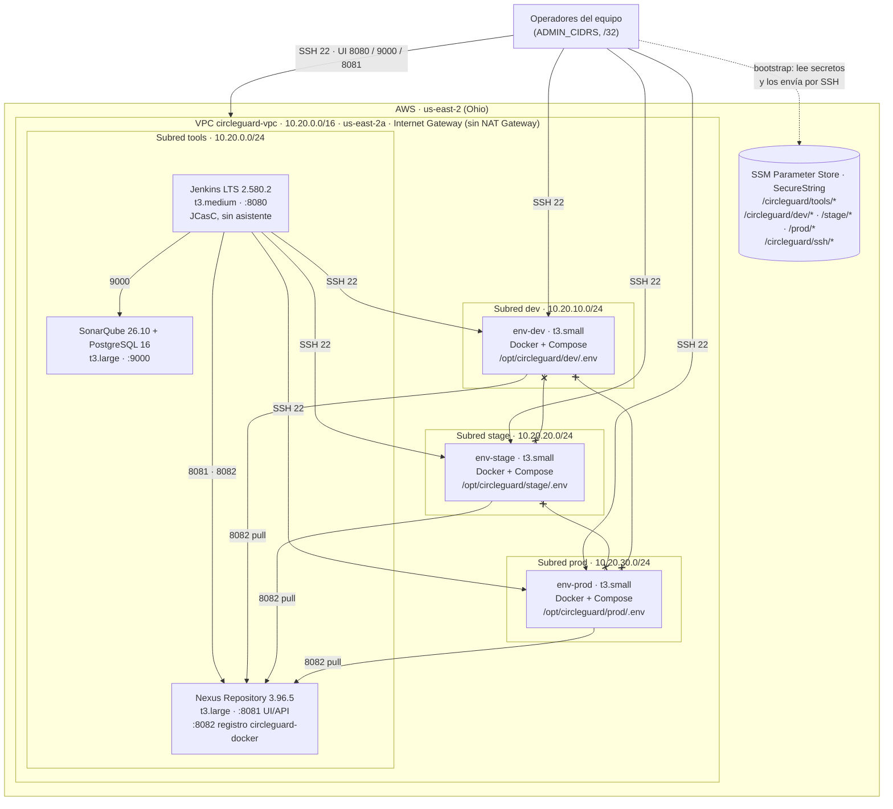

# Diagrama de ambientes de CircleGuard (HU-01)

Infraestructura de la plataforma en AWS: servidores para Jenkins, SonarQube y Nexus, y tres
ambientes aislados (`dev`, `stage`, `prod`). Todo se aprovisiona con `infra/bootstrap-*.sh` y
Docker Compose (ver [infra/README.md](../../infra/README.md)).

`x--x` = tráfico **bloqueado**: ningún grupo de seguridad permite comunicación entre ambientes.

## Comunicación permitida

Grupos de seguridad de `infra/bootstrap-network.sh`. Todo lo que no figura aquí está denegado.

| Origen | Destino | Puerto | Propósito |
|---|---|---|---|
| `ADMIN_CIDRS` | todos los servidores | 22 | Aprovisionamiento por SSH |
| `ADMIN_CIDRS` | jenkins · sonarqube · nexus | 8080 · 9000 · 8081 | Interfaces administrativas |
| `sg-jenkins` | `sg-sonarqube` | 9000 | Análisis estático (lo usará E1.4) |
| `sg-jenkins` | `sg-nexus` | 8081 · 8082 | Publicación de artefactos e imágenes (E1.3/E1.4) |
| `sg-jenkins` | `sg-env-{dev,stage,prod}` | 22 | Despliegue (E1.5) |
| `sg-env-{dev,stage,prod}` | `sg-nexus` | 8082 | Descarga de imágenes |
| todos (salida) | 0.0.0.0/0 | 80 · 443 | Paquetes, imágenes y plugins |
| `sg-env-X` | `sg-env-Y` | — | **Denegado** (no existe regla de entrada ni de salida) |
| sonarqube · nexus | ambientes | — | **Denegado** |
| Internet | registro Docker de Nexus (8082) | — | **Denegado** |

## Aislamiento de los ambientes

| Dimensión | Mecanismo |
|---|---|
| Cómputo | Una instancia EC2 por ambiente |
| Red | Subred propia y grupo de seguridad propio, sin reglas hacia otros ambientes; salida limitada a 80/443 y al registro |
| Credenciales | Ruta SSM propia con valores **distintos** por ambiente. Cada host recibe solo el `.env` de su ambiente (`0600 root`) |
| Acceso | Par de llaves SSH propio por ambiente (`circleguard-dev`, `circleguard-stage`, `circleguard-prod`) y otro para herramientas |
| Datos | Volúmenes en el EBS cifrado de cada instancia |
| Identificación | Etiquetas `Project`, `Story`, `ManagedBy`, `Role` y `Environment` |

Comprobación: `bash infra/verify-infra.sh --isolation` intenta cada conexión desde los propios
hosts con `nc` y exige `closed` entre ambientes y `open` en los flujos permitidos.

## Servidores

| Host | Subred | Tipo | Disco | Contenido |
|---|---|---|---|---|
| circleguard-jenkins | tools | t3.medium | 30 GiB gp3 cifrado | Jenkins (imagen derivada de la LTS con JCasC fijado) |
| circleguard-sonarqube | tools | t3.large | 30 GiB gp3 cifrado | SonarQube Community Build y PostgreSQL 16 (sin puerto publicado) |
| circleguard-nexus | tools | t3.large | 40 GiB gp3 cifrado | Nexus Repository CE y el repositorio Docker hosted `circleguard-docker` (etiquetas inmutables) |
| circleguard-env-{dev,stage,prod} | dev · stage · prod | t3.small | 20 GiB gp3 cifrado | Docker Engine y Compose, listo para E1.3/E1.5 |

Todas las instancias usan Ubuntu 24.04 LTS, IMDSv2 obligatorio, créditos de CPU `standard` e
IPv4 pública automática (sin Elastic IP).
