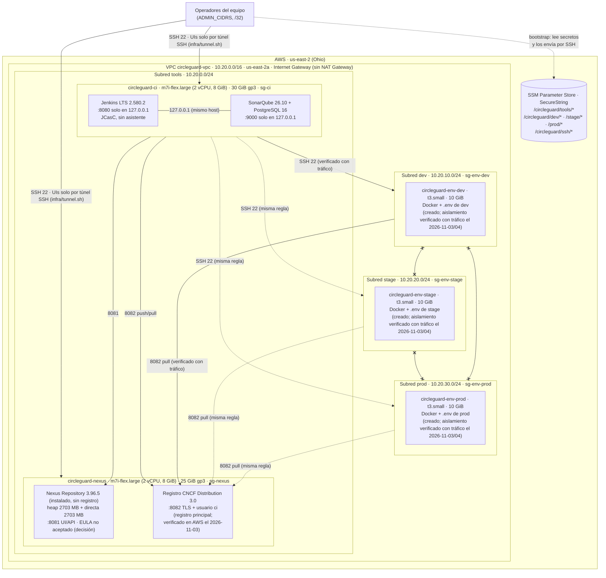

# Diagrama de ambientes de CircleGuard (HU-01)

Infraestructura de la plataforma en AWS (topología B, aprobada el 2026-11-02): dos servidores
para Jenkins, SonarQube y Nexus, y tres ambientes (`dev`, `stage`, `prod`) aislados por red. Todo
se aprovisiona con `infra/bootstrap-*.sh` y Docker Compose (ver [infra/README.md](../../infra/README.md)).

**Decisiones del 2026-11-03:**
- **Registro principal:** CNCF Distribution en el servidor `nexus`, en el puerto 8082, con TLS,
  usuario `ci` y volumen persistente ([decisión y trade-offs](registro-artefactos.md)). Jenkins
  publica en él con `crane`. **Verificado en AWS el 2026-11-03.** Nexus queda instalado sin
  registro: el EULA no se acepta.
- **Ambientes:** un servidor `t3.small` por ambiente (`ENV_SERVERS=dev,stage,prod`). Se encienden y
  prueban por pares, porque el equipo limita a 5 las vCPU encendidas a la vez (`QUOTA_VCPU_LIMIT`;
  la cuota real de la cuenta es de 16) ([detalle](../../infra/README.md#ambientes-dev-stage-y-prod-servidores-por-pares)).

`x--x` = tráfico **bloqueado**: ningún grupo de seguridad permite comunicación entre ambientes
(verificado con tráfico en los dos sentidos el 2026-11-03/04). Las líneas punteadas hacia `stage` y
`prod` usan las mismas reglas que las continuas de `dev`, probadas con tráfico; en esos dos
ambientes se verificaron por configuración. Desde Internet solo se acepta SSH (22) desde `ADMIN_CIDRS`: las interfaces HTTP de las
herramientas no se exponen, y su administración pasa por un túnel SSH cifrado.

## Comunicación permitida

Grupos de seguridad de `infra/bootstrap-network.sh`. Todo lo que no figura aquí está denegado.

| Origen | Destino | Puerto | Propósito |
|---|---|---|---|
| `ADMIN_CIDRS` | `sg-ci`, `sg-nexus` (y los grupos de ambiente) | 22 | Aprovisionamiento por SSH, y túnel SSH hacia las UIs de Jenkins (8080), SonarQube (9000) y Nexus (8081) |
| Internet (incluido `ADMIN_CIDRS`) | 8080 · 9000 · 8081 · 8082 | — | **Denegado**: las UIs HTTP no se exponen |
| Jenkins | SonarQube | 9000 | Mismo servidor (`ci`): no necesita regla de red; SonarQube solo escucha en 127.0.0.1 |
| `sg-ci` | `sg-nexus` | 8081 · 8082 | Publicación de artefactos e imágenes (E1.3/E1.4). El 8082 lo sirve el registro elegido con `REGISTRY_BACKEND` |
| `sg-ci` | `sg-env-{dev,stage,prod}` | 22 | Despliegue (E1.5) |
| `sg-env-{dev,stage,prod}` | `sg-nexus` | 8082 | Descarga de imágenes del registro |
| todos (salida) | 0.0.0.0/0 | 80 · 443 | Paquetes, imágenes y plugins |
| `sg-env-X` | `sg-env-Y` | — | **Denegado** (no existe regla de entrada ni de salida) |
| `sg-nexus` | `sg-ci` y ambientes | — | **Denegado** |
| Internet | registro Docker (8082) | — | **Denegado** |

## Subredes

| Subred | CIDR | Grupo de seguridad | Servidores |
|---|---|---|---|
| `circleguard-subnet-tools` | 10.20.0.0/24 | `sg-ci`, `sg-nexus` | `circleguard-ci`, `circleguard-nexus` (creados el 2026-11-02, detenidos) |
| `circleguard-subnet-dev` | 10.20.10.0/24 | `sg-env-dev` | `circleguard-env-dev` (creado el 2026-11-03/04, detenido) |
| `circleguard-subnet-stage` | 10.20.20.0/24 | `sg-env-stage` | `circleguard-env-stage` (creado el 2026-11-03/04, detenido) |
| `circleguard-subnet-prod` | 10.20.30.0/24 | `sg-env-prod` | `circleguard-env-prod` (creado el 2026-11-03/04, detenido) |

Las cuatro subredes comparten la tabla de rutas `circleguard-rt-public`, con salida por el
Internet Gateway. El aislamiento entre ambientes lo imponen los grupos de seguridad, que deniegan
todo lo no listado en entrada y en salida, no la tabla de rutas.

## Matriz de grupos de seguridad (31 reglas, `desired_rules` de `bootstrap-network.sh`)

| Grupo | Entrada | Salida | Total |
|---|---|---|---|
| `sg-ci` | 22 desde `ADMIN_CIDRS` | 80 y 443 a Internet; 8081 y 8082 a `sg-nexus`; 22 a `sg-env-dev`, `sg-env-stage` y `sg-env-prod` | 1 + 7 |
| `sg-nexus` | 22 desde `ADMIN_CIDRS`; 8081 desde `sg-ci`; 8082 desde `sg-ci` y los tres grupos de ambiente | 80 y 443 a Internet | 6 + 2 |
| `sg-env-dev` | 22 desde `ADMIN_CIDRS`; 22 desde `sg-ci` | 80 y 443 a Internet; 8082 a `sg-nexus` | 2 + 3 |
| `sg-env-stage` | Igual que `sg-env-dev` | Igual que `sg-env-dev` | 2 + 3 |
| `sg-env-prod` | Igual que `sg-env-dev` | Igual que `sg-env-dev` | 2 + 3 |

13 reglas de entrada y 18 de salida. `bootstrap-network.sh` revoca cualquier regla que no esté en
esta lista, incluida la salida por defecto «todo permitido» de los grupos nuevos.
`verify-infra.sh --health` comprueba en AWS que ningún grupo de ambiente referencia a otro.

## Aislamiento de los ambientes

| Dimensión | Mecanismo | Estado en HU-01 |
|---|---|---|
| Red | Subred propia y grupo de seguridad propio, sin reglas hacia otros ambientes; salida limitada a 80/443 y al registro | **Configurado** |
| Credenciales | Ruta SSM propia con valores **distintos** por ambiente (`/circleguard/{dev,stage,prod}/*`) | **Configurado** |
| Acceso | Par de llaves SSH propio por ambiente (`circleguard-dev`, `circleguard-stage`, `circleguard-prod`) y otro para herramientas | **Configurado** |
| Configuración | `infra/config/envs/<env>.env` por ambiente | **Configurado** |
| Cómputo | Un servidor `t3.small` por ambiente (`ENV_SERVERS=dev,stage,prod`), encendidos por pares por el límite de 5 vCPU (`QUOTA_VCPU_LIMIT`) | **Creados en AWS y verificados con tráfico el 2026-11-03/04** ([evidencias](../evidencias/hu-01/aws/aislamiento/README.md)) |
| Identificación | Etiquetas `Project`, `Story`, `ManagedBy`, `Role` y `Environment` | **Configurado** |

**Aislamiento configurado frente a verificado.**
- **Configuración:** `bash infra/verify-infra.sh --health` la comprueba en AWS (verificado el
  2026-11-02, 15 PASS): cada ambiente tiene su subred y su grupo de seguridad, ninguna regla
  referencia a otro ambiente y solo se referencian `sg-ci` y `sg-nexus`.
- **Tráfico:** `bash infra/test-isolation.sh --apply` crea los servidores por pares y prueba con
  `nc`, desde los hosts:
  - que dev, stage y prod no se alcanzan entre sí;
  - que `ci` puede desplegar en ellos (22);
  - que solo pueden ir al registro (8082).
- **Estado: verificado en AWS el 2026-11-03/04** ([evidencias](../evidencias/hu-01/aws/aislamiento/README.md)):
  - los 6 flujos entre ambientes, bloqueados;
  - `ci → env-dev:22` y `env-dev → nexus:8082`, permitidos;
  - `env-dev → ci:8080/9000` y `nexus → env-dev:22`, bloqueados.
  Los flujos permitidos de `stage` y `prod` usan las mismas reglas que `dev`, verificadas por
  configuración.

## Servidores

| Host | Subred | Tipo | Disco | Contenido |
|---|---|---|---|---|
| circleguard-ci | tools | m7i-flex.large (2 vCPU, 8 GiB) | 30 GiB gp3 cifrado | Jenkins (imagen derivada de la LTS con JCasC fijado), SonarQube Community Build y PostgreSQL 16 (sin puerto publicado) |
| circleguard-nexus | tools | m7i-flex.large (2 vCPU, 8 GiB) | 25 GiB gp3 cifrado | Registro principal CNCF Distribution en el 8082 (≈ 50 MiB) y Nexus Repository CE con el EULA sin aceptar (el repositorio `circleguard-docker` solo se crearía si el equipo lo aceptara) |
| circleguard-env-{dev,stage,prod} | dev, stage, prod | t3.small (2 vCPU, 2 GiB, créditos standard) | 10 GiB gp3 cifrado | Docker y Compose, parada automática, swap y el `.env` con las credenciales de su ambiente. Las aplicaciones se desplegarán con E1.5. Pendientes de autorización |

Todas las instancias usan Ubuntu 24.04 LTS, IMDSv2 obligatorio, IPv4 pública automática (sin
Elastic IP), un swap de seguridad de 2 GiB y no tienen rol IAM. Se apagan solas a las 4 horas del
arranque: la instancia queda detenida, con su disco. Los tipos flex no usan créditos de CPU y los
`t3.small` usan créditos standard (sin cargos por ráfagas). La cuenta está en el plan gratuito de
AWS, que solo lanza tipos aptos para la capa gratuita (8 GiB como máximo). Con el límite de 5 vCPU
(`QUOTA_VCPU_LIMIT`, decisión del equipo; la cuota real leída el 2026-11-03 es de 16) caben dos
instancias encendidas a la vez (4 vCPU): `bootstrap-servers.sh` rechaza cualquier combinación que
lo supere.

| Memoria prevista | `ci` | `nexus` |
|---|---|---|
| Servicios | Jenkins (recomendado: 4 GB), SonarQube (escala pequeña: 4 GB y 2 núcleos), PostgreSQL | Nexus (mínimo: host de 8 GB; *heap* ≥ 2703 MB; *heap* + directa ≤ 2/3 de la RAM) |
| Uso típico estimado | ≈ 4.8 GiB de 8 | ≈ 4.1 GiB de 8 |
| Pico estimado | ≈ 6.0 a 7.0 GiB | ≈ 6.4 GiB |
| Medido | Pendiente: `verify-infra.sh --health` lo registra tras el despliegue | Pendiente |

## Identidades y autorización

Ninguna identidad tiene claves de acceso permanentes. Cada capacidad tiene su propia identidad, y
AWS, no los scripts, impide que una capacidad se use desde otra. Plantillas en
[`infra/config/iam/`](../../infra/config/iam/) y creación con `infra/bootstrap-iam.sh`.

| Identidad | Puede | Cómo se obtiene | Límite impuesto por AWS |
|---|---|---|---|
| Rol `circleguard-hu01-reader` | Describir, precios, Access Analyzer, detener instancias | Sesión `aws login` del operador | Solo el usuario operador |
| Rol `circleguard-hu01-operator` | Crear e iniciar recursos acotados; ningún borrado ni permiso IAM | Código MFA nuevo en `AssumeRole` | MFA en cada asunción; sesión ≤ 1 h |
| Rol `circleguard-hu01-teardown` | Describir (política de lectura adjunta) y borrar recursos con `Project=circleguard` | Usuario de teardown en CloudShell | Solo ese usuario, MFA de menos de 15 min; nunca en la estación |

El simulador de políticas IAM confirma que ninguna de estas identidades puede crear credenciales,
modificar permisos, pasar roles, cambiar la cuenta o asumir el rol de teardown
([evidencia 09](../evidencias/hu-01/09-aws-preparacion-cuenta-e-iam.txt)).
