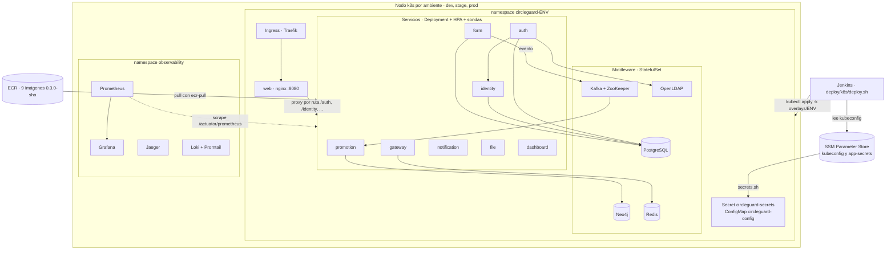

# Kubernetes en CircleGuard — diseño y consolidación **[S2]**

**Documento:** HU-17 (Sprint 2 · E2.9) sobre el diseño de HU-10 (S2 · E2.2)
**Última actualización:** 2026-11-21
**Estado:** **Implementado** (PR #21). El clúster k3s, los 8 servicios, el cliente web, el
middleware, los overlays por ambiente, el Ingress y los HPA están desplegados y con evidencia en
`docs/evidencias/e2.2-kubernetes/`. Queda pendiente el despliegue desde Jenkins (HU-11) y el
Blue-Green/rollback de HU-16.

> Si algo de este documento no coincide con lo que implemente HU-10, **prevalece el código** y se
> corrige este archivo en el mismo PR.

## 1. Qué debe existir para cumplir E2.2

| Criterio de la rúbrica | Artefacto esperado | Estado |
|---|---|---|
| Clúster funcional (EKS o k3s) | Salida de `kubectl cluster-info` | Cumplido (k3s por Terraform en dev/stage/prod) |
| 8 microservicios con manifiestos/plantillas | `deploy/k8s/` o chart Helm | Cumplido (`deploy/k8s/base/apps/`) |
| Middleware y dependencias en el clúster | PostgreSQL, Neo4j, Redis, Kafka, OpenLDAP (o servicios gestionados) | Cumplido (`statefulsets` + ZooKeeper) |
| Deployment y Service por servicio | Un `Deployment` + un `Service` por microservicio | Cumplido |
| Configuraciones por ambiente | Kustomize `overlays/dev|stage|prod` o `values-*.yaml` | Cumplido (`deploy/k8s/overlays/`) |
| ConfigMaps | Variables no sensibles por ambiente | Cumplido (`base/configmap.yaml`) |
| Secrets sin valores reales en Git | `Secret` con `stringData` referenciado a SSM/SealedSecrets | Cumplido (`deploy/k8s/secrets.sh` + SSM) |
| PersistentVolumes/PVC | PostgreSQL, Neo4j y Kafka si corren en el clúster | Cumplido (StatefulSets) |
| Ingress | Un host por ambiente (o path por servicio) | Cumplido (Traefik) |
| Liveness/readiness con Actuator | `/actuator/health/liveness` y `/actuator/health/readiness` | Cumplido (HU-13 + HU-10) |
| Descubrimiento interno | `Service` DNS: `http://identity:8083`, etc. | Cumplido |
| Pods `Ready` | `kubectl get pods` con `1/1 Running` | Cumplido (evidencia e2.2) |
| HPA (rúbrica C3) | `HorizontalPodAutoscaler` con CPU/memoria | Cumplido (9 HPA) |

## 2. Estructura real

```text
deploy/k8s/
├── base/
│   ├── apps/            auth · identity · form · promotion · notification · gateway · dashboard · file · web
│   ├── middleware/      postgres · neo4j · zookeeper · kafka · redis · openldap
│   ├── configmap.yaml · hpa.yaml · ingress.yaml · init-db.sql · nginx.conf
│   └── kustomization.yaml
├── components/tls/      parche de Ingress con TLS (componente de Kustomize)
├── overlays/
│   ├── dev/             namespace.yaml · kustomization.yaml (circleguard-dev)
│   ├── stage/           namespace.yaml · kustomization.yaml (circleguard-stage)
│   └── prod/            namespace.yaml · kustomization.yaml (circleguard-prod, gateway con 2 réplicas mínimas)
├── observability/       all-in-one.yaml · grafana/{service-overview,business}.json
├── deploy.sh            namespace, ecr-pull, secretos, kustomize, rollout status
└── secrets.sh           secretos de la aplicación desde SSM Parameter Store
```

La decisión es **Kustomize** y no Helm: tres ambientes casi iguales no justifican un motor de
plantillas. Cada ambiente es un `overlay` que fija el namespace, la etiqueta `environment` y los
valores propios del ConfigMap. Las imágenes usan los marcadores `__REGISTRY__` y `__TAG__`, que
`deploy.sh` sustituye con la versión `0.3.0-<sha>` publicada en ECR.

## 2.1 Diagrama



Cada ambiente es un nodo k3s independiente creado por Terraform (`envs/dev`, `envs/stage`,
`envs/prod`). El aislamiento entre ambientes es por **nodo y por namespace**, no solo por
namespace. Los 9 HPA escalan por CPU al 70 %. Las sondas y los límites de recursos están en cada
manifiesto de `base/apps/`.

## 3. Contrato de nombres y configuración

### 3.1 Nombres estables

| Recurso | Valor | Por qué |
|---|---|---|
| Namespaces | `circleguard-dev`, `circleguard-stage`, `circleguard-prod` | Aislamiento por ambiente |
| Namespace de observabilidad | `observability` | Un solo Prometheus/Grafana para los tres ambientes |
| Servicios | `auth`, `identity`, `form`, `promotion`, `notification`, `gateway`, `dashboard`, `file`, `web` | El DNS interno queda `http://<servicio>:<puerto>` |
| Ingress | `circleguard.<ambiente>.<host>` y `grafana.<host>` | Estable para la demo |

### 3.2 ConfigMap por ambiente

| Clave | dev | stage | prod |
|---|---|---|---|
| `SPRING_KAFKA_BOOTSTRAP_SERVERS` | `kafka:9092` | `kafka:9092` | `kafka:9092` |
| `SPRING_DATASOURCE_URL` | `jdbc:postgresql://postgres:5432/circleguard_<svc>` | idem | idem |
| `SPRING_NEO4J_URI` | `bolt://neo4j:7687` | idem | idem |
| `SPRING_DATA_REDIS_HOST` | `redis` | `redis` | `redis` |
| `CIRCLEGUARD_IDENTITYSERVICE_URL` | `http://identity:8083` | idem | idem |
| `CIRCLEGUARD_PROMOTIONSERVICE_URL` | `http://promotion:8088` | idem | idem |
| `MANAGEMENT_ENDPOINTS_WEB_EXPOSURE_INCLUDE` | `health,prometheus` | idem | idem |
| `OTEL_EXPORTER_OTLP_ENDPOINT` | `http://otel-collector.observability:4318/v1/traces` | idem | idem |
| `ENVIRONMENT` | `dev` | `stage` | `prod` |

> **Obligatorio por HU-12:** sin `CIRCLEGUARD_IDENTITYSERVICE_URL` el login de `auth` llama a
> `localhost:8083` dentro de su propio pod y falla. Ver
> [`../revisiones/hu-12-revision.md`](../revisiones/hu-12-revision.md) O1.

### 3.3 Secrets

| Secreto | Fuente | Nunca en Git |
|---|---|---|
| `CG_JWT_SECRET` | SSM SecureString / SealedSecret | Sí |
| `CG_VAULT_SECRET`, `CG_VAULT_SALT` | SSM | Sí |
| `POSTGRES_PASSWORD`, `NEO4J_PASSWORD` | SSM | Sí |
| `CG_QR_SECRET` | SSM | Sí |
| Credenciales de registro | Jenkins credential + `imagePullSecret` | Sí |

## 4. Probes y recursos

```yaml
# Ejemplo de contrato, no un manifiesto final
livenessProbe:
  httpGet: { path: /actuator/health/liveness, port: 8088 }
  initialDelaySeconds: 40
  periodSeconds: 10
readinessProbe:
  httpGet: { path: /actuator/health/readiness, port: 8088 }
  initialDelaySeconds: 20
  periodSeconds: 5
resources:
  requests: { cpu: 100m, memory: 384Mi }
  limits:   { cpu: 500m, memory: 768Mi }
```

Ajustar según el consumo real medido en HU-13 (JVM, Neo4j y Kafka son los que más pesan). En un
clúster de 2 vCPU no caben los tres ambientes completos a la vez: la demo enciende **un** ambiente
o usa réplicas 1 y límites bajos. Documentar la decisión.

## 5. Estrategia de despliegue

| Ambiente | Estrategia | Razón |
|---|---|---|
| dev / stage | `RollingUpdate` con `maxUnavailable: 0` | Validación rápida, sin duplicar el stack |
| prod | **Blue-Green** (D-29) | Permite comparar versiones y volver con un cambio de selector |

Blue-Green se implementa con dos `Deployment` (`<svc>-blue`, `<svc>-green`) y un `Service` cuyo
selector apunta a uno. El pipeline despliega el color inactivo, espera `Ready`, ejecuta el smoke
test y conmuta. El rollback es volver el selector al color anterior; no se borra hasta cerrar la
ventana de observación.

**Canary** queda como evolución (bonus de service mesh): requiere NGINX Ingress con
`canary-weight` o Istio/Flagger y análisis de métricas. No se recomienda para la entrega por
tiempo y recursos (ver D-29).

## 6. Dependencias con otras historias

| Necesidad | Historia | Efecto si falta |
|---|---|---|
| Actuator y `/actuator/prometheus` en los servicios | HU-13 | Las probes y el scrape no existen; el Ingress no puede validar |
| Imágenes semver en el registro | HU-06 | No hay versión reproducible que desplegar |
| `CIRCLEGUARD_IDENTITYSERVICE_URL` en el ConfigMap | HU-12/HU-11 | Login roto en el pod |
| TLS y RBAC | HU-14 | Ingress sin TLS y métricas sin control de acceso |
| Aprobación manual y notificación | HU-06/HU-11 | La promoción a prod no tiene evidencia |

## 7. Evidencias que debe producir HU-10 (para HU-17)

1. `kubectl cluster-info` y versión del clúster.
2. `kubectl get nodes -o wide`.
3. `kubectl -n circleguard-dev get deploy,svc,pods,ingress,hpa`.
4. `kubectl -n circleguard-dev get configmap,secret` (sin valores).
5. `kubectl describe pod` de un servicio con probes en `Ready`.
6. Captura de un pod pasando de `Running` a `Ready`.
7. Diagrama del clúster (Mermaid o draw.io) con namespaces y flujo de tráfico.
8. `kubectl rollout history` y un `rollout undo` de prueba (lo usa HU-16).

## 8. Riesgos conocidos

| Riesgo | Mitigación |
|---|---|
| 2 vCPU / 8 GiB no soportan 8 servicios + middleware + observabilidad | Réplicas 1, límites bajos, apagar dev/stage durante la demo de prod, o usar nodos más grandes con aprobación de costo |
| Persistencia de Neo4j/PostgreSQL en el clúster | PVC + StorageClass; si no hay, usar servicios externos y documentarlo |
| Kafka en un solo broker | Aceptable para el curso; declarar que no hay HA real |
| Probes que dependen de Actuator | HU-13 debe mergear antes de la evidencia final de HU-10 |
| Ingress sin TLS | HU-14 debe emitir/instalar el certificado y documentar la validación |
