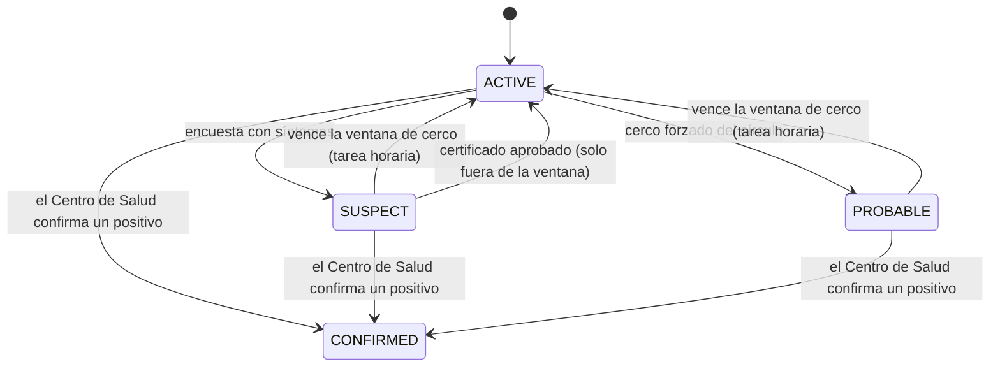
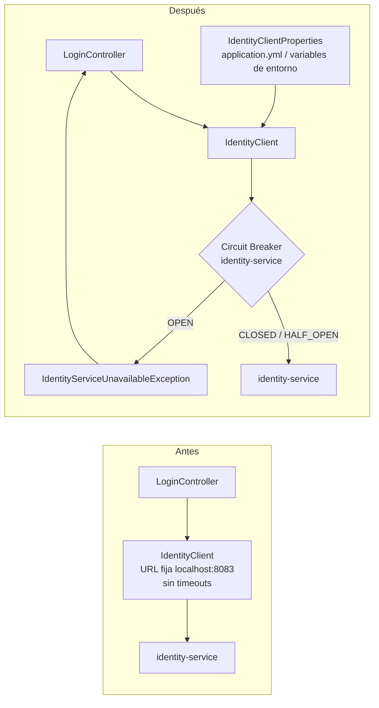
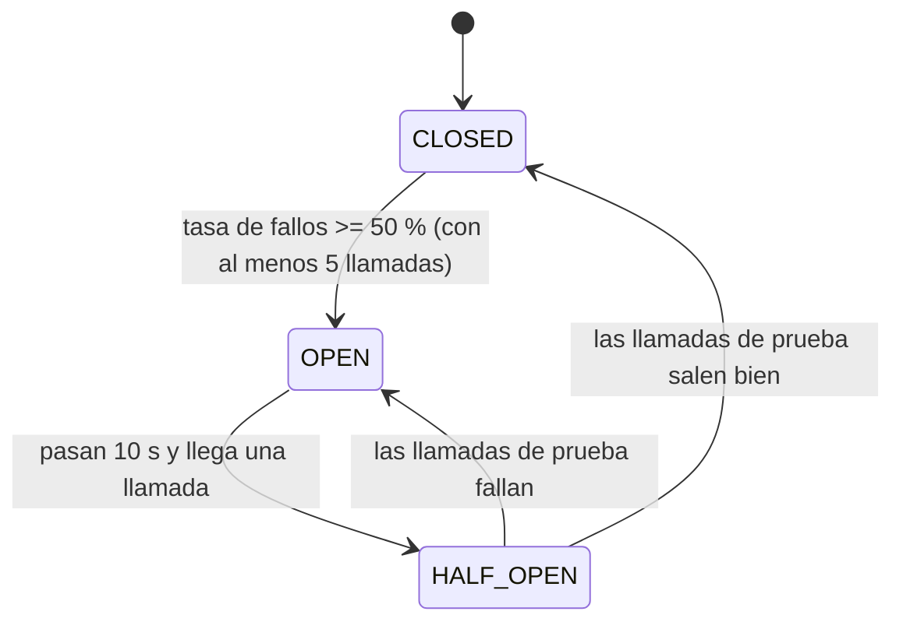
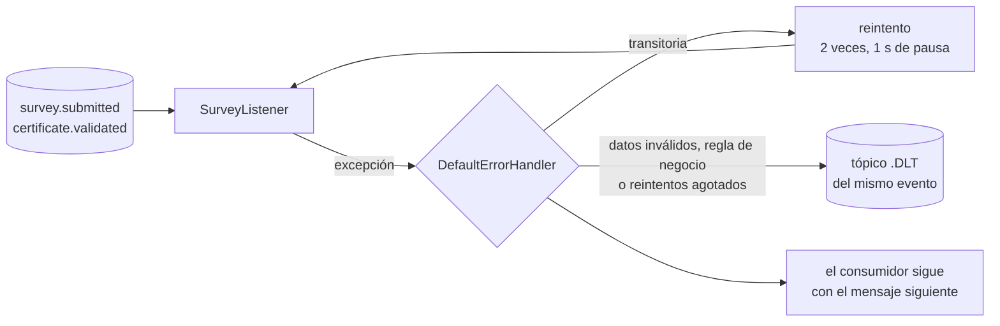

# Patrones de diseño en CircleGuard (HU-12 · E2.4)

## A. Introducción

Este documento hace tres cosas, todas verificables contra el código:

1. **Identifica los patrones que ya existen** en la arquitectura de microservicios, con su ubicación exacta y su estado real (implementado, parcial o ausente).
2. **Documenta los tres patrones que HU-12 implementa o mejora**: un patrón de resiliencia (*Circuit Breaker*), uno de configuración (*External Configuration*) y uno adicional elegido por el equipo (*Dead Letter Topic*).
3. **Muestra la evidencia**: las pruebas con fallas inyectadas y los comandos para repetirlas.

**Contexto.** CircleGuard tiene ocho microservicios Spring Boot 3.2.4 (Java 21). Se comunican por eventos de Kafka y por dos llamadas HTTP síncronas (`auth → identity` y `dashboard → promotion`). Los datos viven en PostgreSQL (una base por servicio), Neo4j (grafo de contactos) y Redis (estado de salud para el control de acceso). Ver [`diagramas.md`](diagramas.md).

**Criterio de estado.** *Implementado* = existe y se usa en producción. *Parcial* = existe pero incompleto o sin uso real. *Ausente* = no existe. Una tecnología presente en las dependencias no cuenta como patrón si el código no lo aplica.

---

## B. Inventario de patrones existentes (CA-01, CA-02)

| Patrón | Estado | Ubicación en el código |
|---|---|---|
| Database per Service | ✅ Implementado (lógico) | `init-db.sql:2`; `application.yml:5` de auth, form, dashboard y promotion, `:8` de identity |
| Arquitectura dirigida por eventos | ✅ Implementado | Productores: `HealthSurveyService.java:52,78`, `HealthStatusService.java:119,135,150`, `IdentityVaultController.java:97`, `AuditLogService.java:33`. Consumidores: `SurveyListener.java:23,36`, `CircleFencedListener.java:20`, `ExposureNotificationListener.java:22`, `PriorityAlertListener.java:27` |
| API Gateway | ⚠️ Parcial | Proxy nginx por prefijo en `mobile/nginx.conf:22-60`. `gateway-service` **no** es un API Gateway |
| Cache-Aside | ⚠️ Parcial | `CacheConfig.java:14-26`, `HealthStatusService.java:39,168,173` |
| Máquina de estados | ⚠️ Parcial (implícita) | `HealthStatusService.java:285`, `StatusLifecycleService.java:33`, `CircleService.java:51`, `HealthStatusController.java:31` |
| Retry | ⚠️ Parcial | `PushServiceImpl.java:42`, `EmailServiceImpl.java:22`, `SmsServiceImpl.java:39`, `NotificationApplication.java:9` |
| Feature Toggle | ⚠️ Solo datos | `SystemSettings.java:18`, `AdminController.java:53` |
| Circuit Breaker, Bulkhead | ❌ Ausente antes de HU-12 | No había Resilience4j en ningún `build.gradle.kts` |

### B.1 Database per Service — ✅ implementado (lógico)

- **Cómo funciona.** `init-db.sql` crea cinco bases (`circleguard_auth`, `_identity`, `_promotion`, `_dashboard`, `_form`). Cada servicio apunta a la suya y tiene sus propias migraciones Flyway. Una búsqueda de los nombres de base ajenos en el código no encuentra accesos cruzados. `notification`, `gateway` y `file` no usan base relacional.
- **Beneficios.** Cada servicio evoluciona su esquema sin coordinar con los demás; ningún servicio puede leer tablas de otro por accidente.
- **Limitaciones.** El aislamiento es **lógico**: las cinco bases están en una sola instancia de PostgreSQL y comparten usuario y contraseña (`POSTGRES_USER`). Un fallo de esa instancia afecta a todos. Además, Redis (clave `user:status:*`) es compartido entre promotion (escribe) y gateway (lee): ese contrato implícito acopla ambos servicios.

### B.2 Arquitectura dirigida por eventos — ✅ implementado

- **Tópicos.** `survey.submitted` y `certificate.validated` (form → promotion); `promotion.status.changed`, `circle.fenced`, `alert.priority` y `proximity.detected` (promotion); `notification.audit` (notification); `audit.identity.accessed` (identity).
- **Cómo funciona.** form publica con `KafkaTemplate`; promotion y notification consumen con `@KafkaListener`. Un fallo de notification no detiene a promotion.
- **Evidencia.** Las pruebas de integración de HU-04 recorren el flujo form → Kafka → promotion → notification con un broker real (`tests/integration`).
- **Carencia que HU-12 corrige en promotion y en notification.** Los listeners capturaban toda excepción y solo la registraban, así que un evento que fallaba se perdía (ver §C.3). Ya no: `SurveyListener`, `CircleFencedListener`, `ExposureNotificationListener` y `PriorityAlertListener` dejan que el fallo llegue al manejador de errores, que reintenta o lo manda al `.DLT`.

### B.3 API Gateway — ⚠️ parcial

- **Lo que hay.** El cliente web se sirve detrás de un nginx que reenvía por prefijo de ruta (`/auth/`, `/identity/`, `/dashboard/`, `/file/`, `/form/`, `/gateway/`, `/notification/`; `mobile/nginx.conf:22-60`). Es un proxy inverso de borde.
- **Lo que NO hay.** Ni autenticación centralizada, ni *rate limiting*, ni agregación de respuestas, ni Spring Cloud Gateway.
- **Aclaración importante.** `circleguard-gateway-service` **no es** un API Gateway. Valida el código QR de acceso al campus (`QrValidationService`) y lee el estado de salud en Redis. El nombre induce a confusión.
- **Defecto detectado, fuera del alcance de HU-12 (se reporta, no se corrige).** `QrValidationService.java:37` deniega el acceso solo a `CONTAGIED` y `POTENTIAL`, pero promotion escribe en Redis `SUSPECT`, `PROBABLE` y `CONFIRMED` (`HealthStatusService.java:98-109`). Las pruebas del gateway pasan porque simulan `POTENTIAL`. Con los estados reales, el control de acceso no bloquea a nadie.

### B.4 Cache-Aside — ⚠️ parcial

- **Lo que hay.** `@EnableCaching` con un `CaffeineCacheManager` (5 minutos de vida, 10 000 entradas; `CacheConfig.java:14-26`). `getCachedStatus` está anotado con `@Cacheable("userStatus")` (`HealthStatusService.java:173`) y `updateStatus` invalida con `@CacheEvict` (`:39`, `:168`). Eso es Cache-Aside con la abstracción de Spring.
- **Por qué es parcial.** Nadie llama a `getCachedStatus` en producción: solo lo usa una prueba (`AdministrativeCorrectionIntegrationTest.java:63`). Los cachés `systemSettings`, `proximityMatches` y `buildingMetadata` se declaran (`CacheConfig.java:26`) pero no tienen ningún `@Cacheable`.
- **Lo que parece Cache-Aside y no lo es.** Redis guarda el estado de cada usuario, pero lo **escribe** promotion tras recalcularlo en Neo4j y lo lee gateway sin consultar la fuente: es un modelo de lectura precalculado, no una caché con carga bajo demanda.

### B.5 Máquina de estados — ⚠️ parcial (implícita)

Los estados son cadenas de texto (`ACTIVE`, `SUSPECT`, `PROBABLE`, `CONFIRMED`) y las transiciones están repartidas, sin enumeración ni tabla de transiciones válidas:

| Transición | Dónde ocurre |
|---|---|
| ACTIVE → SUSPECT | `SurveyListener.java` (encuesta con síntomas) |
| ACTIVE → PROBABLE | `CircleService.java:51` (`forceFenceCircle`: cerco forzado de un círculo; solo a los miembros ACTIVE) |
| cualquiera → CONFIRMED | `HealthStatusController.java:31` (el rol `HEALTH_CENTER` confirma un positivo; no valida el estado de origen) |
| SUSPECT / PROBABLE → ACTIVE | `StatusLifecycleService.java:33` (tarea horaria al vencer la ventana) y `SurveyListener.java` (certificado aprobado) |
| Guarda de la transición a ACTIVE | `HealthStatusService.java:285` (`checkFenceWindow`; lanza `FenceException` dentro de la ventana de cerco) |

- **Limitación.** Sin tabla de transiciones es difícil saber qué cambios de estado son legales y los tests no pueden recorrerlas de forma sistemática. Convertirla en una máquina explícita queda como mejora futura; no se incluyó en HU-12 por su riesgo sobre el núcleo de promotion y su contrato con gateway.

### B.6 Retry — ⚠️ parcial

- `PushServiceImpl`, `EmailServiceImpl` y `SmsServiceImpl` usan `@Retryable` (3 intentos, 2 s de espera) con `@Recover` y `@EnableRetry` (`NotificationApplication.java:9`).
- Los parámetros están fijos en la anotación (no son configurables) y solo se prueba el correo (`NotificationRetryTest.java:31`; push y SMS no tienen prueba).

### B.7 Feature Toggle — ⚠️ solo datos

`SystemSettings.unconfirmedFencingEnabled` (`SystemSettings.java:18`) se guarda en base de datos y se modifica por API (`AdminController.java:53`), **pero ninguna lógica de negocio lo lee**: no cambia el comportamiento. Por eso no se tomó como patrón de configuración de HU-12.

---

## C. Patrones implementados o mejorados

### C.1 Circuit Breaker (Resilience4j) — categoría: resiliencia (CA-03)

**Propósito.** Que un servicio dependiente caído o lento no arrastre al servicio que lo llama.

**Problema que resuelve.** `auth` llama a `identity` en cada inicio de sesión para obtener el `anonymousId`. La llamada usaba un `RestTemplate` sin tiempos de espera: si `identity` se colgaba, cada login retenía un hilo para siempre; si estaba caído, el cliente recibía un 500 genérico tras un intento inútil.

**Antes y después.**

**Componentes y ubicación.**

| Componente | Archivo |
|---|---|
| Cliente con circuit breaker y timeouts | `services/circleguard-auth-service/src/main/java/com/circleguard/auth/client/IdentityClient.java` (`CircuitBreaker.of`, línea 67) |
| Mapeo del error a HTTP 503 | `.../auth/controller/LoginController.java:50` |
| Dependencia | `services/circleguard-auth-service/build.gradle.kts` (`resilience4j-circuitbreaker:2.2.0`, módulo central, sin AOP ni Actuator) |

**Qué cuenta como fallo.** Errores de red, timeouts (`ResourceAccessException`) y respuestas 5xx (`HttpServerErrorException`). Las respuestas 4xx son errores de negocio, no una dependencia enferma: no abren el circuito.

**Estados del circuito.**

**Decisiones técnicas.**
- **Sin fallback degradado.** No se devuelve un valor por defecto: sin `identity` no existe `anonymousId`, y fabricar uno rompería la anonimización. El comportamiento correcto es fallar rápido con **503** para que el cliente reintente.
- **`IdentityServiceUnavailableException` extiende `RestClientException`.** Así los llamadores y pruebas que ya trataban ese tipo siguen funcionando.
- **Módulo central de Resilience4j.** Evita arrastrar Spring AOP y Actuator, que pertenecen a la configuración de observabilidad de HU-13.

**Trade-offs.**

| Ventajas | Desventajas |
|---|---|
| Falla rápido y libera hilos cuando `identity` no responde | Rechaza logins legítimos mientras el circuito está abierto (hasta 10 s por defecto) |
| Da tiempo de recuperarse a `identity` en lugar de saturarlo con reintentos | Dependencia nueva (Resilience4j 2.2.0) |
| Estado inspeccionable y listo para métricas | Los umbrales mal ajustados abren de más o de menos; hay que calibrarlos con tráfico real |
| El 503 es honesto: distingue «dependencia caída» de «error nuestro» | Sin fallback, el login no funciona sin `identity` (decisión deliberada) |

**Alternativas descartadas.** *Retry* solo (multiplica la carga sobre un servicio caído); *Bulkhead* (útil, pero no resuelve el hilo colgado y exigiría más piezas); fallback con un `anonymousId` provisional (viola la anonimización).

**Integración con HU-13 (no implementada aquí).** `IdentityClient.getCircuitBreaker()` expone la instancia para enlazarla a Micrometer (`resilience4j-micrometer`) sin tocar la clase. Las transiciones de estado ya se escriben en el log.

### C.2 External Configuration — categoría: configuración (CA-04)

**Propósito.** Que la forma de conectar con `identity` se pueda cambiar por despliegue, sin recompilar y sin tocar la lógica.

**Problema que resuelve.** La URL era una constante en el código (`http://localhost:8083`) y no había forma de sobrescribirla. En Docker Compose, el servicio `auth` no define ninguna URL de `identity`, así que, por lectura del código y de `deploy/compose/docker-compose.common.yml`, el login llamaría a `localhost` dentro de su propio contenedor y fallaría. Es una inferencia: no se ejecutó en contenedores, y los E2E no lo detectan porque interceptan `/api/v1/**`.

**Componentes y ubicación.** `IdentityClientProperties.java` (`@ConfigurationProperties("circleguard.identity-service")`), que lee `IdentityClient`.

**Parámetros (todos con valor por defecto seguro y sin credenciales).**

| Propiedad | Por defecto | Variable de entorno |
|---|---|---|
| `circleguard.identity-service.url` | `http://localhost:8083` | `CIRCLEGUARD_IDENTITYSERVICE_URL` |
| `...connect-timeout` | `2s` | `CIRCLEGUARD_IDENTITYSERVICE_CONNECTTIMEOUT` |
| `...read-timeout` | `3s` | `CIRCLEGUARD_IDENTITYSERVICE_READTIMEOUT` |
| `...circuit-breaker.failure-rate-threshold` | `50` (%) | `CIRCLEGUARD_IDENTITYSERVICE_CIRCUITBREAKER_FAILURERATETHRESHOLD` |
| `...circuit-breaker.sliding-window-size` | `10` | `CIRCLEGUARD_IDENTITYSERVICE_CIRCUITBREAKER_SLIDINGWINDOWSIZE` |
| `...circuit-breaker.minimum-number-of-calls` | `5` | `CIRCLEGUARD_IDENTITYSERVICE_CIRCUITBREAKER_MINIMUMNUMBEROFCALLS` |
| `...circuit-breaker.wait-duration-in-open-state` | `10s` | `CIRCLEGUARD_IDENTITYSERVICE_CIRCUITBREAKER_WAITDURATIONINOPENSTATE` |
| `...circuit-breaker.permitted-calls-in-half-open-state` | `3` | `CIRCLEGUARD_IDENTITYSERVICE_CIRCUITBREAKER_PERMITTEDCALLSINHALFOPENSTATE` |

Con `@ConfigurationProperties`, el *relaxed binding* de variables de entorno **elimina** los guiones (`identity-service` → `IDENTITYSERVICE`). Con `@Value` (caso de los parámetros de Kafka de §C.3) los guiones pasan a guion bajo.

**Trade-offs.**

| Ventajas | Desventajas |
|---|---|
| Cambiar URL, timeouts y umbrales sin recompilar | Sin `application.yml` documentado, los valores solo se ven en esta tabla y en la clase |
| Valores agrupados y tipados (`Duration`, `float`), fáciles de validar y probar | Ahora **el despliegue debe definir la URL** (`CIRCLEGUARD_IDENTITYSERVICE_URL=http://identity:8083`) |
| El comportamiento cambia solo con la configuración (probado) | Más parámetros = más superficie de mala configuración |

**Acción pendiente fuera de HU-12.** Compose y Kubernetes pertenecen a otras historias (HU-10 y HU-11): quien las mantenga debe añadir `CIRCLEGUARD_IDENTITYSERVICE_URL` al servicio `auth`. Algo análogo ocurre con `dashboard → promotion` (`circleguard.promotion-service.url`).

**Alternativa descartada.** *Feature Toggle*: el único flag existente no lo lee ninguna lógica, así que no aportaba valor real a este caso.

### C.3 Dead Letter Topic — categoría: mensajería resiliente (CA-05)

**Propósito.** No perder eventos que no se pueden procesar y que un mensaje defectuoso no bloquee el consumo.

**Por qué este patrón (justificación de la elección).** El patrón no existía y resuelve un problema real: los listeners de promotion capturaban toda excepción y solo la registraban. Un evento que fallaba (por ejemplo, Neo4j caído un momento) se perdía sin dejar rastro. No duplica a ningún patrón existente (Retry de notification es síncrono por canal; el Circuit Breaker protege llamadas HTTP) y usa `spring-kafka`, que ya era dependencia.

**Antes y después.**

Antes: la excepción moría en el `catch` del listener y el evento se perdía. Después: llega al manejador de errores del contenedor, que decide.

**Componentes y ubicación.**

| Componente | Archivo |
|---|---|
| Manejador con reintento acotado y publicación al DLT (promotion) | `services/circleguard-promotion-service/src/main/java/com/circleguard/promotion/config/KafkaErrorHandlingConfig.java` |
| Listeners de promotion que dejan de tragar la excepción | `.../promotion/listener/SurveyListener.java` |
| `ErrorHandlingDeserializer` para registros ilegibles | `services/circleguard-promotion-service/src/main/resources/application.yml` (`spring.kafka.consumer.value-deserializer`) |
| Manejador equivalente en notification | `services/circleguard-notification-service/src/main/java/com/circleguard/notification/config/KafkaErrorHandlingConfig.java` |
| Listeners de notification que dejan de tragar la excepción | `.../notification/service/CircleFencedListener.java`, `ExposureNotificationListener.java`, `PriorityAlertListener.java` |

Spring Boot aplica el bean `CommonErrorHandler` a todos los contenedores de `@KafkaListener`; no hizo falta otra configuración. La clase se repite en notification porque cada servicio se despliega por separado y no hay un módulo compartido.

**Decisiones técnicas.**
- **Qué se reintenta y qué no.** Transitorios (p. ej. Neo4j o Redis caídos un momento): hasta 2 reintentos, 3 entregas en total. Directo al DLT, sin reintento: `ClassCastException` e `IllegalArgumentException` (datos malformados) y `FenceException` (regla de negocio: aprobar un certificado dentro de la ventana de cerco; reintentar no cambia el resultado).
- **Qué se reintenta en notification.** Transitorios (p. ej. el auth-service sin responder al resolver una alerta): hasta 2 reintentos. Directo al DLT: `JsonProcessingException`, `ClassCastException` e `IllegalArgumentException` (carga mal formada). El envío por correo, SMS y push es asíncrono y cada canal tiene su propio reintento, así que sus fallos no llegan a este manejador: lo que se reintenta aquí es lo que ocurre antes de despachar.
- **Registros que no se pueden deserializar (promotion).** El consumidor usa `ErrorHandlingDeserializer` con `JsonDeserializer` como delegado. Un registro ilegible deja de lanzar una excepción desde `poll()` (que repetiría los mismos bytes para siempre) y llega al manejador, que lo publica en el DLT **tal cual**. Para eso hace falta un segundo productor con `ByteArraySerializer` para los valores y `StringSerializer` para la clave: el productor de la aplicación serializa a JSON y alteraría los bytes. El recuperador elige la plantilla según el tipo del valor (`byte[]` antes que `Object`).
- **Valor del DLT en notification.** Sus consumidores leen texto plano, así que el DLT se escribe con un productor `StringSerializer`. Con el productor de la aplicación (JSON) el texto original quedaría entre comillas.
- **Partición del DLT.** Se deja que el productor la elija (partición -1) para no exigir que el DLT tenga tantas particiones como el tópico origen.
- **Nombre del tópico.** `<tópico original>.DLT`.

**Configuración.**

| Propiedad (`@Value`) | Por defecto | Variable de entorno |
|---|---|---|
| `circleguard.kafka.consumer.retry.max-retries` | `2` | `CIRCLEGUARD_KAFKA_CONSUMER_RETRY_MAX_RETRIES` |
| `circleguard.kafka.consumer.retry.backoff-ms` | `1000` | `CIRCLEGUARD_KAFKA_CONSUMER_RETRY_BACKOFF_MS` |

**Cambio de comportamiento a tener en cuenta.** Un certificado aprobado para un usuario todavía dentro de la ventana de cerco antes se descartaba en silencio; ahora termina en `certificate.validated.DLT`, donde se puede auditar.

**Trade-offs.**

| Ventajas | Desventajas |
|---|---|
| No se pierden eventos: quedan en el DLT para inspeccionarlos y reprocesarlos | Entrega **al menos una vez**: tras un reintento puede haber eventos duplicados (p. ej. dos avisos al mismo usuario) |
| Un mensaje defectuoso no bloquea la partición | Durante el reintento la partición se pausa unos segundos |
| No añade dependencias | Alguien debe vigilar los `.DLT` y reprocesarlos: un DLT que nadie mira equivale a perder el mensaje |
| Distingue errores transitorios de errores de datos | Los `.DLT` deben existir (o auto-crearse) en el broker; las cabeceras de la excepción pueden incluir texto del error |

**Limitaciones conocidas.**
- Los consumidores de notification leen texto plano y no pueden fallar al deserializar, pero un fallo a mitad de un listener puede procesar el mismo evento dos veces (p. ej. repetir el aviso a algunos administradores en `PriorityAlertListener`). Es el coste de la entrega al menos una vez.
- Los `.DLT` no tienen consumidor: alguien debe revisarlos y reprocesarlos. No hay alerta ni panel (observabilidad corresponde a HU-13).
- Los cinco `@KafkaListener` del repositorio quedan cubiertos (`survey.submitted`, `certificate.validated`, `circle.fenced`, `promotion.status.changed`, `alert.priority`). `proximity.detected` y `notification.audit` solo se publican; ningún servicio los consume.

---

## D. Resumen de pruebas por patrón (CA-07)

| Patrón | Prueba | Falla inyectada | Qué demuestra |
|---|---|---|---|
| Circuit Breaker | `IdentityClientTest$CircuitBreakerWithInjectedFaults` (6 pruebas) | Servidor HTTP real que responde 500, se cuelga más que el timeout o responde 400 | CLOSED con servidor sano; apertura al llegar al umbral; rechazo sin llamar al servidor; HALF_OPEN y vuelta a CLOSED; reapertura si las pruebas fallan; un timeout cuenta como fallo; los 4xx no abren el circuito |
| Circuit Breaker | `LoginControllerFlowsTest` | Cliente que lanza `IdentityServiceUnavailableException` | El login devuelve 503 sin token; un error genérico sigue siendo 500 |
| External Configuration | `IdentityClientTest$ExternalConfiguration` (4 pruebas) | Propiedades y variables de entorno distintas | Valores por defecto seguros; enlace tipado desde propiedades; sobrescritura por variable de entorno; solo cambiar la configuración cambia cuándo abre el circuito |
| Dead Letter Topic | `DeadLetterTopicIntegrationTest` (6 pruebas, Kafka real) | Evento malformado y bytes que no son JSON en promotion; eventos malformados en los tres tópicos de notification; listener que falla de forma transitoria o permanente | El evento malformado llega a `survey.submitted.DLT` y el consumo continúa; los bytes ilegibles llegan al DLT sin alterarse y el consumo continúa (`ErrorHandlingDeserializer`); los tres tópicos de notification van a su `.DLT` y un cambio de estado posterior se sigue notificando; un fallo transitorio se reintenta 3 veces y se recupera sin pasar por el DLT; uno permanente se entrega 1 + 2 veces y va al DLT; los errores de datos y de negocio no se reintentan |
| Dead Letter Topic | `DeadLetterHandlingTest` en notification (9 pruebas) | Eventos malformados y un auth-service que no responde | Los tres listeners ya no tragan la excepción; un error de datos se manda al `.DLT` sin reintento y uno transitorio se reintenta |
| Validación de la respuesta de identity | `IdentityClientTest` (3 pruebas nuevas) | Respuesta vacía, sin `anonymousId` o con un UUID mal formado | Se informa como identity-service no disponible (503) en vez de un 500 por `NullPointerException` |

## E. Evidencias y cómo reproducirlas

Los resultados de esta sección son de ejecuciones reales en WSL (Gradle 8.14, JDK 21, Docker 29.2). Los comandos se ejecutan desde la raíz del repositorio.

| Comando | Resultado verificado |
|---|---|
| `./gradlew :services:circleguard-auth-service:test --tests '*IdentityClientTest*' --tests '*LoginController*' -x jacocoTestCoverageVerification` | 12 pruebas de `IdentityClientTest` (2 originales, 6 de circuit breaker, 4 de configuración), 5 de `LoginControllerFlowsTest` y 1 de `LoginControllerTest`: **0 fallos** |
| `./gradlew :services:circleguard-promotion-service:test --tests '*SurveyListenerTest' -x jacocoTestCoverageVerification` | 2 pruebas existentes, **0 fallos** (siguen pasando tras quitar el `catch`) |
| `./gradlew :tests:integration:integrationTest --tests '*DeadLetterTopicIntegrationTest'` (requiere Docker) | 4 pruebas, **0 fallos**, 26 s |

`-x jacocoTestCoverageVerification` solo se usa al filtrar pruebas: el gate de cobertura exige la suite completa del servicio.

**Validación de compatibilidad (CA-08), con el gate de cobertura activo:**

| Comando | Resultado verificado |
|---|---|
| `./gradlew :services:circleguard-auth-service:test :services:circleguard-promotion-service:test :services:circleguard-notification-service:test` | `BUILD SUCCESSFUL`. auth 57 pruebas, promotion 125, notification 20: **0 fallos**. Cobertura de líneas: auth 98,5 % (línea base 98,0 %), promotion 91,4 % (línea base 90,9 %), ambas por encima del mínimo de 60 % |
| `./gradlew :tests:integration:integrationTest :services:circleguard-promotion-service:integrationTest` (Docker) | `BUILD SUCCESSFUL`. `tests:integration`: 11 pruebas (6 de DLT, IT-1/1b/2, IT-3/4) y promotion: 6 pruebas: **0 fallos** |

**Una primera ejecución falló en IT-2 (de HU-04) y se corrigió.** La causa no estaba en los patrones: mi prueba de DLT corría antes de que se sembrara `SystemSettings` y dejó cacheado el resultado vacío (ver §F.7). Se corrigió sembrando la configuración al inicio de la prueba nueva y se repitió la suite completa.

## F. Hallazgos fuera del alcance de HU-12 (reportados, no corregidos)

1. **El gateway no bloquea los estados reales** (`QrValidationService.java:37`; ver §B.3). Afecta al control de acceso.
2. **Compose no pasa la URL de `identity` a `auth`** ni la de `promotion` a `dashboard` (HU-10/HU-11).
3. ~~Los consumidores de notification siguen descartando eventos fallidos~~: **resuelto** en la ampliación de HU-12 (§C.3).
4. **`getCachedStatus` y tres cachés declarados no se usan** (§B.4).
5. ~~`LoginController` imprimía con `System.out` (incluida la longitud de la contraseña) y volcaba trazas con `printStackTrace`~~: **resuelto** en la ampliación de HU-12; ahora usa SLF4J y no registra nada derivado de la contraseña.
6. **`LmsServiceImpl` apunta por defecto al puerto 8081 de identity** (el real es el 8083).
7. **`SystemSettingsRepository.getSettings()` cachea también el resultado vacío** (`@Cacheable("systemSettings")` con Caffeine, que admite valores nulos, 5 minutos). Si se consulta antes de que exista la fila, `checkFenceWindow` falla con «System Settings not initialized» hasta que expira el caché. Lo descubrió el orden de ejecución de las pruebas de integración: la prueba de DLT corría antes de que otra sembrara la configuración. En producción Flyway inserta la fila, así que la gravedad es baja, pero el comportamiento existe. La prueba nueva ahora siembra la configuración primero.
