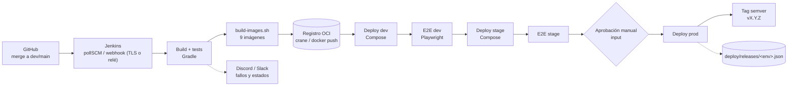

# Pipeline de entrega continua (HU-06)

Diseño del pipeline de Jenkins que construye, publica, despliega y promueve CircleGuard. La
implementación está en `Jenkinsfile` y en los scripts de `deploy/`.



## Ramas y etapas

| Rama | Build/tests | dev | E2E dev | stage | E2E stage | prod | tag |
|---|---|---|---|---|---|---|---|
| `dev` | Sí | Automático | Sí | Automático | Sí | No | No |
| `main` | Sí | Automático | Sí | Automático | Sí | **Aprobación manual** | Sí |
| Otra | Sí | No | No | No | No | No | No |

> El criterio de HU-06 dice “merge a `main`”. En este repositorio `dev` es la rama de integración
> y `main` la de release. Por eso `dev` despliega dev/stage y `main` añade la aprobación y prod.
> Con `FORCE_PROD=true` se puede probar la aprobación desde otra rama.

## Etapas del Jenkinsfile

| Etapa | Qué hace | Script |
|---|---|---|
| Checkout | Detecta los servicios modificados (Shared Library) | `cgDetectChanges` |
| Prepare | Calcula la versión o valida la indicada | `deploy/next-version.sh` |
| Build | Compila clases y testClasses de los servicios seleccionados | `cgGradle` |
| Unit tests and coverage | `test` + JaCoCo, publica JUnit | `cgUnitTests` |
| SonarQube quality gate | Analiza y bloquea si el gate falla | `cgSonar` |
| Integration tests | Ejecuta `integrationTest` | `cgIntegrationTests` |
| Package | Genera y archiva los `bootJar` | `cgPackage` |
| Publish artifacts | Publica los JAR en Nexus (solo `dev`/`main`) | `cgPublish` |
| Package images | Construye las 9 imágenes | `deploy/build-images.sh` |
| Publish images | Publica en el registro | `deploy/publish-images.sh` |
| Deploy dev | Despliega dev | `deploy/deploy.sh dev` |
| E2E dev | Smoke E2E | `deploy/e2e.sh dev` |
| Deploy stage | Despliega stage | `deploy/deploy.sh stage` |
| E2E stage | Smoke E2E | `deploy/e2e.sh stage` |
| Approve prod | `input` con `submitter: admin`, timeout 24 h | Jenkinsfile |
| Deploy prod | Despliega prod | `deploy/deploy.sh prod` |
| Tag release | Crea y publica `vX.Y.Z` | `deploy/tag-release.sh` |

## Versionado

`deploy/next-version.sh` usa Git y Conventional Commits:

- `BREAKING CHANGE` o `tipo!:` → **major**
- `feat:` → **minor**
- `fix:`, `perf:` u otros → **patch**
- Sin commits desde el último tag → mantiene la versión

El tag es `vMAJOR.MINOR.PATCH` (anotado) y la imagen de release usa `MAJOR.MINOR.PATCH` (Docker no
admite `+` ni `latest`). En `dev` y otras ramas, el pipeline añade `-<sha>` (por ejemplo
`0.2.0-a1b2c3d`) para que cada commit tenga una imagen única; el tag estable se crea en `main`.

## Trazabilidad

Cada despliegue escribe:

- `deploy/releases/<env>.json`: última versión, commit, fecha, actor y evento.
- `deploy/releases/history.tsv`: historial append-only de deploys y rollbacks.
- `CG_RELEASES_DIR` (por defecto `$HOME/.circleguard/releases`): copia persistente que sobrevive a
  la limpieza del workspace de Jenkins. `current-version.sh` la consulta primero.

El pipeline archiva los archivos del workspace como artefactos de Jenkins. Si se quiere una fuente
de verdad en Git, el equipo puede hacer que Jenkins los commitee; para esta historia se archivan y
se copian a la evidencia.

## Rollback

```bash
IMAGE_REGISTRY=<registro> ./deploy/rollback.sh stage 0.9.0
```

El script:

1. Comprueba que la versión no sea la actual.
2. Verifica que las 9 imágenes existan (`docker manifest inspect` o `crane manifest`).
3. Redespliega esa versión con `deploy.sh` y evento `rollback`.
4. Registra el rollback y notifica.

## Notificaciones

`deploy/notify.sh` soporta Discord (`DISCORD_WEBHOOK_URL`) o Slack (`SLACK_WEBHOOK_URL`). Si no hay
webhook, no falla: solo informa que se omitió. El pipeline llama a `notify.sh` en los `post`
`success`, `unstable` y `failure`.

## E2E

`tests/e2e-playwright` contiene una suite de humo:

- la aplicación web responde y sirve el shell;
- `/healthz` del proxy responde `200`.

`deploy/e2e.sh <env>` instala dependencias/browser si hace falta y ejecuta Playwright contra
`E2E_BASE_URL`. Es el gate de promoción a stage. El Jenkinsfile pasa `E2E_URL_DEV` y
`E2E_URL_STAGE`; en despliegues remotos hay que apuntarlos a `http://<host>:3000` (o a un túnel
SSH), no a `localhost` del agente. En dev el web se publica en `127.0.0.1:3000`, así que un E2E
remoto necesita un túnel SSH; stage sí publica en `0.0.0.0`. Para E2E funcional completo (login,
cuestionario, QR) la suite se amplía en la siguiente iteración.

## Prerrequisitos reales (HU-04)

El pipeline está escrito, pero para ejecutarlo en Jenkins faltan:

1. Plugins de pipeline: `infra/bootstrap/jenkins/plugins.txt` ya trae el conjunto de HU-03;
   `jenkins/plugins.txt` añade los extras del CD (Node/Playwright y SSH).
2. Un agente/herramienta con **JDK 21 + Gradle wrapper** (ya versionado), **Git** y **Bash**.
3. Docker + Compose si `BUILD_IMAGES=true`, o un agente con Docker.
4. Node 22 + Playwright si el E2E corre en el agente.
5. Credenciales de Jenkins: `circleguard-registry`, `github-token`, `discord-webhook` y
   `circleguard-deploy` (SSH).
6. Un destino de despliegue. Los hosts `t3.small` de HU-01 (2 GiB) **no** aguantan los 15
   contenedores; para el stack completo hacen falta servidores más grandes y subir
   `QUOTA_VCPU_LIMIT`.
7. El host de ambiente debe tener el repositorio en `DEPLOY_PATH` (por ejemplo
   `/opt/circleguard/circleguard`). HU-01 no lo clona: el primer despliegue debe clonarlo/copiarlo
   una vez; los siguientes solo reciben `IMAGE_TAG` y secretos.
7. Trigger: `pollSCM` cada 5 minutos. Para webhook inmediato hace falta TLS o un relé, porque
   Jenkins no está expuesto a Internet (decisión de HU-01).

## Limitaciones conocidas

- Los 10 tests base de HU-01 siguen fallando; la etapa los publica y deja el build `UNSTABLE`, pero
  no bloquea el despliegue. Se corrigen en HU-04/E1.6.
- `crane` publica y descarga, no construye. La construcción sigue siendo con Docker/BuildKit.
- El registro CNCF Distribution permite sobrescribir tags; la disciplina la impone el pipeline
  (semver, nunca `latest`).
- `prod` usa el mismo Compose; el TLS/ingress es E2.6.

## Evidencias

Ver [`docs/evidencias/hu-06/`](../evidencias/hu-06/README.md).
