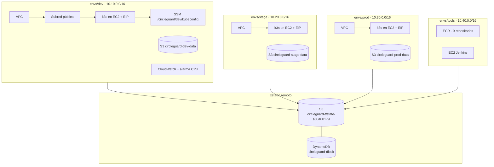

# Terraform en CircleGuard — diseño y consolidación **[S2]**

**Documento:** HU-17 (Sprint 2 · E2.9) sobre la implementación de HU-09 (S2 · E2.1)
**Última actualización:** 2026-11-20
**Estado:** **Implementado y aplicado** en `dev`, `stage`, `prod` y `tools` (PR #15, #16 y #18,
mergeados en `dev`). El estado remoto vive en S3 con bloqueo en DynamoDB. Queda pendiente la
evidencia de `terraform fmt -check`/`validate` y un `destroy` documentado.

> Si algo de este documento no coincide con el código, **prevalece el código** y se corrige este
> archivo en el mismo PR.

## 1. Qué exige el criterio E2.1

| Criterio | Artefacto | Estado |
|---|---|---|
| Infraestructura declarada en Terraform, no solo Bash | `infra/terraform/` con módulos | Cumplido |
| Módulos reutilizables: red, cómputo/clúster, registro, almacenamiento, observabilidad | Un módulo por carpeta con `variables.tf`, `main.tf`, `outputs.tf` | Cumplido (6 módulos) |
| Configuraciones independientes y parametrizables para dev, stage y prod | `envs/{dev,stage,prod}` + `envs/tools` | Cumplido |
| Cada ambiente configura recursos, tamaños, nombres y parámetros | `terraform.tfvars` por ambiente | Cumplido |
| Backend remoto (por ejemplo S3) | `backend "s3"` en cada ambiente | Cumplido |
| Lock de estado (DynamoDB o compatible) | `dynamodb_table = "circleguard-tflock"` | Cumplido |
| Sin credenciales en archivos ni en el repositorio | Roles IAM + SSM; `.gitignore` excluye estado | Cumplido |
| `terraform fmt` y `terraform validate` correctos | Salida de ambos comandos | **Pendiente de evidencia** |
| `terraform plan` antes de aplicar | Plan archivado como artefacto | Cumplido (20 logs) |
| Diagramas actualizados | Mermaid de recursos y relaciones | Cumplido (§4) |

## 2. Estructura real

```text
infra/terraform/
├── bootstrap-state/          bucket S3 + tabla DynamoDB del estado remoto
├── iam/terraform-policy.json permisos del rol que ejecuta Terraform
├── modules/
│   ├── network/              VPC, subred pública, IGW, rutas
│   ├── compute/              nodo k3s en EC2, EIP, SSM, security group y llave
│   ├── registry/             repositorios ECR (9 imágenes)
│   ├── storage/              bucket S3 de datos (versionado, cifrado, privado)
│   ├── observability/        log group de CloudWatch + alarma de CPU
│   └── ci-server/            servidor Jenkins (EC2) y su IAM
└── envs/
    ├── dev/                 10.10.0.0/16
    ├── stage/               10.20.0.0/16
    ├── prod/                10.30.0.0/16
    └── tools/               10.40.0.0/16 (ECR + Jenkins)
```

## 3. Ambientes y recursos

| Ambiente | Módulos | Recursos aplicados | Salida principal |
|---|---|---|---|
| `bootstrap-state` | S3 + DynamoDB | 5 | `circleguard-tfstate-a00400179`, `circleguard-tflock` |
| `dev` | network + compute + storage + observability | Red 5 · cómputo 12 · extras 6 · EIP 3 | `node_public_ip`, `kubeconfig_parameter = /circleguard/dev/kubeconfig` |
| `stage` | network + compute + storage + observability | 25 | `kubeconfig_parameter = /circleguard/stage/kubeconfig` |
| `prod` | network + compute + storage + observability | 25 | `kubeconfig_parameter = /circleguard/prod/kubeconfig` |
| `tools` | network + registry + ci-server | ECR 18 · Jenkins 16 | 9 repositorios ECR y servidor Jenkins |

Cada ambiente de aplicación crea:

- VPC con subred pública, internet gateway y tabla de rutas (sin NAT Gateway).
- Una instancia `m7i-flex.large` con k3s instalado por `user_data`, elastic IP y security group
  (SSH restringido por `admin_cidr`, API de Kubernetes, HTTP y HTTPS).
- El `kubeconfig` se publica cifrado en SSM (`/circleguard/<env>/kubeconfig`), nunca en Git.
- Un bucket S3 de datos con versionado, cifrado AES256 y acceso público bloqueado.
- Un log group de CloudWatch (`/circleguard/<env>/k3s`, 7 días) y una alarma de CPU al 80 %.

> **Alcance del módulo `observability`.** En Terraform cubre la observabilidad **de la
> infraestructura** (logs y alarma de CPU). El stack Prometheus/Grafana/Jaeger/Loki se despliega
> con `deploy/k8s/observability/` (HU-13); no se duplica en Terraform.

## 4. Diagrama



## 5. Backend remoto y estado

| Elemento | Valor |
|---|---|
| Bucket | `circleguard-tfstate-a00400179` (versionado y cifrado) |
| Tabla de lock | `circleguard-tflock` |
| Claves | `envs/dev/terraform.tfstate`, `envs/stage/...`, `envs/prod/...`, `envs/tools/...` |
| Credenciales | Rol IAM `circleguard-hu01-*`; nunca claves en el repositorio |
| Estado local | Ignorado por `.gitignore` (`*.tfstate`, `.terraform/`, `*.tfplan`) |

El bucket y la tabla se crean una sola vez desde `bootstrap-state/`; los demás ambientes solo los
referencian.

## 6. Cómo se ejecuta

```bash
# 1) Backend remoto (una sola vez)
cd infra/terraform/bootstrap-state
terraform init && terraform apply

# 2) Un ambiente (ejemplo: dev)
cd ../envs/dev
terraform init
terraform plan  -var="admin_cidr=203.0.113.0/32" -out=dev.tfplan
terraform apply dev.tfplan
```

`admin_cidr` (CIDR autorizado para SSH) es obligatorio y **no** está en los `terraform.tfvars`
versionados. Se pasa por `-var` o por `TF_VAR_admin_cidr`; si se quiere fijar por ambiente, se usa un
`*.auto.tfvars` local no versionado. La llave SSH sale de `ssh_public_key_path`
(`~/.ssh/id_ed25519.pub` por defecto).

Después del apply:

```bash
terraform output
aws ssm get-parameter --name /circleguard/dev/kubeconfig --with-decryption \
  --query Parameter.Value --output text > /tmp/dev.kubeconfig
KUBECONFIG=/tmp/dev.kubeconfig kubectl get nodes
```

## 7. Evidencias

Índice completo: [`../evidencias/e2.1-terraform/README.md`](../evidencias/e2.1-terraform/README.md).

| Evidencia | Archivo |
|---|---|
| Backend remoto (plan/apply) | `01-bootstrap-plan.log`, `02-bootstrap-apply.log` |
| Red de dev | `03-dev-red-plan.log`, `04-dev-red-apply.log` |
| Registro ECR de tools | `05-tools-registry-plan.log`, `06-tools-registry-apply.log` |
| Cómputo k3s de dev | `07-dev-compute-plan.log`, `08-dev-compute-apply.log` |
| Plan inicial de stage y prod | `09-stage-plan.log`, `10-prod-plan.log` |
| Almacenamiento y observabilidad de dev | `11-dev-extras-plan.log`, `12-dev-extras-apply.log` |
| Elastic IP de dev | `13-dev-eip-plan.log`, `14-dev-eip-apply.log` |
| Servidor Jenkins de tools | `15-tools-ci-plan.log`, `16-tools-ci-apply.log` |
| Apply completo de stage | `17-stage-full-plan.log`, `18-stage-full-apply.log` |
| Apply completo de prod | `19-prod-full-plan.log`, `20-prod-full-apply.log` |

## 8. Qué falta o está limitado

| Pendiente | Impacto | Cómo se cierra |
|---|---|---|
| Evidencia de `terraform fmt -check -recursive` y `terraform validate` | E2.1 lo pide explícitamente | Ejecutar en cada ambiente y guardar la salida |
| `admin_cidr` fuera de los `tfvars` | El plan no es reproducible solo con el repo | Añadir el valor por ambiente o documentar `TF_VAR_admin_cidr` en el README |
| Sin evidencia de `terraform destroy` | Costo y exposición si las instancias siguen encendidas | Apagar/destruir al cerrar y guardar la salida |
| El módulo `observability` solo crea CloudWatch | La rúbrica espera un módulo de observabilidad | Ya se justifica con el stack de HU-13, pero conviene enlazarlo en el diagrama |
| Un solo nodo por ambiente | Sin alta disponibilidad | Documentar la decisión de costo (D-33) |
| Sin `infra/terraform/README.md` | Descubrimiento | Este documento + la sección de `infra/README.md` lo cubren |

## 9. Dependencias

| Necesidad | Historia | Estado |
|---|---|---|
| Clúster k3s y `kubeconfig` | HU-09 (S2) | Cumplido |
| Manifiestos de los 8 servicios | HU-10 (S2) | **Pendiente** |
| Pipeline que despliegue en K8s | HU-11 (S2) | **Pendiente** |
| Stack de observabilidad | HU-13 (S2) | Implementado en Compose/K8s, sin evidencia en clúster |
| TLS y RBAC del clúster | HU-14 (S2) | En rama, sin mergear |
| Aprobación de costo | D-33 | Vigente |

## 10. Riesgos conocidos

| Riesgo | Mitigación |
|---|---|
| Migrar de Bash a Terraform puede romper la infraestructura existente | Ambientes nuevos y etiquetas `ManagedBy=terraform`; no destruir sin respaldo |
| El estado remoto contiene datos sensibles | Bucket privado, cifrado, versionado y acceso mínimo; nunca imprimir el state |
| `apply` accidental en prod | Revisión del plan y aprobación manual (D-33) |
| Costo del clúster 24/7 | Apagado por horario, nodos pequeños y `destroy` al cerrar la sesión |
| Diferencias entre ambientes | Variables tipadas y un `main.tf` por ambiente con el mismo contrato |
