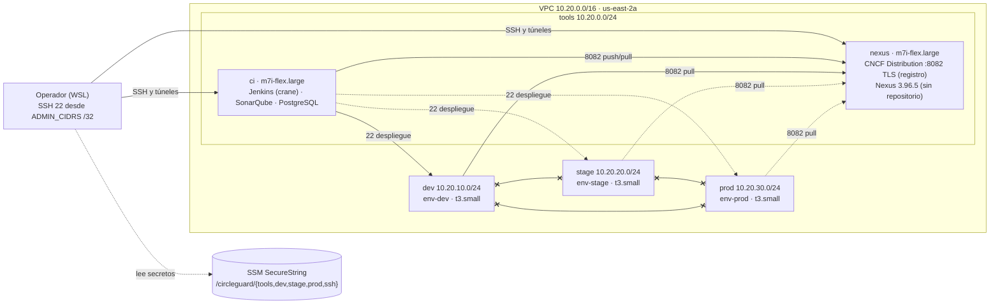

# Informe final de HU-01 · Infraestructura en la nube con Bash (Sprint 1, E1.2)

Actualizado: 2026-11-04, 00:30 UTC. Base: commit `3afca6f` de la rama
`HU01_Infraestructura_nube_bash` más los cambios locales sin confirmar descritos en la sección 9.

Estados de la matriz:
- **PASS:** implementación completa y evidencia verificable.
- **PARTIAL:** implementación o evidencia incompletas.
- **FAIL:** requisito incumplido.
- **BLOCKED:** requiere una autorización, una decisión o una dependencia externa.

Tipos de prueba:
- **Local:** Git Bash, WSL o Docker Desktop en la estación de trabajo, sin AWS.
- **Integración local:** contenedor Linux con Docker, sin VPC ni SSH reales.
- **AWS:** ejecución real en la cuenta del proyecto.

**Resultado: HU-01 NO está cerrada.**

| C1 | C2 | C3 | C4 | C5 | C6 |
|---|---|---|---|---|---|
| **PASS** | **PASS** | **PASS** | **PASS** | **BLOCKED** | **PASS** |

- C2 y la idempotencia de `bootstrap-env.sh` (C3) quedaron demostrados en AWS el 2026-11-03/04 con
  la prueba de aislamiento con tráfico, autorizada por el responsable (sección 11).
- Solo C5 sigue pendiente: depende del ensayo de otro integrante (sección 12).
- Ningún criterio está en FAIL.
- Coste acumulado estimado: 0.41 USD de 15.

## 1. Objetivo y alcance

**Objetivo (E1.2):** crear con scripts Bash idempotentes y Docker Compose:
- los servidores en la nube de Jenkins, SonarQube y el registro de artefactos;
- los ambientes `dev`, `stage` y `prod`, aislados entre sí;
- todo ello con las credenciales fuera del repositorio.

Criterios de aceptación:

| Criterio | Enunciado |
|---|---|
| C1 | Servidores en la nube para Jenkins, SonarQube y el registro de artefactos |
| C2 | `dev`, `stage` y `prod` aislados |
| C3 | `infra/bootstrap-*.sh` idempotentes |
| C4 | Credenciales de `docker-compose.dev.yml` fuera del repositorio |
| C5 | Bash y Docker Compose, sin configuración manual no documentada |
| C6 | Credenciales fuera del repositorio, con un mecanismo seguro |

**Dentro del alcance:**
- red, IAM y secretos;
- servidores `ci` y `nexus`, y un servidor `t3.small` por ambiente;
- Jenkins, SonarQube, el registro CNCF Distribution y su integración con Jenkins;
- pruebas de idempotencia, de recuperación y de aislamiento;
- parada y destrucción.

**Fuera del alcance:**
- **Despliegue de los servicios núcleo en los ambientes (E1.5):** HU-01 entrega los ambientes
  aislados y aprovisionados, sin aplicaciones (sección 15).
- **Pipelines (E1.3 y E1.4).**
- **Cambios en las migraciones de la base de datos (E2.6).**

## 2. Arquitectura

| Capa | Decisión | Detalle |
|---|---|---|
| Nube | AWS `us-east-2` (Ohio), zona `us-east-2a`. Cuenta independiente en el plan gratuito | La cuenta aparece siempre enmascarada (`****3303`) |
| Red | VPC `10.20.0.0/16` con Internet Gateway, sin NAT Gateway. Cuatro subredes `/24`: `tools` (`10.20.0.0`), `dev` (`10.20.10.0`), `stage` (`10.20.20.0`) y `prod` (`10.20.30.0`) | 5 grupos de seguridad y 31 reglas: 13 de entrada y 18 de salida ([S2](aws/idempotencia/S2.txt)) |
| Cómputo | `ci` y `nexus`, `m7i-flex.large`. Un `t3.small` por ambiente | Sección 4 |
| Registro | **CNCF Distribution 3.0.0** en el servidor `nexus` (decisión definitiva) | Sección 6 |
| Secretos | SSM Parameter Store, SecureString: 36 parámetros | Sección 8 |
| Identidad | Roles IAM de lectura, operación y destrucción, con MFA y sesiones temporales. Sin claves permanentes | Sección 13 |
| Plano de control | Estación de trabajo con WSL Ubuntu y los scripts `infra/*.sh` | Los scripts leen SSM y configuran los hosts por SSH. Las UIs solo son accesibles por túnel |

Decisiones registradas:
- [registro de artefactos](../../arquitectura/registro-artefactos.md);
- [infraestructura y ambientes](../../arquitectura/infra-ambientes.md);
- [EULA de Nexus](16-nexus-eula.md).

## 3. Diagrama

Versión resumida. El diagrama completo, con todas las reglas, está en
[infra-ambientes.md](../../arquitectura/infra-ambientes.md).



Leyenda:
- **Línea continua:** tráfico verificado en AWS (2026-11-03 y 2026-11-03/04).
- **Línea punteada:** la misma regla de grupo de seguridad que la línea continua equivalente de
  `dev`. Está verificada por reglas; no se probó con tráfico desde `stage` ni `prod`.
- **`x--x`:** bloqueado, verificado con tráfico en los dos sentidos. Ningún grupo de seguridad
  permite tráfico entre ambientes.

## 4. Servidores

| Servidor | Tipo | Disco | Software | Estado (2026-11-04, 00:21 UTC) |
|---|---|---|---|---|
| `circleguard-ci` | `m7i-flex.large` (2 vCPU, 8 GiB) | 30 GiB gp3 cifrado | Jenkins 2.580.2 LTS (JDK 21, JCasC, `crane` 0.22.1), SonarQube 26.10.0 Community y PostgreSQL 16.15 | **Detenido** (con volumen) |
| `circleguard-nexus` | `m7i-flex.large` (2 vCPU, 8 GiB) | 25 GiB gp3 cifrado | CNCF Distribution 3.0.0 y Nexus Repository 3.96.5 (sin EULA) | **Detenido** (con volumen) |
| `circleguard-env-dev`, `-stage`, `-prod` | `t3.small` (2 vCPU, 2 GiB) | 10 GiB gp3 cifrado | Docker 29.9.3, Compose 5.7.0, parada automática, swap y `.env` del ambiente | **Creados el 2026-11-03/04 por la prueba de aislamiento y detenidos** (con volumen) |

Comunes a todos:
- AMI Ubuntu 24.04 de Canonical fijada (`ami-0fc53b217ec1ad816`). La política del operador solo
  permite lanzar esa AMI.
- IMDSv2 obligatorio, sin rol IAM de instancia y con 2 GiB de swap.
- Parada automática a las 4 h del arranque (temporizador systemd), y parada obligatoria al final
  de cada prueba.
- Etiquetas `Project`, `Story`, `ManagedBy`, `Role` y `Environment`.

Cuota de vCPU:
- **Cuota real:** 16 vCPU ([lectura del 2026-11-03](auditoria/20261103T201403Z-bootstrap-quota.txt)).
- **Límite que aplica `bootstrap-servers.sh`:** `QUOTA_VCPU_LIMIT=5`, un límite conservador del
  equipo. Por eso los servidores se encienden de dos en dos (4 vCPU).
- **Necesario con los cinco encendidos:** `QUOTA_VCPU_TARGET=10`.

## 5. Separación de ambientes

Cada ambiente tiene recursos propios:

| Recurso | `dev` | `stage` | `prod` |
|---|---|---|---|
| Subred | `10.20.10.0/24` | `10.20.20.0/24` | `10.20.30.0/24` |
| Grupo de seguridad | `sg-env-dev` | `sg-env-stage` | `sg-env-prod` |
| Par de llaves SSH | `circleguard-dev` | `circleguard-stage` | `circleguard-prod` |
| Secretos (SSM) | `/circleguard/dev/*` (9) | `/circleguard/stage/*` (9) | `/circleguard/prod/*` (9) |
| Configuración | `infra/config/envs/dev.env` | `stage.env` | `prod.env` |
| Servidor | `env-dev` | `env-stage` | `env-prod` |

Reglas:
- **Permitido:** `ci → ambiente:22` (despliegue) y `ambiente → nexus:8082` (descarga de
  imágenes); salida 80/443.
- **Bloqueado:** cualquier tráfico entre ambientes, y de los ambientes hacia Jenkins (8080) y
  SonarQube (9000).
- **Credenciales:** cada host recibe solo las de su ambiente, en un `.env` 0600 de root.

Verificado:
- **En AWS el 2026-11-02:** 15 comprobaciones de configuración en PASS: ninguna regla entre
  ambientes y solo referencias a `ci` y `nexus` ([evidencia 14](14-despliegue-aws-fase4.md) §8).
- **En AWS el 2026-11-03:** `verify-infra.sh --isolation` en PASS, incluido `ci → registro:8082`
  ([isolation.txt](aws/idempotencia/isolation.txt)).
- **En AWS el 2026-11-03/04, con tráfico real** entre los servidores de ambiente
  ([aws/aislamiento/](aws/aislamiento/README.md), sección 11):
  - los 6 flujos entre ambientes, bloqueados;
  - los permitidos (`ci → env-dev:22` y `env-dev → nexus:8082`) en PASS;
  - cada host con solo el `.env` de su ambiente.

## 6. Registro de artefactos: CNCF Distribution

**Decisión definitiva del equipo** ([registro-artefactos.md](../../arquitectura/registro-artefactos.md)):
- el registro principal es CNCF Distribution 3.0.0 (Apache 2.0);
- **el EULA de Nexus Community Edition no se acepta.** Nexus queda instalado como componente sin
  repositorio operativo: no se crean el repositorio `circleguard-docker`, el realm DockerToken ni
  cambios de acceso anónimo;
- nada depende de Nexus.

| Aspecto | Implementación |
|---|---|
| Ubicación | Servidor `nexus`, puerto 8082. El conector Docker de Nexus se movió a `127.0.0.1:18082` para liberar el puerto |
| TLS | Certificado EC P-256 autofirmado, generado en el host por `prepare.sh` antes de arrancar el contenedor |
| Autenticación | `htpasswd` bcrypt con un usuario, `ci`. La contraseña está en SSM (`/circleguard/tools/registry/REGISTRY_CI_PASSWORD`) |
| Clientes | Docker: `insecure-registries` limitado a la subred `tools`. `crane --insecure`: cifra, pero no autentica el servidor (sección 15) |
| Persistencia y salud | Volumen propio; *healthcheck* por el puerto de depuración `127.0.0.1:5001` |
| Rotación | `rotate-registry-password.sh`: SSM, registro y Jenkins, con verificación y recuperación. Probada en local; no ejecutada en AWS |

Evidencia en AWS (2026-11-03, [registry.txt](aws/idempotencia/registry.txt)):
- `PASS registry: el usuario ci publica y descarga una imagen (ci -> 10.20.0.221:8082)`;
- `PASS registry: Jenkins (contenedor cg-jenkins) se autentica, publica y descarga con crane`;
- tras reiniciar los contenedores, el registro vuelve a estar sano
  ([health-after-restart.txt](aws/idempotencia/health-after-restart.txt)).

Sobre el PENDING de esa salida:
- Es la comprobación del EULA en el texto del commit `3afca6f`. La decisión ya es definitiva: con
  el código actual, `verify-infra.sh` informa de ella como PASS y `configure.sh` como UNCHANGED
  ([prueba local, 19/19](auditoria/20261103T230202Z-decision-eula-local.txt)).
- Ese cambio todavía no se ha ejecutado en AWS.

## 7. Integración de Jenkins con el registro (`crane`)

- **Imagen:** `circleguard-jenkins:2.580.2-lts-jdk21-casc2144-crane0.22.1`, construida en el host.
  - Incluye `crane` (go-containerregistry v0.22.1, Apache 2.0) con su sha256 fijado
    (`0ab7a1d6…4cda0`).
  - No monta el socket de Docker.
- **Credenciales:** `REGISTRY_ADDRESS`, `REGISTRY_CI_USER` y `REGISTRY_CI_PASSWORD`, en el `.env`
  0600 del *stack*, generado desde SSM.
- **Prueba:** desde el contenedor `cg-jenkins`, `crane` se autentica, publica una imagen, la
  descarga y compara el *digest*.
  - **AWS:** PASS el 2026-11-03.
  - **Integración local:** PASS el 2026-11-03 a las 04:15
    ([integración local](auditoria/20261103T041534Z-integracion-local-hu01.txt) §4).
- **Persistencia:** el contenedor se recreó con la nueva imagen y el volumen `jenkins_home` es
  anterior a la prueba: PASS en [report.txt](aws/idempotencia/report.txt).

## 8. Gestión de secretos

| Mecanismo | Detalle |
|---|---|
| Almacén | SSM Parameter Store, SecureString: 36 parámetros (`tools` 5, `dev` 9, `stage` 9, `prod` 9, `ssh` 4) ([S2](aws/idempotencia/S2.txt)) |
| Generación | `bootstrap-secrets.sh` crea los que faltan y no sobrescribe los existentes: `unchanged=44` en la 2.ª ejecución |
| Transporte | Los valores viajan por stdin y SSH. Nunca aparecen como argumentos ni en la salida; solo se muestran nombres, versiones y hashes |
| En los hosts | `.env` 0600 de root por *stack*. Sus hashes se omiten en las evidencias (`<hash omitido>`) |
| Llaves SSH | Una por ambiente y otra para las herramientas. Su copia de custodia está en SSM, y el ensayo las restaura desde allí |
| Repositorio | `docker-compose.dev.yml` con `${VAR:?}` y sin valores (commit `3a43855`), `.env.example` vacío y `.gitignore` para `.env`, `operator.local.env`, `infra/logs` e `infra/security/reports` |
| Escaneo | Gitleaks v8.30.1: **0 ACTIVO** en el árbol de trabajo. En el historial, 51 HISTÓRICO, que se consideran comprometidos y no se reutilizan ([árbol](auditoria/20261104T002645Z-worktree-summary.txt), [historial](auditoria/20261104T002645Z-history-summary.txt)) |
| Evidencias | Copias enmascaradas por `cg_mask_evidence` y comprobadas con `infra/check-evidence.sh`: 0 hallazgos en [`aws/idempotencia/`](aws/idempotencia/README.md) y en [`aws/aislamiento/`](aws/aislamiento/README.md) |
| Por ambiente | Cada host de ambiente recibió solo su `.env` (`.env pertenece al ambiente`, 0600 root): PASS en AWS en los tres |

## 9. Scripts

`bash infra/bootstrap-all.sh --apply --approve ci,nexus` es el **comando único**. Ejecuta, en
orden:
1. red;
2. secretos;
3. servidores;
4. Jenkins;
5. SonarQube;
6. Nexus;
7. registro;
8. verificación.

Convenciones de todos los scripts ([infra/README.md](../../../infra/README.md)):
- `--plan` por defecto.
- `--apply` para cambiar, y `--approve <rol>` para lo que se factura.
- Salida `CREATED`, `UPDATED`, `UNCHANGED` y `PLAN`, con un `SUMMARY` final. El registro de cada
  ejecución se guarda en `infra/logs/`.
- Las pruebas detienen siempre las instancias al salir (`trap`).

Cambios de esta revisión (sin confirmar):

| Archivo | Cambio |
|---|---|
| `infra/bootstrap/nexus/configure.sh`, `infra/verify-infra.sh`, `infra/bootstrap-nexus.sh` | El EULA no aceptado deja de presentarse como decisión pendiente. Es UNCHANGED y PASS mientras el registro sea CNCF Distribution; solo queda PENDING con `REGISTRY_BACKEND=nexus` |
| `infra/test-idempotency.sh` | **Defecto corregido:** las copias `masked/` se hacían antes de escribir `RESULTADO` y la parada en `report.txt`. Ahora se hacen al final e incluyen `stop.txt`. El texto de la duración indica lo que mide realmente |
| `infra/test-isolation.sh` | Comprueba también la idempotencia de `bootstrap-env.sh` en cada host. Mensajes: límite de vCPU frente a la cuota |
| `infra/bootstrap-servers.sh`, `infra/config/aws.env` | Distinguen el límite configurado (5) de la cuota real (16) |
| `infra/check-evidence.sh` (nuevo) | Comprobación de solo lectura, sin AWS, de una carpeta de evidencias antes de versionarla |

Pruebas ejecutadas en esta revisión y en las anteriores:

| Prueba | Tipo | Fecha (UTC) | Resultado | Evidencia |
|---|---|---|---|---|
| Sintaxis `bash -n` de los 34 scripts | Local | 2026-11-04 00:28 | 34/34 | [validaciones](auditoria/20261104T002821Z-validaciones-locales-hu01.txt) |
| ShellCheck v0.11.0 `-x -S style` | Local | 2026-11-03 23:10 | 0 hallazgos en 34 scripts; control positivo SC2086 detectado | [ShellCheck](auditoria/20261103T231008Z-shellcheck-hu01.txt) |
| Comprobaciones unitarias: roles, guarda de vCPU, orden del registro, Compose, `bootstrap-env` y planes | Local | 2026-11-03 23:10 | 40/40 | [unitarias](auditoria/20261103T231039Z-comprobaciones-unitarias-hu01.txt) |
| Decisión del EULA (`configure.sh` contra una API simulada y la rama de `verify-infra.sh`) | Local | 2026-11-03 23:02 | 19/19 | [EULA](auditoria/20261103T230202Z-decision-eula-local.txt) |
| Orden de las copias enmascaradas | Local | 2026-11-03 23:05 | 7/7 | [orden](auditoria/20261103T230549Z-orden-evidencias-local.txt) |
| `check-evidence.sh`: carpeta real y control negativo | Local | 2026-11-03 22:52 | 0 hallazgos en la real; 6 categorías y el valor ficticio detectados | [check-evidence](auditoria/20261103T225236Z-check-evidence.txt) |
| Gitleaks: árbol de trabajo e historial | Local | 2026-11-04 00:26 | ACTIVO=0 en 467 archivos; historial de 24 commits: 51 HISTÓRICO, 13 PRUEBA, 4 RESIDUAL | [árbol](auditoria/20261104T002645Z-worktree-summary.txt), [historial](auditoria/20261104T002645Z-history-summary.txt) |
| Compose, enlaces, `git diff --check` y archivos sensibles | Local | 2026-11-04 00:28 | 5 Compose válidos y rechazados sin variables; 204 enlaces sin errores; sin espacios finales; ningún archivo sensible versionado | [validaciones](auditoria/20261104T002821Z-validaciones-locales-hu01.txt) |
| Prerrequisitos de la estación de trabajo | Local (WSL) | 2026-11-03 16:28 | `pass=17 warn=1 fail=0` | [prerrequisitos](auditoria/20261103T162805Z-prerrequisitos-wsl.txt) |
| Secretos, registro (×4), `verify-infra`, Jenkins con `crane`, rotación y persistencia | Integración local | 2026-11-03 04:15 | 22/22 | [integración](auditoria/20261103T041534Z-integracion-local-hu01.txt) |
| `prepare.sh` y `configure.sh` del registro | Local | 2026-11-03 04:08 | 21/21 | [registro](auditoria/20261103T041534Z-prueba-local-registro.txt) |
| Despliegue paso a paso de red, IAM, secretos, `ci` y `nexus` | **AWS** | 2026-11-02 | PASS | [evidencia 14](14-despliegue-aws-fase4.md), [`fase4/`](fase4/) |
| **Idempotencia integral** con `test-idempotency.sh --apply --approve ci,nexus` | **AWS** | 2026-11-03 20:22-20:54 | `RESULTADO: IDEMPOTENTE` | [`aws/idempotencia/`](aws/idempotencia/README.md) |
| **Aislamiento con tráfico** con `test-isolation.sh --apply` (dos sesiones, autorizada) | **AWS** | 2026-11-03 23:41 → 2026-11-04 00:20 | `AISLAMIENTO VERIFICADO CON TRÁFICO`: fases 1-3 con 16/16 cada una, fase 4 con 3/3 y fase 5 con 2/2; `bootstrap-env.sh` idempotente | [`aws/aislamiento/`](aws/aislamiento/README.md) |
| Ensayo de reconstrucción por otro integrante | **AWS** | — | **No ejecutado** | [`aws/ensayo-nivel1/`](aws/ensayo-nivel1/README.md) |

Nota sobre la integración local: después de las 04:15 cambiaron `verify-infra.sh`,
`nexus/configure.sh` y los mensajes de otros scripts. Esos cambios tienen sus propias pruebas
locales (EULA y orden). Para el registro y Jenkins, la prueba en AWS del 2026-11-03 sustituye a la
integración local.

## 10. Evidencias de idempotencia

Prueba ejecutada por el responsable de la cuenta el 2026-11-03, sobre el commit `3afca6f`
([carpeta](aws/idempotencia/README.md)):

| Paso | Resultado | Archivo |
|---|---|---|
| S0, punto de partida | 2 instancias detenidas | [S0](aws/idempotencia/S0.txt) |
| run1 (`bootstrap-all.sh`) | Inicia `ci` y `nexus`; despliega el registro; recrea Jenkins (imagen con `crane`) y Nexus (puerto del conector); crea el secreto del registro | [run1](aws/idempotencia/run1.txt), [diff S0-S1](aws/idempotencia/diff-S0-S1.txt) |
| S0 → S1 | Red y llaves sin cambios; 1 parámetro SSM nuevo | [report](aws/idempotencia/report.txt) |
| **run2 (`bootstrap-all.sh`)** | **`created=0 updated=0 unchanged=137 planned=4`**, en 560 s. Ninguna línea CREATED ni UPDATED | [run2](aws/idempotencia/run2.txt) |
| **diff S1 S2** | **Vacío** | [diff S1-S2](aws/idempotencia/diff-S1-S2.txt) |
| Registro | `ci` y Jenkins publican y descargan | [registry](aws/idempotencia/registry.txt) |
| Recuperación | Reinicio de todos los contenedores: salud 25 PASS, 0 FAIL, 1 PENDING (EULA); **diff S2 S3 vacío** | [health](aws/idempotencia/health-after-restart.txt), [diff S2-S3](aws/idempotencia/diff-S2-S3.txt) |
| Persistencia | Ninguna contraseña de fábrica se reemplazó de nuevo; `jenkins_home` conservado; SonarQube y Nexus usan la contraseña gestionada | [report](aws/idempotencia/report.txt) |
| Parada | `no hay instancias de circleguard en ejecución` | [stop](aws/idempotencia/stop.txt) |
| **Resultado** | **`RESULTADO: IDEMPOTENTE (todas las comprobaciones en PASS)`**. Duración: 1889 s desde la confirmación; servidores encendidos ≈ 26 min | [report](aws/idempotencia/report.txt) |

Las 4 líneas `planned` de run2:
- 3 son los servidores de ambiente, que no se aprobaron en esa prueba;
- 1 es el EULA de Nexus. Con el código actual, este pasa a UNCHANGED (`planned=3`).

**Qué no cubre:**
- `bootstrap-env.sh`, porque no había servidores de ambiente. Su idempotencia se demostró en la
  prueba de aislamiento (sección 11).
- La reconstrucción desde cero en una cuenta vacía (sección 15).

## 11. Prueba de aislamiento con tráfico

**Estado: ejecutada en AWS el 2026-11-03/04. Resultado: `AISLAMIENTO VERIFICADO CON TRÁFICO (todas
las comprobaciones en PASS)` en las dos sesiones** ([evidencias](aws/aislamiento/README.md)).
- **Autorización:** la dio de forma explícita el responsable de la cuenta.
- **MFA:** la escribió el responsable solo en la página oficial de AWS, una vez por sesión.
- **Cobertura:** C2 y la idempotencia de `bootstrap-env.sh` (C3).

| Sesión (UTC) | Fases | Resultado | Duración |
|---|---|---|---|
| 2026-11-03 23:41 → 2026-11-04 00:05 | 1, 2 y 3 | 16/16 PASS por fase; `bootstrap-env.sh` sin cambios en su 2.ª ejecución en dev, stage y prod | 1427 s |
| 2026-11-04 00:08 → 00:20 | 4 y 5 | 3/3 y 2/2 PASS; `bootstrap-env.sh` dev sin cambios | 716 s |

| Flujo | Esperado | Resultado en AWS |
|---|---|---|
| dev ↔ stage, dev ↔ prod y stage ↔ prod (22, ambos sentidos: 6 flujos) | Bloqueado | **PASS** |
| `ci → env-dev:22` | Permitido | **PASS** |
| `env-dev → ci:8080` y `env-dev → ci:9000` | Bloqueado | **PASS** |
| `env-dev → nexus:8082` | Permitido | **PASS** |
| `nexus → env-dev:22` | Bloqueado | **PASS** |
| En cada host: Docker, parada automática, swap y `.env` propio 0600 de root | Presentes | **PASS** |

Otros resultados:
- **Red:** en la sesión 1 se movió la regla del puerto 22 a la IP nueva del operador en los 5 grupos
  de seguridad (`updated=10`); en la sesión 2, sin cambios.
- **Parada:** cada fase detuvo sus servidores. Una comprobación independiente de solo lectura, a
  las 00:21 UTC, mostró las 5 instancias `stopped`.
- **Coste de la prueba:** ≈ 0.03 USD según el registro de costos local (estimado: ≤ 0.15), más el
  EBS de los nuevos volúmenes.

Comprobaciones de `test-isolation.sh` hechas antes, sin AWS:

| Comprobación | Resultado |
|---|---|
| Plan | 5 fases de dos servidores y parada final obligatoria. `--phases` inválido se rechaza ([unitarias](auditoria/20261103T231039Z-comprobaciones-unitarias-hu01.txt)) |
| Guarda de vCPU | Cada fase usa ≤ 4 vCPU: cabe en el límite de 5 y en la cuota real de 16 |
| Idempotencia de `bootstrap-env.sh` | Una segunda ejecución con cambios da FAIL. Probado con registros de fases simulados |
| Copias enmascaradas | Se hacen en el `trap` de salida, después de la parada |
| Requisitos previos | La fase 5 necesita el registro desplegado (ya lo está, en su volumen). La prueba de idempotencia validó con `--dry-run` los permisos de creación de los servidores de ambiente |

| Fase | Servidores | Comprobaciones con `nc` desde los hosts |
|---|---|---|
| 1 | `env-dev` + `env-stage` | dev ↔ stage **bloqueado**; Docker, parada automática, swap y `.env` 0600 |
| 2 | `env-dev` + `env-prod` | dev ↔ prod **bloqueado** |
| 3 | `env-stage` + `env-prod` | stage ↔ prod **bloqueado** |
| 4 | `ci` + `env-dev` | `ci → env:22` **permitido**; `env → ci:8080/9000` **bloqueados** |
| 5 | `nexus` + `env-dev` | `env → nexus:8082` **permitido**; `nexus → env:22` **bloqueado** |

Procedimiento seguido, desde WSL en la raíz del repositorio. La MFA se escribe solo en la página
oficial de AWS.

```bash
bash infra/test-isolation.sh                          # plan, sin AWS
bash infra/aws-session.sh login operator              # sesión 1 (MFA en la página de AWS)
bash infra/test-isolation.sh --apply --phases=1,2,3   # escribir: PROBAR AISLAMIENTO
bash infra/aws-session.sh login operator              # sesión 2
bash infra/test-isolation.sh --apply --phases=4,5
```

| Aspecto | Valor |
|---|---|
| Duración | Sesión 1: ≈ 30-35 min. Sesión 2: ≈ 20-25 min. El script aborta y detiene todo a los 50 min |
| Coste | ≈ 0.15 USD de horas de instancia, más 0.079 USD/día por los 30 GiB de EBS de los ambientes mientras existan |
| Qué crea | 3 instancias `t3.small` y sus 3 volúmenes. Quedan detenidos hasta la destrucción final |
| Riesgo | Bajo: las fases se detienen al terminar y al fallar. No modifica IAM, la VPC ni las cuotas. Solo actualiza la regla 22 si cambió la IP del operador |

Evidencia:
- Las dos carpetas `masked/` están en [`aws/aislamiento/`](aws/aislamiento/README.md), con el
  sha256 de los originales y los tres criterios de PASS cumplidos.
- `bash infra/check-evidence.sh` da `hallazgos=0` en las dos.

## 12. Ensayo de reconstrucción

**Estado: no realizado.** Cubre C5: otra persona reproduce el resultado solo con la documentación.
Ningún integrante ha hecho el ensayo y este informe no lo simula.

| Aspecto | Detalle |
|---|---|
| Quién | Un integrante distinto del responsable («B») |
| Dónde | Su WSL, sin `~/.circleguard` ni `~/.ssh/circleguard` |
| Identidad (opción A) | B ejecuta todos los comandos. El responsable escribe el usuario, la contraseña y la MFA del operador en la página de AWS, compartiendo pantalla. Nada se envía por chat |
| Pasos | Clon; `check-prerequisites.sh` (`fail=0`); sesión; `bootstrap-secrets.sh --apply` (restaura las llaves desde SSM); `bootstrap-all.sh --plan`; `test-idempotency.sh --apply --approve ci,nexus` |
| Coste y duración | ≤ 0.21 USD; ≈ 30 min de preparación y ≈ 45 min de prueba |
| Entregables | En [`aws/ensayo-nivel1/`](aws/ensayo-nivel1/README.md): las salidas, la copia `masked/` y `ACTA.md`, que parte de la [plantilla](ensayo-reconstruccion/ACTA-PLANTILLA.md) |
| Criterios de PASS | [README del ensayo](ensayo-reconstruccion/README.md#criterios-para-declarar-c5-en-pass) |

El ensayo no destruye nada. El nivel 2, que destruye y reconstruye en AWS, no forma parte de HU-01
(sección 15).

## 13. Seguridad

| Área | Control | Evidencia |
|---|---|---|
| Identidad | 3 roles (lectura, operación y destrucción) con MFA y sesiones de 1 h. Usuarios sin claves permanentes. El operador no puede destruir. La destrucción se hace desde CloudShell con un usuario aparte | [06](06-iam-minimo-privilegio.txt), [10](10-iam-creacion-e-idempotencia.txt), [11](11-validacion-identidades.txt) |
| Políticas | Access Analyzer sin hallazgos. El simulador IAM no encontró escaladas. El lanzamiento de EC2 está limitado a la AMI fijada | [09](09-aws-preparacion-cuenta-e-iam.txt) |
| Red | Desde Internet solo se acepta el puerto 22, desde `ADMIN_CIDRS` (/32). Las UIs (8080, 9000, 8081) solo son accesibles por túnel SSH. El 8082 solo se abre a `ci` y a los ambientes. Sin tráfico entre ambientes (verificado con tráfico) | [infra-ambientes.md](../../arquitectura/infra-ambientes.md), [S2](aws/idempotencia/S2.txt), [aislamiento](aws/aislamiento/README.md) |
| Hosts | IMDSv2 obligatorio, EBS cifrado, sin rol de instancia y parada automática a las 4 h | [report](aws/idempotencia/report.txt) |
| Registro | TLS y autenticación bcrypt. Sin acceso anónimo | Sección 6 |
| Secretos | SSM SecureString, stdin, `.env` 0600 de root. Gitleaks con ACTIVO=0 | Sección 8 |
| Evidencias | Sin número de cuenta, IP públicas completas ni hashes de archivos secretos. Comprobadas con `check-evidence.sh` | [check-evidence](auditoria/20261103T225236Z-check-evidence.txt) |
| Coste | Guardas de presupuesto (15 USD), confirmación con frases explícitas y parada obligatoria | Sección 14 |

## 14. Costes

Estimaciones locales con los precios de referencia de `infra/config/aws.env` (2026-11-02). No son
la factura: esta llega a Billing con retraso. Los créditos no se cuentan como presupuesto.

| Concepto | USD |
|---|---|
| Presupuesto absoluto · línea de alerta | 15 · 12 |
| **Acumulado estimado** (registro de costos local, 2026-11-04 00:22 UTC: dos sesiones con `ci` y `nexus`, la prueba de aislamiento y el EBS) | **0.41** |
| Lo que factura ahora | 85 GiB de EBS (`ci` 30, `nexus` 25 y 3 × 10 de los ambientes): 0.224 USD/día. Las 5 instancias están detenidas |
| EBS hasta el 2026-11-22 (18 días) | ≈ 4.03 |
| Ensayo de reconstrucción (otro integrante) | ≤ 0.21 |
| Dos demostraciones de 3 h con `ci` y `nexus` | ≈ 1.25 |
| Reserva de transferencia de datos | 0.27 |
| **Previsto hasta el 2026-11-22** | **≈ 6.2** |
| Margen frente a 15 USD · frente a 12 USD | ≈ 8.8 · ≈ 5.8 |

`bootstrap-servers.sh` rechaza cualquier operación cuya estimación supere el presupuesto. Destruir
la infraestructura al terminar la evaluación detiene el coste del EBS.

## 15. Limitaciones y riesgos

| Limitación | Efecto | Tratamiento |
|---|---|---|
| TLS autofirmado sin autenticar el servidor (`insecure-registries`, `crane --insecure`) | El tráfico va cifrado, pero un atacante dentro de la VPC podría suplantar al registro | Limitado a la subred `tools` y a los grupos de seguridad. Mejora: una CA propia distribuida a los clientes |
| Un solo usuario del registro (`ci`), sin autorización por repositorio | Quien tenga la credencial puede publicar y borrar cualquier imagen | Credencial solo en SSM y en Jenkins, con rotación disponible |
| Etiquetas mutables en Distribution | Una etiqueta puede reescribirse | Los pipelines (E1.3/E1.4) deben desplegar por *digest* |
| Credenciales del registro como variables de entorno en Jenkins | Visibles para quien administre el contenedor o los *jobs* | Mejora: el almacén de credenciales de Jenkins (E1.3) |
| Nexus instalado sin repositorio operativo | Ocupa memoria en el servidor `nexus` sin dar servicio | Decisión del equipo; puede retirarse sin afectar al registro |
| 2 RESIDUAL de Gitleaks: comentarios de las migraciones Flyway V2/V3 con la contraseña de usuarios de prueba | No son secretos de infraestructura; riesgo si llegan a `stage` o `prod` | E2.6. Las migraciones aplicadas no se modifican |
| 51 HISTÓRICO en el commit inicial | Credenciales públicas en el historial | Se consideran comprometidas y no se reutilizan. El historial no se reescribe |
| Servicios núcleo en los tres ambientes (enunciado, p. 4) | Un `t3.small` (2 GiB) no basta. Con `ci` y `nexus`, sumarían 10 vCPU (caben en la cuota de 16) y ≈ 0.50 USD/h | Fuera de HU-01: E1.5 deberá ampliar el tamaño y `QUOTA_VCPU_LIMIT` |
| «Reconstruir desde cero con un comando» (rúbrica P1.2) | Demostrado: el comando único converge en AWS sobre la infraestructura existente, y la creación desde cero del 2026-11-02 se hizo paso a paso. **No demostrado:** destruir y reconstruir con un solo comando (nivel 2) | Destruiría datos de Jenkins y SonarQube, y requiere una decisión del equipo. Queda en PARTIAL |
| Rotación del registro | Probada solo en local | Puede ejecutarse en la demostración |
| Flujos permitidos de `stage` y `prod` (`ci → env:22`, `env → nexus:8082`) | Probados con tráfico solo desde `env-dev` (fases 4 y 5). En `stage` y `prod` son las mismas reglas, verificadas por configuración | Los bloqueos entre ambientes sí se probaron con tráfico en los tres |
| Sin copias de seguridad del EBS | Perder un volumen implica reconfigurar desde los scripts. Los secretos sobreviven en SSM | Aceptado para un entorno académico |
| Una sola zona de disponibilidad | Sin alta disponibilidad | Aceptado por coste |
| Un solo usuario operador, con la MFA del responsable | El ensayo de B necesita al responsable | Opción A del ensayo |
| Sesión MFA de 1 h | Las pruebas largas se dividen | Fases de `test-isolation.sh` y límite de 50 min |
| Evidencia del EULA con el texto de `3afca6f` | El PENDING ya no refleja la decisión | Explicado en la sección 6. El texto nuevo aparecerá en la próxima ejecución |

## 16. Matriz de cumplimiento

### Criterios de HU-01

| Criterio | Estado | Evidencia | Qué falta |
|---|---|---|---|
| C1 · Servidores en la nube para Jenkins, SonarQube y el registro | **PASS** | AWS 2026-11-02 ([14](14-despliegue-aws-fase4.md)). AWS 2026-11-03: registro, Jenkins con `crane` y salud 25/0/1 ([`aws/idempotencia/`](aws/idempotencia/README.md)) | Capturas (sin AWS para las de texto) |
| C2 · `dev`, `stage` y `prod` aislados | **PASS** | AWS 2026-11-03/04, con tráfico real: 6 flujos entre ambientes bloqueados; permitidos y bloqueos hacia `ci` y desde `nexus` en PASS ([`aws/aislamiento/`](aws/aislamiento/README.md)). Antes: reglas ([14](14-despliegue-aws-fase4.md) §8) | Capturas |
| C3 · `infra/bootstrap-*.sh` idempotentes | **PASS** | AWS 2026-11-03: 2.ª ejecución de `bootstrap-all.sh` con `created=0 updated=0 unchanged=137` y diffs vacíos ([run2](aws/idempotencia/run2.txt)). AWS 2026-11-03/04: 2.ª ejecución de `bootstrap-env.sh` con `created=0 updated=0` en dev, stage y prod ([`aws/aislamiento/`](aws/aislamiento/README.md)) | — |
| C4 · Credenciales de `docker-compose.dev.yml` fuera del repositorio | **PASS** | [commit 3a43855](auditoria/20261103T160739Z-commit-3a43855-credenciales.txt), [02](02-validacion-compose.txt) | — |
| C5 · Sin configuración manual no documentada | **BLOCKED** (otro integrante) | Instalación y prueba solo con scripts; pasos humanos documentados con su motivo ([infra/README.md](../../../infra/README.md)) | Ensayo de B (sección 12) |
| C6 · Credenciales con un mecanismo seguro | **PASS** | SSM, `.env` 0600, IAM con MFA, Gitleaks ACTIVO=0 (sección 8) | — |

### Sprint 1 (E1.2) y entrega

| # | Requisito (fuente) | Estado | Nota |
|---|---|---|---|
| 1 | Estructura `infra/bootstrap/` (p. 6) | **PASS** | `infra/bootstrap-*.sh` e `infra/bootstrap/{lib,host,jenkins,sonarqube,nexus,registry}/` |
| 2 | «Tres ambientes aislados» (P1.2) | **PASS** | Igual que C2: verificado con tráfico en AWS |
| 3 | «Reconstruyen Jenkins, SonarQube y registro desde cero con un comando» (P1.2) | **PARTIAL** | Comando único demostrado en AWS; reconstrucción destructiva no hecha (sección 15) |
| 4 | Servicios núcleo en los tres ambientes (p. 4) | **BLOCKED** (otra HU, E1.5) | Ambientes aprovisionados y aislados, sin aplicaciones |
| 5 | E1 · Salida del bootstrap | **PASS** | [run1](aws/idempotencia/run1.txt) y [run2](aws/idempotencia/run2.txt), además de [`fase4/`](fase4/) |
| 6 | E2 · Diagrama de ambientes | **PASS** | [infra-ambientes.md](../../arquitectura/infra-ambientes.md) y la sección 3 |
| 7 | E3 · Commit que elimina las credenciales | **PASS** | `3a43855` |
| 8 | E4 · Captura del escaneo de secretos | **BLOCKED** (manual, sin AWS) | [capturas/README.md](capturas/README.md) |
| 9 | Evidencias con capturas (p. 6 y p. 9, n.º 2) | **BLOCKED** (manual) | Las de texto se pueden tomar ya, sin AWS |
| 10 | Apagar o destruir tras la evaluación (p. 9, n.º 4) | **PASS** (mecanismo) | Parada verificada en AWS el 2026-11-02, el 2026-11-03 ([stop](aws/idempotencia/stop.txt)) y el 2026-11-03/04, en cada fase del aislamiento ([stops](aws/aislamiento/fases-1-3/stops.txt)). La destrucción final la hace el equipo |

## 17. Conclusión

HU-01 tiene la infraestructura construida y verificada en AWS:
- servidores y registro (C1);
- ambientes aislados, verificados con tráfico (C2);
- idempotencia del comando único y de `bootstrap-env.sh` (C3);
- credenciales seguras (C4 y C6).

Para cerrarla falta **el ensayo de reconstrucción de otro integrante** (C5). Quien prepara este
informe no puede suplirlo y no lo simula. Si da PASS, los seis criterios quedan en PASS. El coste
previsto (≈ 6.2 USD) cabe en 15 USD.

### Acciones del responsable de la cuenta

Siempre desde WSL. La MFA se escribe solo en la página de AWS.

| N.º | Acción | Comando | Coste |
|---|---|---|---|
| U1 | ~~Autorizar y ejecutar la prueba de aislamiento~~ **Hecho el 2026-11-03/04** | Sección 11 | ≈ 0.03 USD + EBS |
| U2 | ~~Copiar y comprobar las evidencias~~ **Hecho**; falta versionarlas con los commits | [aws/README.md](aws/README.md) | 0 |
| U3 | Tomar las capturas de texto, incluida la de C2 (no requieren AWS) | [capturas/README.md](capturas/README.md) | 0 |
| U4 | Acompañar el ensayo de B, escribiendo la MFA en la página de AWS | Sección 12 | ≤ 0.21 USD |
| U5 | Registrar con el equipo o el profesor el alcance de los ambientes frente a E1.5 | — | 0 |
| U6 | Revisar y confirmar los cambios, y publicar la rama | Anexo | 0 |
| U7 | Al terminar la evaluación, destruir la infraestructura desde CloudShell | [Detener o destruir](../../../infra/README.md#detener-o-destruir) | Detiene el gasto |

### Acciones de otro integrante

| N.º | Acción | Instrucciones |
|---|---|---|
| B1 | Ensayo de reconstrucción de nivel 1 y su acta | [ensayo-reconstruccion/README.md](ensayo-reconstruccion/README.md), con el mensaje listo para enviar |
| B2 | Capturas de su ejecución y revisión del informe PDF | [capturas/README.md](capturas/README.md) |

## Anexo · Commits sugeridos (no ejecutados)

Los hace el usuario. No se usa `git add .`: cada commit lista sus rutas. Antes del primero:
`bash infra/scan-secrets.sh --worktree`, que debe terminar en PASS.

| N.º | Mensaje | Contenido |
|---|---|---|
| 1 | `fix(nexus): registrar como definitiva la decisión de no aceptar el EULA` | `configure.sh`, `verify-infra.sh`, `bootstrap-nexus.sh`, `registro-artefactos.md`, evidencia 16 y su prueba local |
| 2 | `fix(test): copias enmascaradas completas y comprobación de evidencias` | `test-idempotency.sh`, el nuevo `check-evidence.sh` y sus pruebas locales |
| 3 | `fix(envs): distinguir el límite de vCPU de la cuota y comprobar bootstrap-env.sh` | `aws.env`, `bootstrap-servers.sh`, `test-isolation.sh` y la lectura de la cuota |
| 4 | `docs(hu-01): evidencias de las pruebas de idempotencia y aislamiento en AWS` | `aws/` (`README`, `idempotencia/`, `aislamiento/` con `fases-1-3/` y `fases-4-5/`, `ensayo-nivel1/`) |
| 5 | `docs(hu-01): informe final del Sprint 1, ensayo y validaciones locales` | `infra/README.md`, `infra-ambientes.md`, README de evidencias, este informe, `capturas/`, `ensayo-reconstruccion/` y las validaciones de `auditoria/` |
