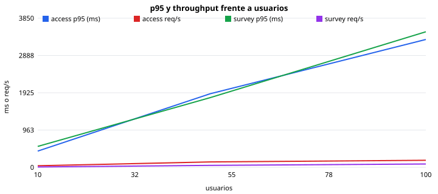

# Informe consolidado de rendimiento, seguridad dinámica, cobertura y calidad (HU-15 · E2.7)

**Fecha de las mediciones:** 2026-11-20 (UTC) · **Estado:** ejecutado en un ambiente **local aislado**; **no** en Jenkins ni en dev de AWS.
**Veredicto de rendimiento:** **ningún objetivo declarado se cumple a 100 usuarios** (causa y acciones en la sección 7). **Veredicto de ZAP:** 0 alertas High: la compuerta pasa con el umbral acordado (High) y bloquearía con umbral Medium.

## 1. Alcance y objetivos

Flujos críticos: validación de acceso (QR → `gateway`) y envío de cuestionarios (`form`), más un análisis pasivo de OWASP ZAP sobre el cliente web.
Los objetivos se declararon antes de medir ([targets.json](../../../tests/performance/targets.json), [pruebas-avanzadas.md](../../operacion/pruebas-avanzadas.md) §1) y no se cambiaron:

| Solicitud medida | p95 | Throughput | Errores |
|---|---|---|---|
| `POST /gateway/gate/validate` | ≤ 300 ms | ≥ 200 req/s | < 1 % |
| `POST /form/surveys` | ≤ 800 ms | ≥ 50 req/s | < 2 % |

## 2. Ambiente y versión probada

| Elemento | Valor |
|---|---|
| Ambiente | Docker Compose local, proyecto aislado (`circleguard-hu14val`), credenciales aleatorias fuera del repositorio. **No es producción ni AWS** |
| Versión | commit `490ae12` más cambios sin confirmar de HU-12/HU-14/HU-15 (entre ellos la lectura de la configuración LDAP de `auth`); imágenes `1.0.0-hu12ldap` (8 servicios + web) |
| Servidor | Windows 11, 8 núcleos lógicos, 7,5 GB de RAM compartidos con el propio equipo de desarrollo (no es un servidor dedicado) |
| Límites por contenedor | 0,5 CPU en `auth`, `gateway`, `form`, `identity`, `file`, `notification`, `promotion`; memoria 384 MiB (`auth`, `gateway`) a 512 MiB (`form`, `promotion`); 1 CPU para Kafka, Neo4j y Postgres |
| Herramientas | Locust 2.32.5 y OWASP ZAP `stable`, ambos fijados por digest ([policy.env](../../../security/policy.env), [run-perf.sh](../../../tests/performance/run-perf.sh)) |
| Carga | 10, 50 y 100 usuarios, 5 min cada escalón, 10 usuarios/s, 20 s de calentamiento no evaluado; acceso a 2 iteraciones/s por usuario y cuestionario a 0,5/s |
| **Desviación del ambiente** | `QR_EXPIRATION=60000` en el contenedor `auth` (override de entorno local, fuera del repositorio). Sin él el QR dura 300 ms y la validación falla (hallazgo H1); el valor usado es el que el código toma por defecto y el que el cliente espera (60 s) |

## 3. Resultados de rendimiento

Fuente: [rendimiento/evaluation.md](rendimiento/evaluation.md) (corrida definitiva) y los CSV de Locust de esa carpeta. Latencias en ms.

| Solicitud | Usuarios | Peticiones | p50 | **p95** | Objetivo p95 | **Throughput** (req/s) | Objetivo | **Errores** | Objetivo | Cumple |
|---|---|---|---|---|---|---|---|---|---|---|
| `POST /gateway/gate/validate` | 10 | 5 195 | 21 | **200** | ≤ 300 | 18,2 | — (n/a) | 0,00 % | < 1 % | sí |
| `POST /gateway/gate/validate` | 50 | 18 752 | 57 | **400** | ≤ 300 | 65,9 | — (n/a) | 0,00 % | < 1 % | **no** (p95) |
| `POST /gateway/gate/validate` | 100 | 24 652 | 77 | **460** | ≤ 300 | **86,8** | ≥ 200 | 0,00 % | < 1 % | **no** (p95 y throughput) |
| `POST /form/surveys` | 10 | 1 411 | 47 | **620** | ≤ 800 | 5,0 | — (n/a) | 0,00 % | < 2 % | sí |
| `POST /form/surveys` | 50 | 6 970 | 290 | **1 100** | ≤ 800 | 24,6 | — (n/a) | 0,00 % | < 2 % | **no** (p95) |
| `POST /form/surveys` | 100 | 11 473 | 700 | **2 700** | ≤ 800 | **40,6** | ≥ 50 | 0,00 % | < 2 % | **no** (p95 y throughput) |
| `GET /auth/qr/generate` (informativa) | 100 | 24 688 | 670 | 2 500 | — | 86,9 | — | 0,00 % | — | — |
| `GET /form/questionnaires/active` (informativa) | 100 | 11 534 | 630 | 2 700 | — | 40,8 | — | 0,00 % | — | — |

El throughput solo se juzga en el escalón de referencia (100 usuarios): en los menores la carga ofrecida es menor que el objetivo por diseño. **La tasa de errores cumple en todos los escalones (0 %).**
La carga ofrecida a 100 usuarios fue 200 iteraciones/s de acceso y 50 envíos/s; el sistema sostuvo 86,8 y 40,6.

**Gráficas** (SVG, en [rendimiento/graficas/](rendimiento/graficas/)): p95 y throughput frente a usuarios ([users-vs-metrics.svg](rendimiento/graficas/users-vs-metrics.svg)); latencia p95 en el tiempo
([acceso 100](rendimiento/graficas/access-u100-latency.svg), [cuestionario 100](rendimiento/graficas/survey-u100-latency.svg)); throughput en el tiempo
([acceso 100](rendimiento/graficas/access-u100-throughput.svg), [cuestionario 100](rendimiento/graficas/survey-u100-throughput.svg)). Informes HTML de Locust: [acceso](rendimiento/access-u100.html), [cuestionario](rendimiento/survey-u100.html).

### Primera ejecución, descartada

Una primera corrida hacía el login dentro de cada usuario virtual. A 100 usuarios fallaron **55 de 100 logins** (503, p95 de 47 s) y esos usuarios no generaron carga, de modo que el throughput del acceso (67,3 req/s) no representaba 100 usuarios.
Se corrigió el escenario (un login compartido al inicio) y se repitió todo. Sus archivos se conservan en [rendimiento/primera-ejecucion-invalidada/](rendimiento/primera-ejecucion-invalidada/) porque exponen el hallazgo H4.

## 4. Seguridad dinámica (OWASP ZAP baseline)

Objetivo `http://web:8080` (cliente web de la pila local), rastreo de 1 minuto, análisis pasivo. Informes: [zap-report.html](zap/zap-report.html), [zap-report.json](zap/zap-report.json), [zap-report.md](zap/zap-report.md), [gate.txt](zap/gate.txt).

| Riesgo | Alertas distintas | Detalle |
|---|---|---|
| High | **0** | — |
| Medium | 2 | Content Security Policy (CSP) no definida; falta la cabecera anti-clickjacking |
| Low | 7 | Cross-Origin-Embedder/Opener/Resource-Policy ausentes, Permissions Policy ausente, `X-Content-Type-Options` ausente, «Dangerous JS Functions» (1), «Timestamp Disclosure - Unix» |
| Informational | 1 | Contenido almacenable en caché |

**Política de bloqueo:** umbral High (`ZAP_BLOCK_RISK`) → **PASS**. Con el umbral Medium el mismo informe da **FAIL** ([gate-umbral-medium.txt](zap/gate-umbral-medium.txt)), lo que demuestra que la compuerta bloquea.
ZAP baseline es pasivo y solo ve lo que el rastreador alcanza; no sustituye una prueba de penetración.

## 5. Cobertura de pruebas y calidad

Ejecutado en una copia sincronizada del árbol de trabajo (JaCoCo con la verificación de cobertura del build activa):

| Servicio | Líneas | Ramas |
|---|---|---|
| circleguard-auth-service | 98,6 % | 90,9 % |
| circleguard-dashboard-service | **2,7 %** | 0,0 % |
| circleguard-file-service | **46,7 %** | n/a |
| circleguard-form-service | 97,9 % | 60,5 % |
| circleguard-gateway-service | 100,0 % | 100,0 % |
| circleguard-identity-service | 98,1 % | 85,7 % |
| circleguard-notification-service | 67,4 % | 58,3 % |
| circleguard-promotion-service | 91,4 % | 65,3 % |
| **Total** | **85,4 %** | **59,9 %** |

Pruebas ejecutadas: **302, 0 fallos, 0 errores, 0 omitidas** (285 unitarias en los 8 servicios, 11 de integración entre servicios con Kafka/Postgres/Neo4j/Redis reales y 6 de integración de promotion).
Las pruebas de extremo a extremo con Playwright forman parte del pipeline y no se repitieron en esta ejecución. Las herramientas de seguridad tienen sus propias suites offline (`security/run-tests.sh`).
**Calidad de dependencias:** el escaneo de HU-14 sigue marcando las 8 bibliotecas de servicio con hallazgos CRITICAL/HIGH ya conocidos (Spring, ver [hu-14.md](../../seguridad/hu-14.md) fase 3b y 9).

## 6. Comparación con los objetivos y veredicto

| Objetivo | Resultado a 100 usuarios | Veredicto |
|---|---|---|
| Acceso: p95 ≤ 300 ms | 460 ms | **No cumple** |
| Acceso: ≥ 200 req/s | 86,8 req/s | **No cumple** |
| Acceso: errores < 1 % | 0,00 % | Cumple |
| Cuestionario: p95 ≤ 800 ms | 2 700 ms | **No cumple** |
| Cuestionario: ≥ 50 req/s | 40,6 req/s | **No cumple** |
| Cuestionario: errores < 2 % | 0,00 % | Cumple |
| Sistema: 100 usuarios, 5 min, sin degradación | Sin errores, **con degradación de latencia** | **No cumple** |
| ZAP: sin alertas High | 0 High | Cumple |

Los objetivos no se modificaron. La corrida es **de un ambiente pequeño y compartido** (ver limitaciones): demuestra que con esta configuración el sistema no alcanza los objetivos y por qué, no que no los alcanzaría con los recursos previstos para dev/stage.

## 7. Hallazgos, causas y acciones propuestas (ninguna aplicada al código del producto)

| # | Hallazgo | Evidencia | Causa | Acción propuesta |
|---|---|---|---|---|
| H1 | **El QR caduca a los 300 ms.** Con la configuración del repositorio la validación de acceso falló el 80,3 % (10 usuarios) y 26 de 40 tokens en una prueba secuencial | [hallazgo-qr/](hallazgo-qr/) | `qr.expiration: 300` en el `application.yml` de auth se interpreta en milisegundos (el valor por defecto del código es 60000 y el cliente espera 60 s) | Corregir el valor/unidad en auth (responsable de HU-04/auth); añadir una prueba que fije la expiración. Con `QR_EXPIRATION=60000` la validación acertó 40/40 y 0 % de errores en todos los escalones |
| H2 | **Acceso: p95 460 ms y 86,8 req/s a 100 usuarios.** La solicitud más lenta del flujo es la generación del QR (p95 2 500 ms), no la validación | tabla de la sección 3; [diagnóstico](rendimiento/diagnostico/stats-access.txt) | Durante la carga `auth` llegó al 68 % de CPU frente a un límite de 0,5 CPU y usó 362 de 384 MiB (94 %); `gateway` trabajó en el límite de CPU (50 %) | Subir CPU y memoria de `auth` y `gateway` en los ambientes reales, o escalar réplicas; perfilar la generación del QR (no se perfiló aquí) |
| H3 | **Cuestionario: p95 2 700 ms y 40,6 req/s.** Degrada desde 50 usuarios (p95 1 100 ms) | tabla de la sección 3; [diagnóstico](rendimiento/diagnostico/stats-survey.txt) | `form` al 60 % de CPU con un límite de 0,5. `GET /questionnaires/active` degrada igual (2 700 ms): la saturación es del servicio, no solo de la escritura | Subir recursos de `form`; revisar la carga del cuestionario activo y el pool de conexiones; repetir la medición |
| H4 | **El login no soporta una avalancha.** 55 de 100 logins simultáneos fallaron con 503 (p95 47 s) | [primera ejecución](rendimiento/primera-ejecucion-invalidada/) | BCrypt con 0,5 CPU y el tiempo de espera de 3 s hacia identity (el circuit breaker de HU-12 respondió 503 como debe) | Dimensionar `auth`/`identity` para la hora punta de entrada, o limitar la tasa de login; no se cambió el timeout |
| H5 | **ZAP: 2 Medium y 7 Low por cabeceras de seguridad ausentes en el cliente web** | [zap-report.html](zap/zap-report.html) | `mobile/nginx.conf` no define CSP, `X-Frame-Options` ni `X-Content-Type-Options` (el terminador TLS de HU-14 sí define HSTS, `X-Frame-Options` y `X-Content-Type-Options`) | Añadir las cabeceras en `mobile/nginx.conf` (HU-02) y repetir el análisis; con ellas el umbral podría bajarse a Medium |
| H6 | Cobertura baja en `dashboard-service` (2,7 %) y `file-service` (46,7 %) | sección 5 | Casi sin pruebas unitarias (2 y 3) | Escribir pruebas de esos servicios |
| H7 | Factor de confusión: Neo4j y Kafka consumieron 115–130 % de un núcleo durante toda la medición | [diagnóstico](rendimiento/diagnostico/) | JVM de infraestructura en el mismo equipo que Locust y los servicios | Repetir en un ambiente con recursos dedicados |

## 8. Limitaciones

- Ambiente pequeño, compartido y local, con límites de 0,5 CPU por servicio; **no es representativo de dev/stage de AWS** (HU-09/HU-10) ni del tamaño real de un campus.
- Un único usuario de prueba (el sembrado por la migración V3): todos los usuarios virtuales comparten el mismo `anonymousId` y el mismo JWT; las validaciones no ejercitan estados de salud distintos. Los envíos de cuestionario usan identificadores sintéticos y responden siempre NO.
- Locust y los servicios comparten la misma máquina: el generador de carga compite por CPU con lo que mide.
- El override `QR_EXPIRATION=60000` cambia la configuración respecto al repositorio (H1). El consumidor de promotion y el lag de Kafka no se midieron.
- ZAP baseline es pasivo y su rastreo dura 1 minuto.
- **Integración con Jenkins preparada pero no ejecutada:** [parche](../../../security/jenkins/Jenkinsfile-hu15-stages.patch) y pasos de la Shared Library verificados; no aplicados al Jenkinsfile (HU-11) y sin ejecución en un Jenkins.
