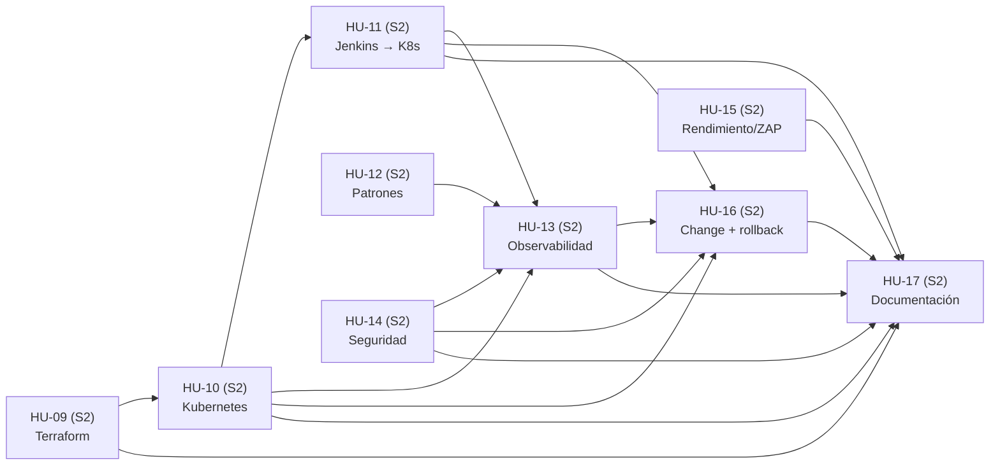

# Metodología ágil y cierre del Sprint 2

**Documento:** HU-17 (Sprint 2 · E2.9, criterios 4 y 5) y rúbrica C1
**Última actualización:** 2026-11-16
**Estado:** proceso definido y en ejecución. Las métricas de cierre (burndown y retrospectiva) se
completan al final del sprint; este documento deja el formato y los datos que ya existen.

## 1. Marco de trabajo

El equipo usa **Scrum ligero** con tablero Jira (proyecto *PIPELINE DEVOPS DE EXTREMO A EXTREMO
PARA CIRCLEGUARD*) y GitHub Flow con rama de integración `dev`.

| Elemento | Cómo se aplica |
|---|---|
| Sprint | 2 semanas; Sprint 2 inició el 2026-11-11 |
| Roles | 3 integrantes; el equipo rota la facilitación de ceremonias |
| Planificación | Historias de usuario en Jira con criterios de aceptación y evidencias |
| Daily | 10 min, tres preguntas: ayer, hoy, bloqueos |
| Refinamiento | Antes de tomar una HU se revisan dependencias y criterios |
| Revisión | Demo funcional al final del sprint (20–30 min) |
| Retrospectiva | Start / Stop / Continue + acciones con dueño y fecha |
| Tablero | `Por hacer` → `En curso` → `En revisión` → `Hecho` |

**Regla de WIP:** máximo **una HU en curso por persona**. Si una HU se bloquea por otra, se cambia a
una tarea que no dependa de ella; no se abren dos frentes.

## 2. Objetivo del Sprint 2

> Pasar de una entrega continua sobre Docker Compose a una plataforma **declarativa, orquestada,
> observable y gobernada**, con evidencia ejecutada de despliegue, rollback, seguridad y
> rendimiento.

El objetivo se evalúa con la rúbrica del entregable 2 (25 % de la nota final). Los pesos orientan
la prioridad: observabilidad y patrones (4 % cada uno), Terraform (4 %), documentación y metodología
(4 % combinadas), pruebas (2.5 %), seguridad (2 %), Kubernetes (2 %), CI/CD (1 %), cambio y rollback
(0.5 %), presentación (1 %).

## 3. Alcance y responsables

| HU (S2) | Jira | Tema | Responsable | Peso rúbrica | Estado 16-nov |
|---|---|---|---|---|---|
| HU-09 (S2) | PDDZ-64 | Terraform con módulos y backend remoto | Juan Esteban | 4 % | Por hacer |
| HU-10 (S2) | PDDZ-65 | Kubernetes: 8 servicios + middleware | Juan Esteban | 2 % | Por hacer |
| HU-11 (S2) | PDDZ-66 | Jenkins → Kubernetes, Trivy, aprobación | Juan Esteban | 1 % | Por hacer |
| HU-12 (S2) | PDDZ-67 | Patrones de diseño (3 nuevos) | Matt Lane | 4 % | En curso (PR #14 mergeado) |
| HU-13 (S2) | PDDZ-68 | Observabilidad centralizada | Sebastian Cosme | 4 % | En curso |
| HU-14 (S2) | PDDZ-69 | Seguridad: Trivy, RBAC, TLS, secretos | Matt Lane | 2 % | Por hacer |
| HU-15 (S2) | PDDZ-70 | Locust + OWASP ZAP | Matt Lane | 2.5 % | Por hacer |
| HU-16 (S2) | PDDZ-71 | Change management y rollback K8s | Sebastian Cosme | 0.5 % | En curso |
| HU-17 (S2) | PDDZ-72 | Documentación completa + resumen en inglés | Sebastian Cosme | 2 % + C1 2 % | En curso |
| — | PDDZ-73 | Revisar pipeline del Sprint 1 | Juan Esteban | — | Por hacer |
| — | PDDZ-74 | Vincular GitHub al Kanban | Matt Lane | — | Por hacer |

> **Nota de nomenclatura (D-32):** la HU-09 del Sprint 1 era *branching*; la HU-09 del Sprint 2 es
> *Terraform*. En documentos se escribe `HU-09 (S1)` o `HU-09 (S2)`.

### 3.1 Grafo de dependencias

## 4. Flujo de una historia

1. **Refinamiento:** se leen los criterios de aceptación y se identifican dependencias.
2. **Rama:** `HU-NN_descripcion` desde `dev` actualizado.
3. **Commits:** Conventional Commits (`feat`, `fix`, `docs`, `test`, `ci`).
4. **PR a `dev`:** plantilla con criterios, evidencias y riesgos; una revisión mínima.
5. **Pipeline:** `commit-lint` + Jenkins; el merge no se hace con el build rojo.
6. **Evidencia:** se guarda en `docs/evidencias/hu-NN/` y se enlaza en Jira y en el PR.
7. **Cierre:** se actualiza la documentación de la HU y el estado en Jira.

### 4.1 Definition of Done

- [ ] Los criterios de aceptación tienen evidencia verificable (comando, captura o archivo).
- [ ] El pipeline pasa (o `UNSTABLE` justificado y documentado).
- [ ] Las pruebas nuevas cubren el cambio y no bajan la cobertura del 60 %.
- [ ] La documentación de la HU está actualizada y enlazada en `docs/README.md`.
- [ ] No hay secretos ni datos personales en el diff.
- [ ] Otro integrante revisó el PR.
- [ ] La HU está en `Hecho` en Jira con el enlace al PR y a la evidencia.

## 5. Métricas del sprint

### 5.1 Flujo acumulado (por estado)

Se exporta de Jira al cierre. La tabla se llena con el histórico de transiciones:

| Día | Por hacer | En curso | En revisión | Hecho | Total |
|---|---:|---:|---:|---:|---:|
| 11-nov (inicio) | 11 | 0 | 0 | 0 | 11 |
| 16-nov | 6 | 4 | 1 | 0 | 11 |
| 20-nov | | | | | |
| Cierre | | | | | |

**Lectura esperada:** el trabajo se mueve de izquierda a derecha sin acumularse en “En revisión”.
Si “En revisión” crece, el cuello de botella es la revisión, no el desarrollo.

### 5.2 Burndown

Jira no tiene estimaciones en puntos (el campo aparece como “Desconocido”). Para no inventar
números, el equipo usa **conteo de historias** y, si se acuerdan puntos, se registran aquí antes de
la primera daily:

| Día | Historias restantes | Puntos restantes (si aplica) | Nota |
|---|---:|---:|---|
| 11-nov | 11 | — | Inicio |
| 12-nov | 11 | — | Planificación |
| 16-nov | 7 | — | HU-12 mergeada; 3 en curso |
| 20-nov | | | |
| Cierre | 0 | — | Demo |

**Regla:** el burndown se actualiza al final de cada daily, no al final del sprint. Un burndown
reconstruido no demuestra nada.

### 5.3 Velocidad

| Sprint | Historias completadas | PRs mergeados | Observación |
|---|---:|---:|---|
| Sprint 1 | 9 (HU-01 a HU-09 S1) | #5–#13 | Base de CI/CD, pruebas y documentación |
| Sprint 2 | En curso | #14 | HU-12 integrada el 15-nov |

### 5.4 Métricas de calidad

| Métrica | Sprint 1 | Sprint 2 (objetivo) |
|---|---|---|
| Cobertura de líneas (5 servicios) | 90.9–100 % | Mantener ≥ 90 % |
| Pruebas unitarias | 269 | ≥ 269 sin regresiones |
| Pruebas de integración | 5 + 6 promotion | Mantener + DLT |
| E2E | 2 humo | 3 flujos (login, cuestionario, acceso) en dev/stage |
| Builds exitosos | #10, #18, #19, #21 | Pipeline estable en `dev` |
| Hallazgos de seguridad | 0 secretos activos | 0 críticos de Trivy |

## 6. Revisión del sprint (agenda, 30 min)

| Min | Tema | Quién |
|---:|---|---|
| 0–3 | Objetivo y alcance | Facilitador |
| 3–8 | Arquitectura e infraestructura | Juan Esteban |
| 8–13 | Pipeline y despliegue en vivo | Juan Esteban |
| 13–18 | Patrones y seguridad | Matt Lane |
| 18–24 | Observabilidad y falla provocada | Sebastian Cosme |
| 24–27 | Resultados de rendimiento y lecciones | Matt Lane |
| 27–30 | Preguntas y cierre | Todos |

La revisión **no** es una presentación de diapositivas: se muestra el sistema funcionando. Las
diapositivas solo explican decisiones y trade-offs.

## 7. Retrospectiva (formato)

### 7.1 Start / Stop / Continue

| Start | Stop | Continue |
|---|---|---|
| Escribir la evidencia al cerrar cada criterio, no al final | Abrir una HU antes de que la dependencia esté mergeada | Revisión cruzada de PRs |
| Probar el rollback antes de la demo | Cambiar objetivos de rendimiento después de medir | Commits pequeños y Conventional Commits |
| Medir el costo antes de cada `apply` | Dejar capturas sin índice | Documentar hallazgos fuera de alcance |

### 7.2 Acciones con dueño

| Acción | Dueño | Fecha | Estado |
|---|---|---|---|
| Cerrar O1/O2 de HU-12 en Compose/K8s | Juan Esteban | 18-nov | Pendiente |
| Repetir la suite de HU-12 en Jenkins | Matt Lane | 18-nov | Pendiente |
| Captura de Billing al cierre | Sebastian Cosme | Cierre | Pendiente |
| Ensayo de la demo con falla provocada | Sebastian Cosme | 21-nov | Pendiente |
| Revisión de documentación por otra persona | Juan Esteban | Cierre | Pendiente |

### 7.3 Mejoras respecto al Sprint 1 (para la rúbrica C1)

| Mejora | Evidencia |
|---|---|
| El E2E pasó de 2 pruebas de humo a 3 flujos (login, cuestionario, acceso) | PR #13, `tests/e2e-playwright` |
| La cobertura es un gate bloqueante (≥ 60 %) | `jacocoTestCoverageVerification` |
| Los patrones de resiliencia y DLT están probados con fallas inyectadas | HU-12 |
| La documentación se organiza por criterio de rúbrica y estado | `docs/README.md` |
| El registro de cambios incluye digest y aprobación (propuesto) | D-30 |
| La revisión de HU-12 dejó observaciones accionables, no un “LGTM” | `docs/revisiones/hu-12-revision.md` |

**Lo que no mejoró todavía:** SonarQube no está conectado de extremo a extremo; el E2E no cubre
todos los flujos en stage; la infraestructura sigue en Bash hasta que HU-09 (S2) mergee. Se declara
en la retrospectiva, no se oculta.

## 8. Riesgos y bloqueos del sprint

| Riesgo | Impacto | Mitigación | Dueño |
|---|---|---|---|
| HU-09/10/11 son la ruta crítica de HU-13/HU-16 | Alto | Empezar HU-13 en Compose y portar a K8s; interfaces acordadas antes | Juan Esteban / Sebastian |
| El clúster de 2 vCPU no soporta todo | Alto | Réplicas 1, límites, apagar ambientes | Juan Esteban |
| Trivy/ZAP bloquean por ruido | Medio | Umbrales acordados y justificación documentada | Matt Lane |
| La demo en vivo falla por red/costo | Medio | Ensayo previo, grabación de respaldo, instancias encendidas 30 min antes | Sebastian |
| La documentación se actualiza al final | Medio | Estado por criterio y revisión semanal | Sebastian |

## 9. Evidencias de metodología

| Evidencia | Dónde |
|---|---|
| Tablero Jira (Sprint 2) | Captura `docs/evidencias/hu-17/01-jira-sprint2.png` |
| Flujo acumulado | §5.1 + export de Jira |
| Burndown | §5.2 + export de Jira |
| Revisión del sprint | Acta o grabación (enlace) |
| Retrospectiva | §7 + captura del tablero de acciones |
| Historial de PRs | GitHub → Pull requests #5–#14 |
| Commits | `git log --oneline --since=2026-11-11` |
