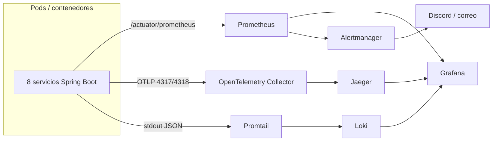

# Observabilidad centralizada — diseño y runbook (HU-13 · E2.5)

**Documento:** HU-13 (Sprint 2 · E2.5) y consolidación para HU-17 (E2.9)
**Última actualización:** 2026-11-16
**Estado:** **Pendiente de implementación.** Hoy no hay Actuator, Micrometer, OpenTelemetry ni
backend de métricas en el repositorio. Este documento es el contrato de lo que se va a implementar
y la guía de evidencia; se actualiza con capturas y resultados al cerrar la historia.

> Decisión de stack: [`../iag/decisiones.md`](../iag/decisiones.md) D-26, D-27 y D-28.

## 1. Objetivo y alcance

El criterio E2.5 pide cuatro cosas que se evalúan por separado:

| # | Criterio | Cómo se demuestra |
|---|---|---|
| 1 | Métricas con Micrometer y endpoints Prometheus | `/actuator/prometheus` responde en los servicios |
| 2 | Prometheus recopila periódicamente | Targets `UP` en `prometheus/targets` |
| 3 | Grafana con dashboards por servicio y de negocio | Captura de cada dashboard |
| 4 | ≥ 3 alertas críticas con umbral, condición y severidad | Alerta en `firing` + notificación |
| 5 | Trazas OpenTelemetry/Jaeger E2E | Una traza con los cuatro servicios |
| 6 | Propagación por Kafka | El `traceId` del mensaje coincide con el de la traza |
| 7 | Logs centralizados (ELK o Loki) | Consulta por `service`, `level` y `traceId` |
| 8 | Consultar métricas, trazas y logs para un incidente | Runbook §9 ejecutado |

**Fuera de alcance:** APM comercial, muestreo avanzado, retención de largo plazo. La retención es de
7 días para logs y 15 días para métricas (suficiente para la evaluación).

## 2. Arquitectura del stack



| Componente | Imagen | Puerto | Namespace |
|---|---|---|---|
| Prometheus | `prom/prometheus` | 9090 | `observability` |
| Alertmanager | `prom/alertmanager` | 9093 | `observability` |
| Grafana | `grafana/grafana` | 3000 | `observability` |
| Jaeger | `jaegertracing/all-in-one` | 16686 (UI), 4317/4318 (OTLP) | `observability` |
| OpenTelemetry Collector | `otel/opentelemetry-collector-contrib` | 4317/4318 | `observability` |
| Loki | `grafana/loki` | 3100 | `observability` |
| Promtail | `grafana/promtail` | — | `observability` |

En local se levanta con un `docker-compose.observability.yml`; en Kubernetes, con
`deploy/k8s/observability/`. El mismo `prometheus.yml` y los mismos dashboards se reutilizan para
no mantener dos verdades.

## 3. Instrumentación de los servicios

### 3.1 Dependencias (todos los servicios)

```kotlin
implementation("org.springframework.boot:spring-boot-starter-actuator")
implementation("io.micrometer:micrometer-registry-prometheus")
implementation("io.micrometer:micrometer-tracing-bridge-otel")
implementation("io.opentelemetry:opentelemetry-exporter-otlp")
```

En `auth` ya existe `resilience4j-circuitbreaker` (HU-12). Añadir
`io.github.resilience4j:resilience4j-micrometer` para exponer el estado del circuito sin tocar
`IdentityClient` (ya ofrece `getCircuitBreaker()`).

### 3.2 Configuración común (`application.yml`)

```yaml
management:
  endpoints:
    web:
      exposure:
        include: health,info,prometheus
  endpoint:
    health:
      probes:
        enabled: true
      show-details: when_authorized
  metrics:
    tags:
      application: ${spring.application.name}
      environment: ${ENVIRONMENT:dev}
  tracing:
    sampling:
      probability: ${TRACING_SAMPLE_RATE:1.0}

spring:
  kafka:
    template:
      observation-enabled: true
    listener:
      observation-enabled: true
```

`TRACING_SAMPLE_RATE=1.0` solo en dev/stage. En prod, 0.1 para no llenar el disco.

### 3.3 Métricas de negocio (instrumentación propia)

Las métricas técnicas salen solas; las de negocio hay que contarlas. Se implementan con
`MeterRegistry` en los puntos que ya existen:

| Métrica | Tipo | Dónde se incrementa | Etiquetas |
|---|---|---|---|
| `circleguard.promotions` | Counter | `HealthStatusService.updateStatus` al cambiar de estado | `from`, `to` |
| `circleguard.promotion.duration` | Timer | Alrededor del recorrido del grafo | `result` |
| `circleguard.checkins` | Counter | `QrValidationService` al validar un QR | `result` (`allowed`/`denied`) |
| `circleguard.containment.time` | Timer | Desde `survey.submitted` hasta `promotion.status.changed` | — |
| `circleguard.notifications` | Counter | `NotificationService` por canal | `channel`, `result` |
| `circleguard.kafka.consumer.lag` | Gauge | `KafkaListenerEndpointRegistry` o Micrometer Kafka | `topic`, `group` |

**Regla:** el nombre no lleva el ambiente; el ambiente va como etiqueta. Así el mismo dashboard
sirve para dev, stage y prod.

## 4. Catálogo de dashboards

### 4.1 Por servicio (uno por microservicio)

| Panel | PromQL | Para qué |
|---|---|---|
| Requests/s | `sum(rate(http_server_requests_seconds_count{application="$svc"}[5m]))` | Tráfico |
| Latencia p95 | `histogram_quantile(0.95, sum by (le) (rate(http_server_requests_seconds_bucket{application="$svc"}[5m])))` | Objetivo de rendimiento |
| Errores 5xx | `sum(rate(http_server_requests_seconds_count{application="$svc",status=~"5.."}[5m]))` | Salud |
| Errores 4xx | idem `4..` | Calidad de contrato |
| JVM heap | `jvm_memory_used_bytes{application="$svc",area="heap"}` | Fugas |
| Hilos | `jvm_threads_live_threads{application="$svc"}` | Saturación |
| Circuit Breaker | `resilience4j_circuitbreaker_state{application="circleguard-auth-service"}` | Estado de `identity` |

### 4.2 De negocio (uno solo, comparativo)

| Panel | Qué muestra |
|---|---|
| Promociones por minuto | `sum(rate(circleguard_promotions_total[5m])) * 60` |
| Promociones por transición | `sum by (from,to) (rate(circleguard_promotions_total[5m]))` |
| Tiempo de contención p95 | `histogram_quantile(0.95, sum by (le) (rate(circleguard_containment_time_seconds_bucket[5m])))` |
| Check-ins permitidos/denegados | `sum by (result) (rate(circleguard_checkins_total[5m]))` |
| Notificaciones por canal | `sum by (channel,result) (rate(circleguard_notifications_total[5m]))` |
| Lag de consumidores | `sum by (topic) (circleguard_kafka_consumer_lag)` |

Los dashboards se versionan como JSON en `deploy/observability/grafana/dashboards/` y se aprovisionan
con `provisioning/dashboards.yml`. No se crean a mano en la UI y se dejan sin exportar.

## 5. Alertas (mínimo tres, con prueba)

| Alerta | Expresión | Umbral | Severidad | Prueba |
|---|---|---|---|---|
| `HighErrorRate` | `sum(rate(http_server_requests_seconds_count{status=~"5.."}[5m])) / sum(rate(http_server_requests_seconds_count[5m]))` | `> 0.05` durante 5 min | `critical` | Detener `identity` y hacer login (circuito abierto → 503) |
| `HighLatencyP95` | p95 del servicio | `> 1 s` durante 5 min | `warning` | Inyectar retraso con `tc`/Toxiproxy o un endpoint de prueba |
| `PromotionConsumerLag` | lag del grupo `promotion-service-group` | `> 100` mensajes 5 min | `critical` | Detener promotion y publicar encuestas |
| `ServiceDown` | `up{job="circleguard"} == 0` | 2 min | `critical` | Escalar a 0 réplicas |
| `CircuitBreakerOpen` | `resilience4j_circuitbreaker_state{state="open"} == 1` | 1 min | `warning` | Detener `identity` y repetir login |

**Formato de regla:**

```yaml
- alert: HighErrorRate
  expr: |
    sum(rate(http_server_requests_seconds_count{status=~"5.."}[5m]))
    / sum(rate(http_server_requests_seconds_count[5m])) > 0.05
  for: 5m
  labels:
    severity: critical
    service: "{{ $labels.application }}"
  annotations:
    summary: "Tasa de errores 5xx alta en {{ $labels.application }}"
    runbook: "docs/operacion/observabilidad.md#9-investigar-un-incidente"
```

Alertmanager agrupa por `alertname` y `service`, y envía a Discord (mismo webhook de HU-06) o correo.
La notificación no debe incluir secretos ni datos personales.

## 6. Trazabilidad distribuida

1. Cada servicio propaga `traceparent` (W3C) en HTTP y en las cabeceras de Kafka.
2. `spring.kafka.template.observation-enabled` y `listener.observation-enabled` crean el span del
   productor y del consumidor; el `traceId` viaja en los headers.
3. El flujo a demostrar es:

```text
POST /api/v1/forms/survey  (form)
  └─ send survey.submitted (Kafka)
       └─ SurveyListener.onSurveySubmitted (promotion)
            ├─ Neo4j: recorrido de contactos
            ├─ Redis: actualización de estado
            └─ send promotion.status.changed (Kafka)
                 └─ NotificationListener (notification)
```

4. En Jaeger se busca por `service=circleguard-form-service` y se abre la traza; deben aparecer los
   cuatro spans con el mismo `traceId`.
5. En Loki se busca `{service="circleguard-promotion-service"} |= "<traceId>"` y debe devolver los
   logs de esa solicitud.

**Si la traza se corta en Kafka:** revisar que el productor y el consumidor tengan
`observation-enabled: true`, que el `KafkaTemplate` sea el bean de Spring y que el consumidor no
use un `JsonDeserializer` que descarte cabeceras.

## 7. Logs centralizados

- Formato JSON en stdout: `timestamp`, `level`, `service`, `traceId`, `spanId`, `message`, `logger`.
- Promtail etiqueta `service` y `level`; **no** etiqueta `traceId` (alta cardinalidad). El `traceId`
  se busca como texto.
- Retención: 7 días (`limits_config.retention_period: 168h`).
- Consultas de ejemplo:

```logql
{service="circleguard-promotion-service"} |= "ERROR"
{service=~"circleguard-.*"} |= "d1f4c2..."
sum by (service) (count_over_time({service=~"circleguard-.*"} |= "ERROR" [5m]))
```

## 8. Despliegue

### 8.1 Local (primera validación)

```bash
docker compose -f deploy/observability/docker-compose.yml up -d
# Prometheus: http://localhost:9090
# Grafana:    http://localhost:3000 (admin / variable de entorno, no en Git)
# Jaeger:     http://localhost:16686
# Loki:       http://localhost:3100
```

### 8.2 Kubernetes **[S2]**

```bash
kubectl apply -k deploy/k8s/observability
kubectl -n observability get pods,svc
kubectl -n observability port-forward svc/grafana 3000:3000
```

- Prometheus descubre los servicios por anotaciones:
  `prometheus.io/scrape: "true"`, `prometheus.io/port: "8080"`, `prometheus.io/path: "/actuator/prometheus"`.
- Grafana se expone por Ingress con TLS (HU-14) o por `port-forward` durante la demo.
- Las credenciales de Grafana se crean como `Secret` desde SSM; nunca en `values.yaml`.
- Recursos sugeridos: Prometheus 512Mi/500m, Grafana 256Mi/200m, Jaeger 512Mi/300m, Loki 512Mi/300m.
  En un nodo de 8 GiB cabe con los límites de los servicios; validar con `kubectl top`.

## 9. Investigar un incidente

**Escenario de demostración:** se detiene `identity` (o se corta la red) y se intenta iniciar sesión.

1. **Alerta:** `HighErrorRate` o `CircuitBreakerOpen` pasa a `firing` en Alertmanager.
2. **Dashboard:** el panel de `auth` muestra 503 y el circuito en `open`; `identity` muestra `up=0`.
3. **Traza:** en Jaeger, la traza del login termina en `auth` con error y no llega a `identity`.
4. **Log:** en Loki, `{service="circleguard-auth-service"} |= "circuit"` muestra la transición
   `CLOSED → OPEN` y el `traceId`.
5. **Conclusión:** la dependencia cayó; el Circuit Breaker protegió los hilos y devolvió 503.
6. **Acción:** restaurar `identity`; el circuito pasa a `HALF_OPEN` y luego `CLOSED`.
7. **Registro:** anotar hora, versión, causa y recuperación en `gestion-cambios.md`.

Ese recorrido es exactamente lo que pide la rúbrica de presentación C3: “métricas, alertas y trazas
interpretadas ante una falla provocada”.

## 10. Matriz de evidencias

| Evidencia | Archivo sugerido | Estado |
|---|---|---|
| Configuración de Micrometer/Prometheus | `deploy/observability/prometheus/prometheus.yml` | Pendiente |
| Targets `UP` | `docs/evidencias/hu-13/01-prometheus-targets.png` | Pendiente |
| Dashboard por servicio | `docs/evidencias/hu-13/02-grafana-servicio.png` | Pendiente |
| Dashboard de negocio | `docs/evidencias/hu-13/03-grafana-negocio.png` | Pendiente |
| Alerta disparada | `docs/evidencias/hu-13/04-alertmanager-firing.png` | Pendiente |
| Traza E2E | `docs/evidencias/hu-13/05-jaeger-traza.png` | Pendiente |
| Propagación por Kafka | `docs/evidencias/hu-13/06-kafka-headers.txt` | Pendiente |
| Consulta de logs | `docs/evidencias/hu-13/07-loki-consulta.png` | Pendiente |
| Incidente resuelto | `docs/evidencias/hu-13/08-incidente.md` | Pendiente |

## 11. Dependencias y riesgos

| Dependencia | Historia | Si falta |
|---|---|---|
| Clúster y namespaces | HU-10 (S2) | El stack corre en Compose; no hay evidencia K8s |
| Probes de Actuator | HU-13 misma | HU-10 no puede configurar liveness/readiness reales |
| Secretos y TLS para Grafana | HU-14 (S2) | Grafana queda en `port-forward`, aceptable para la demo |
| Imágenes con la instrumentación | HU-11 (S2) | El pipeline despliega imágenes sin métricas |
| Objetivos de rendimiento de Locust | HU-15 (S2) | Los umbrales de latencia no tienen referencia externa |

**Riesgos:** memoria del clúster (mitigar con límites y retención), cardinalidad de etiquetas (no
usar `anonymousId` ni `userId` como etiqueta), y relojes desincronizados (usar NTP del nodo para que
las trazas ordenen bien).
