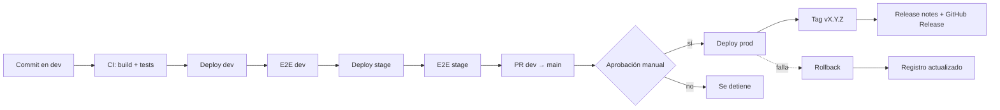

# Gestión de cambios y versiones (HU-16 · E2.8)

**Documento:** HU-16 (Sprint 2 · E2.8) y consolidación para HU-17 (E2.9)
**Última actualización:** 2026-11-21
**Estado:** el proceso y el rollback con **Compose están verificados** (HU-06/HU-07). El rollback
**en Kubernetes tiene procedimiento implementado** (`DEPLOY_MODE=k8s ./deploy/rollback.sh`), pero
**falta ejecutarlo y adjuntar la evidencia**; es el criterio central de E2.8.

> Decisión de estrategia de despliegue: [`../iag/decisiones.md`](../iag/decisiones.md) D-29.
> Decisión del registro: D-30.

## 1. Principios

1. **Toda versión publicada tiene un tag semántico** `vMAJOR.MINOR.PATCH` y un commit identificable.
2. **Toda promoción deja rastro:** quién, cuándo, qué versión, en qué ambiente, con qué aprobación y
   con qué resultado.
3. **Todo despliegue tiene un plan de rollback** antes de ejecutarse, no después.
4. **Un rollback se prueba de verdad** al menos una vez por entrega; un plan escrito no es evidencia.
5. **Nada se despliega a prod sin aprobación** registrada (Jenkins o acta del equipo).

## 2. Tipos de cambio

| Tipo | Ejemplos | Aprobación | Evidencia |
|---|---|---|---|
| **Estándar** | Documentación, configuración no funcional, dependencias de desarrollo | 1 revisor | PR + pipeline verde |
| **Normal** | Nueva funcionalidad, cambio de configuración de un servicio | 1 revisor + pipeline | PR + release notes + registro |
| **Mayor** | Cambio de base de datos, contrato de API, infraestructura | 2 revisores + aprobación de prod | Plan de rollback + ventana + acta |
| **Emergencia** | Incidente en prod | Aprobador de guardia; revisión posterior en 24 h | Registro + postmortem |

La política completa está en
[`../operaciones/politica-aprobacion.md`](../operaciones/politica-aprobacion.md) y la plantilla de
solicitud en [`../operaciones/solicitud-cambio.md`](../operaciones/solicitud-cambio.md).

## 3. Versionado

```text
vMAJOR.MINOR.PATCH
  │      │     └─ corrección compatible (fix)
  │      └─────── funcionalidad compatible (feat)
  └────────────── cambio incompatible o hito de entrega
```

- El tag se crea **solo en `main`**, después de la aprobación de prod.
- `deploy/tag-release.sh` valida el formato y publica el tag.
- `deploy/release-notes.sh` genera las notas desde Conventional Commits entre el tag anterior y el
  nuevo, y actualiza `CHANGELOG.md` y `docs/release-notes/vX.Y.Z.md`.
- Las imágenes usan la misma versión (`1.2.3`), nunca `latest`. En dev/stage se añade el SHA corto
  (`1.2.3-abc1234`) para que cada build sea único.

## 4. Notas de liberación

Cada versión debe tener un documento con:

```markdown
# v1.2.3 — 2026-11-20

## Funcionalidades nuevas
- ...

## Correcciones
- ...

## Cambios técnicos
- ...

## Migraciones y compatibilidad
- Esquema: compatible hacia atrás (expand-contract) / requiere ventana
- Contratos de API: sin cambios / cambio incompatible en ...

## Rollback
- Versión anterior: v1.2.2
- Comando: `./deploy/rollback.sh prod 1.2.2` o `kubectl rollout undo ...`
- Tiempo estimado: 5 min
- Validación posterior: `./deploy/current-version.sh prod`

## Evidencias
- Pipeline: <URL del build>
- Aprobación: <usuario, hora, captura>
- Registro: `deploy/releases/prod.json`
```

Ejemplos reales: [`../release-notes/v0.1.0.md`](../release-notes/v0.1.0.md) y
[`../release-notes/v0.2.0.md`](../release-notes/v0.2.0.md).

## 5. Registro de cambios por ambiente

Un archivo por ambiente, con la última versión y un historial append-only:

```text
deploy/releases/
├── dev.json
├── dev.history.tsv
├── stage.json
├── stage.history.tsv
├── prod.json
└── prod.history.tsv
```

### 5.1 Esquema propuesto (D-30)

```json
{
  "environment": "prod",
  "version": "1.2.3",
  "commit": "6659e1b",
  "image_digest": "sha256:...",
  "deployed_at": "2026-11-20T15:04:05Z",
  "deployed_by": "secosbe",
  "event": "deploy",
  "approved_by": "juan-esteban",
  "approval_ref": "jenkins://circleguard/main/42",
  "result": "success",
  "rollback_of": null,
  "notes": "release notes v1.2.3"
}
```

| Campo | Obligatorio | Para qué |
|---|---|---|
| `version`, `commit`, `image_digest` | Sí | Reproducir exactamente lo desplegado |
| `deployed_at`, `deployed_by` | Sí | Auditoría |
| `event` | Sí | `deploy`, `rollback`, `hotfix`, `stop` |
| `approved_by`, `approval_ref` | En prod | Evidencia de aprobación |
| `result` | Sí | `success`, `failure`, `rolled_back` |
| `rollback_of` | En rollback | Trazabilidad de la reversión |

### 5.2 Historial

```text
2026-11-20T15:04:05Z	prod	1.2.3	6659e1b	deploy	secosbe	approved=juan-esteban	success
2026-11-20T15:20:00Z	prod	1.2.3	6659e1b	rollback	secosbe	rollback_of=1.2.3	success
```

El historial no se reescribe: se añade una línea por evento. Si Jenkins no puede escribir en Git, se
archiva como artefacto y se copia al repositorio al cerrar la historia.

## 6. Proceso de liberación



### 6.1 Antes del despliegue

- [ ] El pipeline de `dev` está verde (o `UNSTABLE` justificado y documentado).
- [ ] Las pruebas E2E de dev y stage pasaron.
- [ ] La versión es semver y las imágenes están en el registro con digest.
- [ ] Las migraciones son compatibles hacia atrás (si hay Blue-Green).
- [ ] El plan de rollback está escrito y la versión anterior sigue disponible.
- [ ] El aprobador de prod está disponible en la ventana.

### 6.2 Durante el despliegue

- [ ] Se registra hora, versión, ambiente y responsable.
- [ ] Se valida `health`/`ready` de todos los servicios.
- [ ] Se ejecuta el smoke test (login, encuesta, validación de acceso).
- [ ] Se revisan métricas y errores durante 5–10 minutos.

### 6.3 Después del despliegue

- [ ] Se actualiza `deploy/releases/<env>.json` y `history.tsv`.
- [ ] Se crea el tag y las notas (solo `main`).
- [ ] Se publica la aprobación como artefacto o captura.
- [ ] Se comunica el resultado al equipo (Discord/Slack).

## 7. Rollback

### 7.1 Plan obligatorio por versión

Toda release debe declarar:

| Pregunta | Ejemplo |
|---|---|
| ¿A qué versión se vuelve? | `1.2.2` (tag `v1.2.2`, commit `abc1234`) |
| ¿Cómo se vuelve? | `./deploy/rollback.sh prod 1.2.2` o `kubectl rollout undo` |
| ¿Cuánto tarda? | 5 min (Compose) / 2 min (K8s Blue-Green) |
| ¿Qué se valida? | 9 contenedores `healthy` / 8 pods `Ready` + smoke test |
| ¿Qué pasa con los datos? | Migración compatible; no se revierte el esquema |
| ¿Quién decide? | Aprobador de prod |
| ¿Cómo se registra? | `event=rollback`, `rollback_of=<versión>` |

### 7.2 Rollback con Compose (verificado)

```bash
./deploy/rollback.sh dev 0.1.0
./deploy/current-version.sh dev
```

Evidencia real de HU-07:

| Build | Ambiente | Cambio | Resultado |
|---|---|---|---|
| #19 | dev | `0.2.0 → 0.1.0` | 15 contenedores `healthy` |
| #21 | prod | `0.2.0 → 0.1.0` | 15 servicios `healthy` |

Archivos: [`../evidencias/hu-07/01-rollback.txt`](../evidencias/hu-07/01-rollback.txt) y
[`../evidencias/hu-07/08-traceability.json`](../evidencias/hu-07/08-traceability.json).

### 7.3 Rollback en Kubernetes **[S2] — criterio central**

**Opción A · Rollback por versión (recomendada):**

```bash
DEPLOY_MODE=k8s ./deploy/rollback.sh dev 0.2.0
```

Reaplica los manifiestos con la versión anterior, espera los `rollout status` de los 8 servicios y
del middleware, y registra `event=rollback` con `RESULT=success`. Requiere `aws` y `kubectl`; el
`kubeconfig` se lee de `/circleguard/<env>/kubeconfig` (SSM) si no hay `KUBECONFIG`.

**Opción B · RollingUpdate manual (dev/stage):**

```bash
kubectl -n circleguard-dev rollout history deployment/promotion
kubectl -n circleguard-dev rollout undo deployment/promotion --to-revision=3
kubectl -n circleguard-dev rollout status deployment/promotion
kubectl -n circleguard-dev get pods -l app=promotion
```

**Opción C · Blue-Green (prod, D-29):**

```bash
# 1. La versión nueva ya está en <svc>-green y pasó el smoke test
kubectl -n circleguard-prod get deploy auth-blue auth-green
# 2. Conmutar el Service al color anterior
kubectl -n circleguard-prod patch service/auth \
  -p '{"spec":{"selector":{"app":"auth","version":"blue"}}}'
# 3. Validar
kubectl -n circleguard-prod get endpoints auth
kubectl -n circleguard-prod get pods -l app=auth
```

**Evidencia mínima del rollback real:**

1. Hora y versión antes/después.
2. `kubectl rollout history` o `kubectl get deploy -o wide` (blue/green).
3. `kubectl get pods` con todos `Ready`.
4. Logs del `Service`/`Endpoints` apuntando a la versión anterior.
5. Registro de cambios actualizado con `event=rollback`.
6. Captura de la alerta o del dashboard durante la ventana (si aplica).

## 8. Aprobación de producción

| Evidencia | Cómo se produce |
|---|---|
| Aprobación en Jenkins | Stage `Approve prod` con usuario y hora; captura del input |
| Registro | `approved_by` y `approval_ref` en `prod.json` |
| Notificación | Mensaje de Discord/Slack con versión y resultado |
| Acta (cambios mayores) | Documento firmado o correo del equipo |

La aprobación **no** se simula con un `echo`. Si se usa `FORCE_PROD=true` para una prueba, se
registra como `event=test` y no cuenta como evidencia de producción.

## 9. Relación con commits y repositorio

| Elemento | Dónde se ve |
|---|---|
| Commit | `git log --oneline` y `deploy/releases/<env>.json` |
| Tag | `git tag -n` y GitHub Releases |
| PR | Enlace en las notas de liberación |
| Imagen | `docker inspect` / `crane manifest` (digest) |
| Pipeline | URL del build en Jenkins |
| Aprobación | `approval_ref` |

## 10. Matriz de criterios E2.8

| # | Criterio | Estado | Evidencia |
|---|---|---|---|
| 1 | Identificador único y tag semántico | Cumplido (HU-07) | `deploy/tag-release.sh`, tags `v0.1.0`, `v0.2.0`; `v0.3.0` pendiente de publicar |
| 2 | Release Notes por versión | Cumplido | `docs/release-notes/v0.1.0.md`, `v0.2.0.md`, `v0.3.0.md` |
| 3 | Nuevas funcionalidades, correcciones y cambios técnicos | Cumplido | Secciones de las notas |
| 4 | Plan de rollback documentado | Cumplido (Compose y K8s) | §7.1, §7.2 y §7.3 |
| 5 | Rollback de artefactos en Kubernetes | Procedimiento implementado (`DEPLOY_MODE=k8s`); **pendiente ejecutar** | [`../evidencias/hu-16/03-rollback-k8s.txt`](../evidencias/hu-16/03-rollback-k8s.txt) |
| 6 | Prueba real de rollback | Cumplido en Compose; **pendiente en K8s** | HU-07 builds #19/#21 |
| 7 | Registro por dev, stage y prod | Parcial | `deploy/releases/*.json` y `history.tsv` |
| 8 | Versión, fecha, ambiente, responsable, aprobación, resultado | Cumplido en código (D-30); falta evidencia de ejecución | `record-release.sh` escribe `result`, `approved_by`, `approval_ref` e `image_digest` |
| 9 | Evidencia de aprobación de prod | Cumplido | Jenkins `Approve prod` + `05-approval.txt` de HU-06 |
| 10 | Relación con commits y versiones | Cumplido | `commit` en el registro y tag |
| 11 | Procedimientos documentados | Cumplido | Este documento + manual de operaciones |

## 11. Qué falta para cerrar HU-16

1. ~~Implementar el registro ampliado (D-30) en `deploy/record-release.sh`.~~ **Hecho:** el script
   acepta `RESULT`, `APPROVED_BY`, `APPROVAL_REF` e `IMAGE_DIGEST` y migra el historial anterior.
   Falta registrar un despliegue real con esos campos.
2. Ejecutar un rollback real en K8s (dev y prod) con `DEPLOY_MODE=k8s ./deploy/rollback.sh` y
   adjuntar la evidencia en `03-rollback-k8s.txt`.
3. Añadir el enlace de aprobación y el digest al registro (`04-registro.txt`).
4. Publicar las notas del Sprint 2 (`docs/release-notes/v0.3.0.md`) y el tag `v0.3.0`.
5. Verificar que el manual de operaciones §7.2 coincide con los comandos usados.
